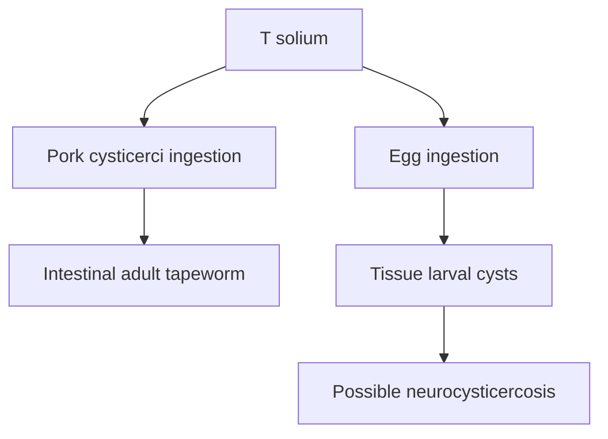

# Helminths and intestinal parasites — detailed concepts

**Priority High. Study-ready, not studied.** [40 MCQs](../MCQs/20-Helminths-and-Intestinal-Parasites-40-MCQs.md)

## Classification and transmission

Helminths multicellular parasitic worms hain. Nematodes roundworms, cestodes segmented tapeworms aur trematodes flukes hain. Infection ingestion, skin penetration, vector bite or foodborne larval cyst ingestion se ho sakti hai. Har parasite ka infective stage alag hai. Isliye prevention aur diagnostic sample bhi alag hote hain.

| Worm | Infective exposure | Classical clinical clue |
|---|---|---|
| Ascaris | Embryonated eggs ingested | Pulmonary migration, bowel/biliary obstruction |
| Hookworm | Filariform larvae penetrate skin | Chronic blood loss, iron deficiency |
| Trichuris | Embryonated eggs ingested | Dysentery, rectal prolapse in heavy disease |
| Enterobius | Eggs ingested | Night perianal itching, tape test |
| Strongyloides | Skin penetration and autoinfection | Hyperinfection with immunosuppression |

## Soil-transmitted helminths

Ascaris eggs soil mein mature hote hain. Ingested larvae gut wall cross karke liver and lungs travel kar sakte hain. Pulmonary migration cough and eosinophilia cause kar sakti hai. Larvae swallowed hokar intestinal adults develop karte hain. Heavy burden bowel obstruction or biliary migration de sakta hai. Bilious vomiting, distension and jaundice urgent assessment maangte hain. Hookworms intestinal mucosa attach karke chronic blood loss cause kar sakte hain. Fatigue, pallor and microcytic anemia important clues hain. Footwear and sanitation prevent exposure. Trichuris barrel-shaped bipolar plugged eggs classical clue hain. Severe colonic inflammation rectal prolapse cause kar sakti hai.

Enterobius female perianal eggs raat mein deposit karti hai. Morning tape test bathing/defecation se pehle collect karna useful hai. Nail hygiene and laundering reduce reinfection. Strongyloides stool mein usually larvae detect hote hain. Autoinfection decades tak persistence allow karti hai. Steroid therapy hyperinfection trigger kar sakti hai. Endemic exposure history immunosuppression se pehle review karo. Dissemination respiratory compromise and enteric sepsis cause kar sakti hai. Ivermectin commonly preferred treatment hai, clinician eligibility and regimen decide karta hai.

## Tapeworms and tissue disease

T. saginata beef cysticerci aur T. solium pork cysticerci ingest karne se intestinal taeniasis develop ho sakti hai. Important trap: T. solium eggs ingest karne se cysticercosis ho sakti hai, undercooked pork cysticerci primarily intestinal taeniasis cause karte hain. CNS cysts seizures and other neurological complications de sakte hain. Imaging-based specialist evaluation zaroori hai. Antiparasitic therapy without lesion assessment unsafe ho sakti hai.

Echinococcus dog-livestock cycle mein circulate karta hai. Human accidental intermediate host ho sakta hai. Liver or lung hydatid cyst develop ho sakti hai. Unplanned puncture cyst leakage, allergic reaction and secondary spread risk de sakta hai. Imaging and specialist management important hain.

## Flukes and filarial worms

Schistosoma freshwater snail intermediate host use karta hai. Cercariae skin penetrate kar sakti hain. S. haematobium hematuria and bladder complications se classically linked hai. S. mansoni or japonicum intestinal/hepatic disease cause kar sakte hain. Praziquantel common therapy hai. Fasciola contaminated aquatic plants ingestion se biliary disease cause kar sakti hai. Trichinella undercooked meat exposure ke baad muscle symptoms and periorbital edema cause kar sakti hai. Wuchereria bancrofti lymphatic filariasis se associated hai. Microfilarial periodicity blood test timing affect kar sakti hai, antigen assays different hote hain. Lymphedema care mein daily hygiene, skin inspection and appropriate movement important hain.

## Community nursing and diagnostics

Stool egg or larva testing species and stage dependent hai. Single negative stool all helminths exclude nahi karta. Eosinophilia clue hai but diagnostic proof nahi. Periodic deworming worm burden reduce karti hai but reinfection control sanitation, safe water, footwear and handwashing require karta hai. Age, pregnancy and other contraindications programme guidance se check karo. Adverse events document and escalate karo. Severe abdominal symptoms or respiratory compromise routine deworming se manage nahi hote.

## Sources and videos

[CDC soil-transmitted helminths](https://www.cdc.gov/sth/hcp/clinical-care/) · [CDC Strongyloides](https://www.cdc.gov/strongyloides/hcp/clinical-overview/index.html) · [CDC taeniasis](https://www.cdc.gov/taeniasis/hcp/clinical-overview/) · [WHO STH](https://www.who.int/news-room/fact-sheets/detail/soil-transmitted-helminth-infections)

- [Utkarsh Nursing, Sagar Sir: Worm Infestation in One Shot](https://www.youtube.com/watch?v=qLRMxe5k-50), indexed teaching video about types, symptoms and treatment. Full playback not reviewed.
- [PW NORCET 10 digestive MCQ countdown](https://www.youtube.com/watch?v=UIeDEjRQPrA), broad practice lead only. Exact helminth segment not verified. Dedicated helminth MCQ video remains pending.
