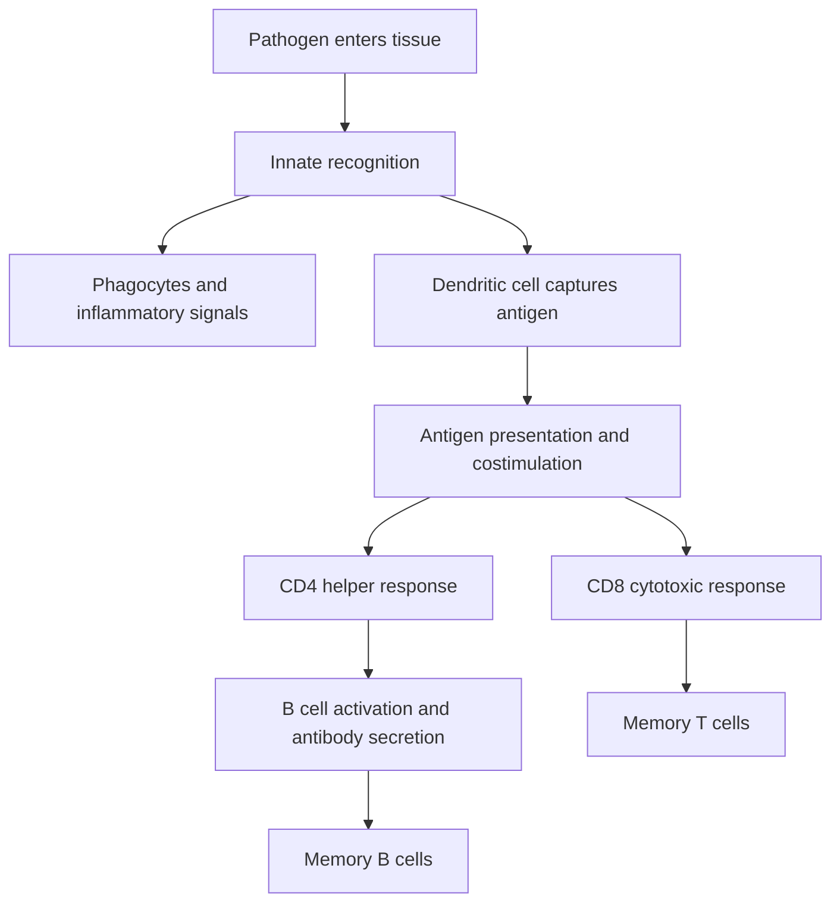

# Innate and adaptive immunity

**Study-ready, unattempted. Priority high.** [40 original MCQs](../MCQs/21-Innate-and-Adaptive-Immunity-40-MCQs.md) · [Reported examination practice](../Previous-Year-Questions/Innate-and-Adaptive-Immunity-Reported-PYQs.md)

## 1. Basic meaning

Immunity ko body ka protection system samjho. Jab microorganism body mein enter karne ki koshish karta hai, tab pehle se available barriers aur immune cells uske against response start karte hain. Is defense ko innate immunity kehte hain. Adaptive immunity specific antigen ko identify karke selected B aur T lymphocytes ki response develop karti hai. Antigen ek structure hai jise immune system recognize kar sakta hai. Antigen ka recognized part epitope kehlata hai.

| Feature | Innate immunity | Adaptive immunity |
|---|---|---|
| Initial response | Rapid | Primary response takes time |
| Recognition | Conserved patterns and danger signals | Antigen-specific receptors |
| Major components | Barriers, phagocytes, NK cells, complement | B and T lymphocytes |
| Memory | Classical antigen-specific memory is not the usual mechanism | Antigen-specific memory develops |
| Example | Neutrophil engulfing bacteria | Memory B cell response after a booster |

Innate immunity ko completely nonspecific kehna basic exam shorthand hai. Iske receptors defined microbial patterns ko recognize karte hain. Trained innate responses bhi possible hain, lekin classical antigen-specific B aur T cell memory adaptive immunity ki hallmark hai.

## 2. First-line defense

Skin ko protective boundary samjho. Intact epithelium microorganisms ko deeper tissues tak pahunchne se rokta hai. Burn mein ye boundary damage ho jaati hai. Respiratory tract mein mucus particles trap karta hai aur cilia mucus ko move karti hain. Isko mucociliary clearance kehte hain. Tears aur saliva mein antimicrobial factors jaise lysozyme milte hain. Stomach acid kuch ingested microorganisms ko inactivate karne mein help karta hai. Normal microbiota bhi invading pathogens ke against competition provide karti hai.

Nurse skin integrity maintain karti hai, aseptic care follow karti hai aur devices ki necessity assess karwati hai. Patient ki normal defenses weak hone par infection risk badh sakta hai.

## 3. Innate cellular defense and inflammation

Neutrophils acute bacterial infection site par early recruitment kar sakte hain. Macrophages microbes aur debris engulf karte hain aur inflammatory signals release karte hain. Phagocytosis ka matlab cell ka particle ko engulf karna hai. Phagosome lysosomal compartments ke saath fuse karke microbial degradation support karta hai. Oxidative burst mein reactive oxygen species killing mein help karte hain. NADPH oxidase defect mein ye mechanism impaired ho sakta hai.

Pattern recognition receptors common microbial patterns ya tissue damage signals identify karte hain. Cytokines signaling molecules hain jo immune cells aur other tissues ko coordinate karte hain. Vasodilation se blood flow increase hota hai aur redness aur warmth ho sakti hai. Vascular permeability badhne se tissue swelling develop ho sakti hai. Diapedesis leukocyte ka vessel wall cross karna hai. Chemotaxis chemical gradient ke along directional movement hai. Fever inflammatory mediators aur hypothalamic PGE2 signaling se develop ho sakta hai.

Natural killer cells innate lymphocytes hain. Ye activating aur inhibitory signals balance karke abnormal cells ko recognize kar sakte hain. Reduced MHC class I expression ek important missing-self clue ho sakta hai. NK cells perforin aur granzymes use karke target cell apoptosis induce kar sakte hain. Type I interferons nearby cells mein antiviral state develop karne mein help karte hain.

Clinical example: chemotherapy patient mein neutrophils bahut kam hain aur fever start ho gaya hai. Nurse pus ya obvious local redness ka wait nahi karti. Febrile neutropenia serious infection emergency ho sakti hai. Prompt clinical assessment, vital signs, escalation aur prescribed management coordinate karo.

## 4. Adaptive immunity and antigen presentation

B aur T lymphocytes antigen-specific receptors use karte hain. B cells human bone marrow mein mature hote hain. T cell precursors bone marrow se thymus jaate hain aur wahan selection aur maturation hoti hai. Lymph nodes aur spleen secondary lymphoid organs hain jahan immune responses organize ho sakte hain.

Dendritic cells peripheral tissue se antigen capture karke lymph nodes mein T cells ko present kar sakti hain. MHC molecule ko ek display platform samjho. Us par peptide fragment display hota hai jise T cell receptor recognize kar sakta hai. Usual pathway mein MHC class II extracellularly acquired antigen fragments CD4 helper T cells ko present karta hai. MHC class I intracellular peptides CD8 cytotoxic T cells ko present kar sakta hai. MHC I most nucleated cells par hota hai. Cross-presentation exceptions bhi exist karti hain.

Naive T cell ko effective activation ke liye antigen recognition ke saath appropriate costimulation aur signals chahiye hote hain. Costimulation absent ho toh anergy ya inadequate activation ho sakti hai. Negative thymic selection strongly self-reactive cells ko remove karne mein help karti hai. Regulatory T cells peripheral tolerance maintain karne mein role play karte hain.

## 5. Humoral and cell-mediated defense

Humoral immunity mein B cell-derived antibodies major role play karti hain. Activated B cell plasma cell ban sakta hai jo antibodies secrete karta hai. Antibodies pathogens ko neutralize kar sakti hain aur phagocytosis ke liye mark kar sakti hain. Cell-mediated immunity mein T cells important role play karte hain. CD8 cells infected cells ko kill kar sakte hain. CD4 cells cytokine signals ke through macrophage, B cell aur other immune responses coordinate karte hain.

Clonal expansion ka matlab matching lymphocytes ka number increase hona hai. Germinal center response mein affinity maturation antibody binding improve kar sakti hai. Class switching antibody constant region aur effector function change karti hai while antigen specificity generally retained rehti hai. Conjugate vaccines protein carrier ke through T cell help recruit kar sakti hain, jo polysaccharide-specific memory improve karti hai.

## 6. Active and passive immunity

| Type | Example | Key distinction |
|---|---|---|
| Natural active | Immune response following infection | Body makes its own response |
| Artificial active | Vaccination | Antigen stimulates own response |
| Natural passive | Placental maternal antibody transfer | Ready-made maternal antibodies |
| Artificial passive | Indicated immunoglobulin administration | Ready-made antibodies, typically temporary |

Active immunity develop hone mein time lag sakta hai aur duration pathogen ke according vary karti hai. Passive immunity rapid protection provide kar sakti hai lekin usually temporary hoti hai. Booster response memory cells ki wajah se faster ho sakti hai. Natural infection deliberate immunity acquisition ka safe substitute nahi hai. Vaccination recommendations follow karo.

Herd protection ka matlab effective population-level transmission reduction se susceptible people ko milne wali indirect protection hai. Har vaccine same degree se transmission reduce nahi karti. Har individual ko guaranteed protection nahi milti. Tetanus jaise non-person-to-person infections mein community transmission-based herd protection ka usual concept applicable nahi hai.

## 7. Clinical nursing integration

Splenectomy ke baad encapsulated organisms se severe infection risk badh sakta hai. Patient ko prescribed vaccination, fever action plan aur clinician-directed prophylaxis education chahiye. T cell deficiency opportunistic infection risk increase kar sakti hai. B cell depletion new vaccine antibody response reduce kar sakti hai. Nurse immune status, medication history aur vaccine-specific contraindications review karwati hai. Immunosuppressed patient mein fever absent hone par bhi hypotension, confusion ya breathing deterioration ko urgent assess karo.

## References and videos

- [OpenStax innate response](https://openstax.org/books/biology-2e/pages/42-1-innate-immune-response)
- [OpenStax adaptive immunity](https://openstax.org/books/microbiology/pages/18-1-overview-of-specific-adaptive-immunity)
- [MHC and antigen-presenting cells](https://openstax.org/books/microbiology/pages/18-2-major-histocompatibility-complexes-and-antigen-presenting-cells)
- [T lymphocytes](https://openstax.org/books/microbiology/pages/18-3-t-lymphocytes-and-cellular-immunity)
- [B lymphocytes](https://openstax.org/books/microbiology/pages/18-4-b-lymphocytes-and-humoral-immunity)
- Concept video: [Immunity in One Shot — NORCET & AIIMS 2026 Nursing Concepts, Pari Ma'am](https://www.youtube.com/watch?v=v90KXV5QYCY). Indexed description includes innate versus adaptive response. Full page and channel metadata could not be retrieved.
- MCQ practice: [Most Important MCQs on Immunity — NORCET, KGMU, SGPGI, RML, RRB, UPUMS and DSSSB](https://www.youtube.com/watch?v=tv96B9IaVVk). Indexed description explicitly includes innate and acquired immunity. Channel metadata and playback unavailable.

Both video URLs and titles are search-indexed, not playback-verified. Full question coverage and answer accuracy remain pending.
