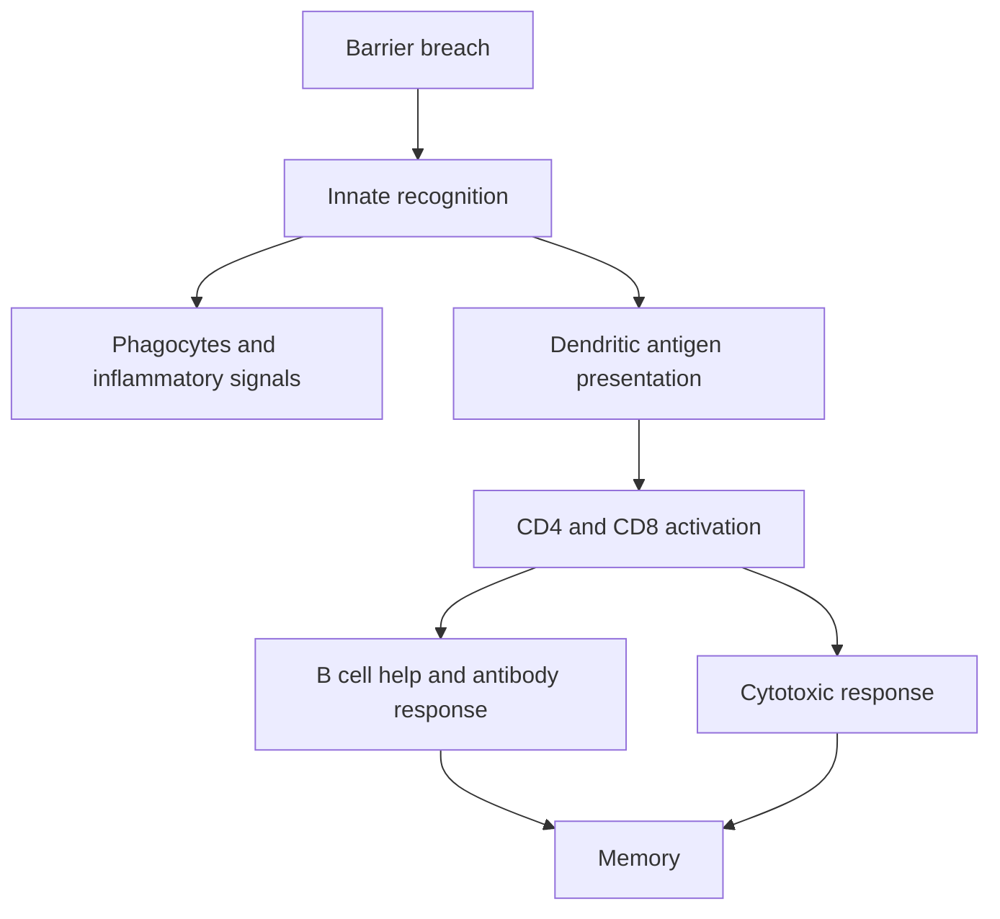

# Innate and adaptive immunity — detailed concepts

**Priority High. Study-ready, unattempted.** [40 MCQs](../MCQs/21-Innate-and-Adaptive-Immunity-40-MCQs.md)

## Basic idea

Immune system ko hospital security ke example se samjho. Skin aur mucosa entrance barrier ki tarah hain. Innate immunity rapid general recognition and response provide karti hai. Adaptive immunity specific antigen identify karti hai aur memory develop kar sakti hai. Dono systems connected hain, independent armies nahi. Innate response microbial patterns recognize karta hai. Adaptive B and T cells diverse receptors use karte hain.

## Barrier and cellular defence

Skin, mucus, ciliary movement, tears, gastric acidity and resident microbiota pathogens ki entry or growth limit karte hain. Lysozyme bacterial wall bonds hydrolyze karta hai. Barrier damage, devices and surgery infection risk increase kar sakte hain. Neutrophils acute inflammation mein early phagocytes hain. Macrophages tissue debris clear karte hain and cytokines release kar sakte hain. Dendritic cells antigen processing and naive T-cell activation bridge innate and adaptive responses. NK cells altered or infected cells recognize kar sakte hain without conventional antigen-specific TCR. Perforin and granzymes target-cell apoptosis support karte hain.

Inflammation mein vasodilation redness and warmth, increased permeability swelling, inflammatory mediators pain produce kar sakte hain. Selectins rolling, integrins firm adhesion and diapedesis tissue entry support karte hain. Chemotaxis chemical gradient ke direction mein movement hai. Phagocytosis mein particle engulf hota hai, phagosome lysosome ke saath fuse kar sakta hai. Oxidative burst microbial killing support karta hai. Chronic granulomatous disease mein NADPH oxidase dysfunction recurrent severe infection risk badhata hai. Toll-like receptors recurring microbial patterns recognize karte hain. Type I interferons nearby cells mein antiviral responses induce kar sakte hain.

## Lymphoid organs and antigen presentation

| Organ | Function |
|---|---|
| Bone marrow | Blood cell production and B-cell development |
| Thymus | T-cell maturation and selection |
| Lymph nodes | Draining lymph antigen surveillance |
| Spleen | Blood antigen surveillance and aged RBC clearance |
| MALT | Mucosal immune responses |

MHC class I generally intracellular peptides CD8 T cells ko present karta hai. MHC class II professional APCs par extracellularly acquired peptides CD4 T cells ko present karta hai. Naive T-cell activation mein antigen recognition and costimulation important hain. CD28-B7 classic costimulatory interaction hai. IL-2 T-cell expansion support karta hai.

## T-cell functions and B-cell response

| Subset | Main exam association |
|---|---|
| Th1 | IFN-gamma and macrophage activation |
| Th2 | Type 2 immunity, IL-5/eosinophils, allergy |
| Th17 | Mucosal defence and neutrophil recruitment |
| Tfh | Germinal centre B-cell help |
| Treg | Regulation and tolerance |
| CD8 | Cytotoxic killing of target cells |

B cells antigen recognition ke baad plasma cells and memory cells form kar sakti hain. Clonal selection selected responsive clones expand karta hai. Primary response initially slower hota hai. Memory response re-exposure par faster ho sakta hai. Class switching antibody constant region and effector function alter karta hai. Affinity maturation antigen binding improve karne wale clones select karti hai. Humoral immunity antibodies se linked hai. Cell-mediated immunity infected cells and intracellular pathogen responses mein important hai.

## Active and passive immunity

Natural active immunity infection ke baad host response se develop hoti hai. Artificial active immunity vaccination se develop ho sakti hai. Natural passive immunity maternal antibody transfer hai. Artificial passive immunity administered immunoglobulin hai. Passive protection immediate but temporary hoti hai and transferred antibodies khud recipient memory create nahi karti. Active response develop hone mein time lag sakta hai. Protection duration specific exposure and vaccine par depend karti hai.

## Nursing priorities

Severe neutropenia with fever emergency hai. Pus or strong fever absent hone se infection exclude nahi hoti. Immunosuppressed patients mein unusual infections, persistent thrush, diarrhea and recurrent severe disease specialist evaluation maangte hain. Live vaccine eligibility individual immune status se check karo. Asplenia mein encapsulated bacterial infection risk increase hota hai. Fever action plan, immunization review and timely care important hain. Older patients atypical infection presentation de sakte hain. CRP inflammation marker hai, organism-specific test nahi.

## Resources

[OpenStax innate immunity](https://openstax.org/books/microbiology/pages/17-introduction) · [OpenStax adaptive immunity](https://openstax.org/books/microbiology/pages/18-1-overview-of-specific-adaptive-immunity) · [OpenStax adaptive summary](https://openstax.org/books/microbiology/pages/18-summary)

- [Immunity in One Shot, Pari Ma'am — NORCET & AIIMS 2026](https://www.youtube.com/watch?v=v90KXV5QYCY), indexed concept session.
- [Most Important MCQs on Immunity — NORCET, KGMU, SGPGI, RML, RRB, UPUMS, DSSB](https://www.youtube.com/watch?v=tv96B9IaVVk), indexed dedicated nursing practice session. Channel name and full playback not independently checked.
