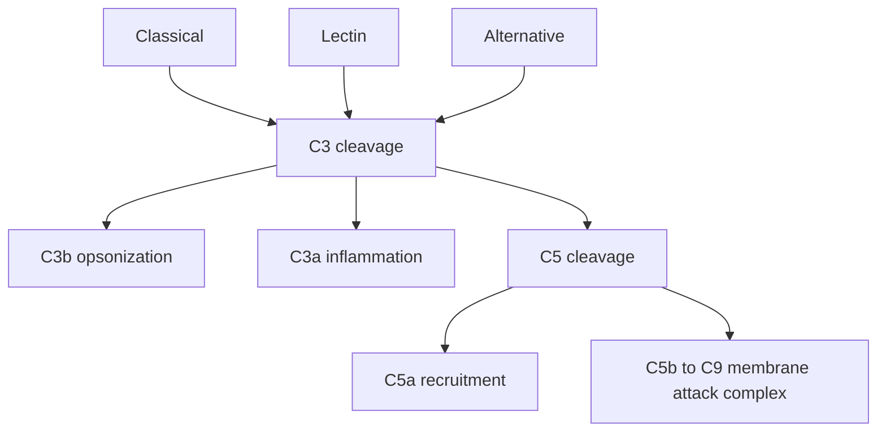

# Immunoglobulins, complement and hypersensitivity — detailed concepts

**Priority High. Study-ready, unattempted.** [40 MCQs](../MCQs/22-Immunoglobulins-Complement-and-Hypersensitivity-40-MCQs.md)

## Antibody structure and function

Antibody Y-shaped immunoglobulin protein hai. Two heavy and two light chains disulfide bonds se associated hoti hain. Fab arms ke variable domains antigen epitope recognize karte hain. Fc portion effector functions and receptors interact karta hai. Antigen binding toxin neutralize kar sakti hai. Antibody coat phagocyte recognition facilitate kare toh opsonization hai. Cross-linking particles ko clump kare toh agglutination hai. NK cell antibody-coated target recognize kare toh ADCC possible hai.

| Class | High-yield function |
|---|---|
| IgG | Major serum class, placental transfer via FcRn |
| IgM | Early primary response, secreted pentamer and strong agglutination |
| IgA | Mucosal secretions and colostrum, often secretory dimer |
| IgE | Mast cell sensitization and helminth-associated responses |
| IgD | Surface receptor on many mature naive B cells |

IgM and IgD membrane receptors monomeric forms mein ho sakte hain. Secretory IgA J chain and secretory component ke saath mucosal protection support karti hai. Class switch constant region change karta hai. Antibody quantity alone clinical protection establish nahi karti.

## Complement pathways

Complement circulating and membrane-associated protein system hai. Classical pathway antibody-antigen recognition se activate ho sakta hai. Lectin pathway mannose-binding lectin and associated enzymes use karta hai. Alternative pathway spontaneous low-level activation and microbial surface amplification se related hai. Properdin alternative convertase stabilize karta hai. Pathways C3 cleavage par converge karte hain. C3b opsonization, C3a and C5a inflammation and C5b-C9 membrane attack complex formation support karte hain.

Terminal component deficiency recurrent Neisseria infection risk badha sakti hai. C3 deficiency broader opsonization problems create kar sakti hai. Complement regulators host tissue protect karte hain. C1 inhibitor dysfunction hereditary angioedema mein bradykinin-mediated swelling cause kar sakta hai. Airway swelling emergency hai. PNH mein GPI-anchored complement regulators CD55/CD59 loss RBC complement injury contribute karta hai. Low C3/C4 active immune complex disease mein consumption support kar sakta hai but nonspecific hai.

## Hypersensitivity types

| Type | Mechanism | Examples |
|---|---|---|
| I | IgE-associated mast cell activation | Immediate allergy and many anaphylactic reactions |
| II | Antibody binding cell surface or tissue target, injury or altered function | Hemolytic anemia, Graves disease |
| III | Immune complex deposition and inflammation | Serum sickness, Arthus reaction |
| IV | T-cell-mediated response | Nickel dermatitis, tuberculin delayed response |

Type I sensitization mein allergen-specific IgE mast cell Fc receptors bind karti hai. Re-exposure cross-linking mediator release trigger kar sakta hai. Anaphylaxis can present without rash. Airway swelling, wheezing, shock and acute systemic signs urgent response maangte hain. IM epinephrine anterolateral thigh first-line hai for anaphylaxis with circulation. Emergency response activate karo. Oxygen, IV fluid and other support clinician/protocol ke according provide karo. Antihistamine and steroid epinephrine substitute nahi hain. Routine IV bolus epinephrine anaphylaxis mein first-line nahi hai. Risk-based observation recurrent symptoms identify karne mein help karti hai.

Type II reactions antibody-target interactions se cell destruction ya altered receptor function produce kar sakti hain. Suspected acute transfusion reaction mein transfusion immediately stop and facility reaction protocol activate karo. Type III soluble complexes tissues mein deposit hoke inflammation produce kar sakte hain. Type IV delayed cellular response hai, antibody-mediated nahi. Patch testing specialist contact allergy assessment mein useful hai. Mantoux induration 48–72 hours mein read hoti hai, active TB alone prove nahi karti.

## Nursing application

Allergy documentation mein drug, timing, symptoms, severity and treatment record karo. Nausea alone IgE allergy prove nahi karti. Severe prior transfusion reaction or immunoglobulin deficiency blood bank ko communicate karo. Selected patients specialized component planning require kar sakte hain. Independent drug challenge unsafe ho sakta hai. Immune test results clinical context se interpret karo.

## Resources

[OpenStax antibodies](https://openstax.org/books/microbiology/pages/18-1-overview-of-specific-adaptive-immunity) · [Complement](https://openstax.org/books/microbiology/pages/17-2-chemical-defenses) · [Hypersensitivity](https://openstax.org/books/microbiology/pages/19-1-hypersensitivities) · [AHA first aid guidelines](https://cpr.heart.org/en/resuscitation%20science/2024%20first%20aid%20guidelines)

- [Immunity in One Shot, Pari Ma'am](https://www.youtube.com/watch?v=v90KXV5QYCY), indexed concept resource.
- [Most Important MCQs on Immunity — nursing competitive exams](https://www.youtube.com/watch?v=tv96B9IaVVk), indexed practice resource. Full playback and exact complement/hypersensitivity segments not independently verified. Dedicated subtopic practice search remains open.
