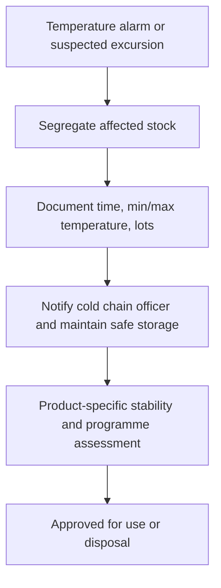

# Vaccination, cold chain and passive immunization

**Study-ready, unattempted.** [40 original MCQs](../MCQs/23-Vaccination-Cold-Chain-and-Passive-Immunization-40-MCQs.md) · [Reported exam practice](../Previous-Year-Questions/Vaccination-and-Cold-Chain-Reported-PYQs.md)

## 1. Vaccine types and immune response

Vaccine ko immune system ki safe training samjho. Vaccine antigen body ko specific immune response develop karne ka signal deta hai. Active immunity develop hone mein time lag sakta hai. Memory cells future exposure par faster response support kar sakte hain. Vaccine effectiveness aur protection duration product aur patient factors ke according vary karti hain.

| Type | Example | Exam clue |
|---|---|---|
| Live attenuated | BCG, OPV, MR | Weakened organism, special contraindications |
| Inactivated | IPV | Organism cannot replicate |
| Toxoid | Tetanus and diphtheria toxoids | Detoxified toxin stimulates protection |
| Recombinant subunit | Hepatitis B | Selected antigen |
| Conjugate | Hib, pneumococcal conjugate | Protein carrier supports T cell help |

Severe immunosuppression aur pregnancy mein live vaccine eligibility product-specific guidance se assess karo. Mild uncomplicated illness usually automatic contraindication nahi hoti. Prior severe allergic reaction to vaccine or relevant component requires clinical review. Missed doses ke liye documented history aur approved catch-up schedule use karo. Har interrupted series ko restart karna necessary nahi hota.

## 2. Cold chain ko basic se samjho

Cold chain manufacturer se vaccination site tak storage aur transport ka temperature-controlled system hai. Vaccine biological product hai. Incorrect temperature se potency permanently affect ho sakti hai. Routine service-level storage mein many vaccines +2 to +8 degrees Celsius par rakhi jaati hain. Har product ke storage instructions check karo. Heat-sensitive, freeze-sensitive aur light-sensitive properties alag hain.

DPT, hepatitis B aur many adsorbed combination products freezing se damage ho sakte hain. OPV generally freezing tolerate kar sakti hai under approved storage conditions. Freeze-dried antigen aur uske diluent ko same property wala mat samjho. Diluent freezing se vial damage ho sakta hai. Reconstituted vaccine ko next session ke liye freeze karna appropriate nahi hai.

ILR ice-lined refrigerator hai. Designated baskets use karo aur freeze-sensitive products ko prescribed warmer position mein rakho. Deep freezer ka subdistrict cold-chain point par usual role ice pack preparation hai. Vaccine carrier small outreach session transport ke liye use hota hai. Conventional carriers mein ice packs condition karne ki requirement follow karo. Modern freeze-preventive carrier ka SOP different ho sakta hai.

## 3. VVM, shake test and temperature breach

Vaccine vial monitor cumulative heat exposure indicate karta hai. Inner square outer reference circle se lighter hai toh heat indicator usable ho sakta hai, provided expiry, storage aur handling criteria bhi meet hote hain. Inner square same ya darker ho jaaye toh vaccine use mat karo. VVM freeze damage, contamination aur every form of potency loss detect nahi karta.

Shake test suitable adsorbed vaccines ke suspected freezing damage assessment mein trained staff use kar sakte hain. Validated method mein suspect vial ko appropriate intentionally frozen and thawed control ke sedimentation behavior ke saath compare kiya jaata hai. Ye exact potency assay nahi hai. Known freeze-damaged vaccine ko shake karke restore nahi kar sakte.

Temperature breach par nurse current reading ke saath previous minimum, maximum aur duration record karti hai. Vials ko labeled quarantine mein rakho. Manufacturer aur programme guidance ke bina affected vaccine administer ya unnecessarily discard mat karo.

## 4. Open vial policy and reconstitution

India UIP mein applicable multidose products ki partially used vials ko up to 28 days reuse kiya ja sakta hai when all eligibility conditions are met. Expiry, opening date/time, acceptable VVM, correct cold chain, aseptic withdrawal aur uncontaminated septum important hain. Product eligibility check karo. Missing opening time ko guess karke write nahi karna chahiye.

Reconstituted BCG, MR aur applicable JE products ke liye 28-day rule apply nahi hota. Indian programme guidance commonly four hours or session end, whichever is earlier, specify karti hai for relevant formulations. WHO multidose policy general six-hour limit ya session end for specified products describe karti hai. India ka stricter product-specific operational rule follow karo. Rotavirus formulations aur vial presentations vary kar sakti hain, isliye current programme instructions dekho.

Manufacturer-approved matching diluent use karo. Dilution volume guess mat karo aur unused contents combine mat karo. Returned vials ki segregation, AEFI investigation retention aur biomedical waste disposal local SOP ke according karo. FEFO ka matlab first-expiry-first-out hai, provided vial all other quality checks pass karti hai.

## 5. Safe session and adverse events

Session plan mein eligible recipients, vaccine stock, carrier, temperature monitoring, appropriate single-use syringes, sharps container aur emergency readiness include karo. Vaccination ke baad record accurately update karo. Used sharp ko immediately designated puncture-resistant container mein dispose karo.

AEFI vaccination ke baad hone wala adverse event hai. Timing alone prove nahi karti ki vaccine cause tha. Mild pain aur fever possible expected reactions hain. Wheeze, hypotension, airway swelling aur systemic allergic symptoms anaphylaxis suggest kar sakte hain. Emergency response activate karo. IM epinephrine first-line treatment hai under anaphylaxis protocol. Antihistamine alone epinephrine ka substitute nahi hai. Fainting after injection vasovagal syncope ho sakti hai, lekin airway, circulation aur serious symptoms assess karo.

Cluster of abscesses ya other unusual adverse events mein lot, session records aur relevant vials preserve karo aur programme reporting activate karo.

## 6. Active and passive protection after exposure

Immunoglobulin ready-made antibodies provide karti hai. Protection usually rapid aur temporary hoti hai. Kuch exposures mein vaccine aur immunoglobulin dono indicated ho sakte hain. Product-specific timing, site aur dosing protocol follow karo. Routine same-syringe mixing avoid karo. Antibody-containing products kuch live injectable vaccine responses interfere kar sakte hain. Exact interval check karo. Hepatitis B infected mother ke newborn ke liye timely vaccine aur indicated HBIG assessment important hai.

## 7. Programme calculations

Vaccine wastage rate = wasted doses / total issued doses × 100, for a defined closed-stock example with no remaining doses. Example: 100 doses issue hui aur 80 administer hui, toh 20 waste hui. Wastage rate 20 percent hai. Wastage factor = 100 / (100 − wastage percentage). Is example mein factor 1.25 hai.

Coverage = number vaccinated / eligible target population × 100. Example: 90 of 100 children vaccinated means 90 percent coverage. Denominator and reporting period verify karo.

eVIN electronic Vaccine Intelligence Network stock aur storage temperature visibility support karta hai. U-WIN individual vaccination records aur programme delivery support karta hai. Dono platforms ka function confuse mat karo.

## Sources and videos

- [India NHM immunization guidelines](https://nhm.gov.in/contact/index1.php?lang=1&level=3&lid=378&sublinkid=944)
- [MoHFW routine immunization manual for health workers](https://www.mohfw.gov.in/sites/default/files/Routine%20Immunization%20Manual%20For%20Health%20Workers.pdf) — indexed manual reference, consult latest programme schedule.
- [ITSU India cold-chain FAQ](https://itsu.org.in/faqs-on-cold-chain/)
- [WHO VVM guidance](https://www.who.int/publications/m/item/vaccine-vial-monitor)
- [WHO multidose vial policy](https://www.who.int/publications/i/item/WHO-IVB-14.07)
- [WHO vaccine diluents](https://www.who.int/publications-detail-redirect/WHO-IVB-15.08)
- Concept and practice: [Mission High Nursing Classes — Immunization 2026, Ankur Sisodia Sir](https://www.youtube.com/watch?v=L-LUQGfR8e8). Indexed 21 August 2026, channel and description retrieved. Includes schedule, route, site, cold chain, VVM and MCQs.
- MCQ practice: [The Nurse — NORCET Community Health Nursing MCQs with Rationales](https://www.youtube.com/watch?v=ICx3rh_PAso&t=980s). Indexed 24 August 2026, channel and chapter description retrieved. Immunization and cold-chain segment starts at 16:20.
- Concept lead: [Iram Fatima — Heat and Freeze Sensitive Vaccines, Open Vial Policy and Shake Test](https://www.youtube.com/watch?v=UuK5wnWs3JI). Indexed title and description retrieved.

Full video playback and each answer not independently verified. Always prioritize current official Indian schedule and product handling guidance over coaching shortcuts.
