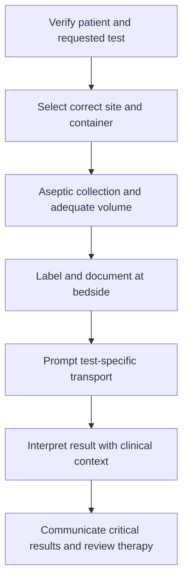

# Specimen collection and diagnostic microbiology

**Study-ready, unattempted.** [40 original MCQs](../MCQs/24-Specimen-Collection-and-Diagnostic-Microbiology-40-MCQs.md) · [Reported exam practice](../Previous-Year-Questions/Specimen-Collection-Reported-PYQs.md)

## 1. Diagnostic stewardship

Diagnostic stewardship ka matlab right patient ke liye right test, right sample, right time aur correct interpretation hai. Laboratory report ki quality sample collection se hi start ho jaati hai. Agar sample wrong site se aaya, contaminated hai ya transport mein organism viability lose ho gayi, toh sophisticated test bhi misleading result de sakta hai.

Collection se pehle order aur two approved patient identifiers verify karo. Procedure explain karo, required PPE use karo aur correct container, collection site, adequate volume aur aseptic technique confirm karo. Patient ke paas specimen label karo. Request par collection time, anatomic site aur relevant antimicrobial exposure mention karo. Lab-approved transport time aur temperature follow karo. Unlabelled ya mismatched sample mein identity guess mat karo. Irreplaceable specimens ke liye documented escalation policy follow karo.

## 2. Blood cultures

Blood culture bloodstream bacteria ya fungi detect karne mein help karti hai. Suspected sepsis mein cultures antibiotic se pehle collect karo if feasible without meaningful treatment delay. Fever spike ka wait zaroori nahi hai. CDC adult guidance mein generally at least two sets with appropriate volume are recommended. Typical adult set mein aerobic aur anaerobic bottle hoti hain. Common target around 10 mL per bottle hai, but product and lab instructions govern. Pediatric volume patient weight aur clinical safety par depend karta hai.

Skin antiseptic aur bottle septum disinfection contamination prevent karne mein help karte hain. Antiseptic ko required contact aur drying time do. Prepared site ya septum unsterile hand se touch mat karo. Separate peripheral collections result interpretation support kar sakti hain. Suspected catheter infection mein paired peripheral and line samples clinician/lab protocol se collect ho sakte hain.

Underfilled bottle mein circulating organisms capture hone ka chance kam ho sakta hai. Skin commensal ek set mein grow ho toh contamination possible hai, lekin vascular device wale patient mein true infection bhi ho sakti hai. Positive flag aur Gram stain preliminary findings hain. Critical result prompt read-back aur clinical escalation maangta hai. Final identification aur susceptibility ka wait karke deterioration ignore mat karo.

## 3. Urine specimens

Clean-catch midstream urine external contamination reduce karne mein help karta hai. Patient ko appropriate hygiene aur approved sterile container use karne ki teaching do. Container ki inner surface touch nahi karni chahiye. Urine drainage bag se routine culture sample mat lo. Indwelling catheter mein clinically indicated specimen designated sampling port se aseptically collect karo according to protocol.

Delayed transport mein lab-approved preservative ya refrigeration requirements follow karo. Room temperature par prolonged storage organism counts distort kar sakti hai. Mixed flora contamination reflect kar sakti hai. Positive culture alone symptomatic UTI prove nahi karti. Asymptomatic bacteriuria usually treatment require nahi karti except specific clinical settings such as pregnancy or selected invasive urologic procedures. Clinician evaluates indication.

## 4. Respiratory specimens

Sputum ka goal lower respiratory secretion collect karna hai, saliva nahi. Patient ko deep cough specimen approved container mein collect karna samjhao. Suspected pulmonary TB mein appropriate respiratory protection aur designated ventilated collection site use karo. Crowded ward mein unnecessary aerosol exposure avoid karo. Viral swab ke liye assay-specific site, swab material aur transport instructions follow karo. Har respiratory assay same swab accept nahi karta.

## 5. Stool, tissue and sterile body fluids

| Specimen | Main principle |
|---|---|
| Stool culture | Avoid urine and toilet water contamination, appropriate enteric transport medium if indicated |
| Stool parasites | Multiple appropriately timed samples may improve detection |
| C. difficile | Test clinically compatible symptomatic patients with suitable unformed stool, subject to lab criteria |
| Deep abscess | Representative aspirate or tissue, anaerobic transport when indicated |
| Biopsy | Separate culture portion from formalin-fixed histology portion |
| CSF | Time-sensitive transport and immediate laboratory communication |

Suspected meningitis emergency hai. Lumbar puncture safety clinician assesses, particularly altered consciousness or focal signs mein. Treatment clinically significant delay ke bina initiate hona chahiye. CSF ka temperature requirement requested test ke according vary karta hai. Har CSF sample freeze ya refrigerate karna correct nahi hai.

## 6. Diagnostic methods and interpretation

Gram stain morphology aur staining pattern ka rapid clue deta hai. Culture viable organisms ki growth detect karti hai. NAAT nucleic acid detect karta hai aur residual genetic material bhi detect kar sakta hai. Antigen tests microbial proteins detect kar sakte hain. Serology antibodies detect karti hai aur timing, past infection aur vaccination history interpretation affect karte hain. MIC standardized conditions mein growth inhibit karne wali tested concentration hai. MIC directly prescribed dose nahi hai. Phenotypic susceptibility results aur molecular resistance markers complementary information provide kar sakte hain.

## 7. Transport and quality improvement

Leakproof primary container aur appropriate secondary containment use karo. Request form ko contamination se protect karo. Leaking specimen ko clean medication area mein open mat karo. Spill/exposure protocol activate karo aur laboratory ko inform karo. Ward-level blood culture contamination rate audit mein consistent denominator aur lab definition follow karo. Collection technique, volume aur critical-result communication ki feedback-based training karo.

Clinical example: patient hypotensive hai aur cultures abhi collect nahi hui hain. Nurse urgent sepsis escalation aur prescribed therapy coordinate karti hai. Culture collection rapidly arrange karti hai, lekin emergency care ko final lab confirmation ke liye hold nahi karti.

## Sources and learning videos

- [IDSA/ASM 2024 diagnostic microbiology reference](https://www.idsociety.org/practice-guideline/laboratory-diagnosis-of-infectious-diseases)
- [CDC adult blood culture collection](https://www.cdc.gov/lab-quality/php/preventing-adult-blood-culture-contamination/collect.html)
- [CDC contamination prevention](https://www.cdc.gov/lab-quality/php/preventing-adult-blood-culture-contamination/)
- [CDC blood culture contamination quality measure](https://www.cdc.gov/lab-quality/php/preventing-adult-blood-culture-contamination/primary-measure.html)
- Concept in Hindi: [Med3D Vision — Specimen Collection Complete Guide, Nursing Exam 2026](https://www.youtube.com/watch?v=nzjRsBdh_M0). Published 7 June 2026, indexed description includes blood, urine, stool, sputum, swabs, CSF and safety.
- Scenario-based learning: [nurschool — Essential Specimen Collection English for New Nurses](https://www.youtube.com/watch?v=d9MpXvc14Uo). Published 3 July 2025. Indexed sections include blood culture at 26:41 and urine culture at 44:13.
- MCQ practice: [Medical Knowledge Online — SPECIMEN COLLECTION - MCQ - Unit 5 - Infection Control & Safety](https://www.youtube.com/watch?v=utfUGjshIaE). Published 17 February 2026, indexed description specifically identifies specimen collection quiz and contamination prevention.

Video titles, channels and descriptions retrieved from search. Full playback and every answer were not independently checked. Dedicated NORCET-only question session remains pending.
