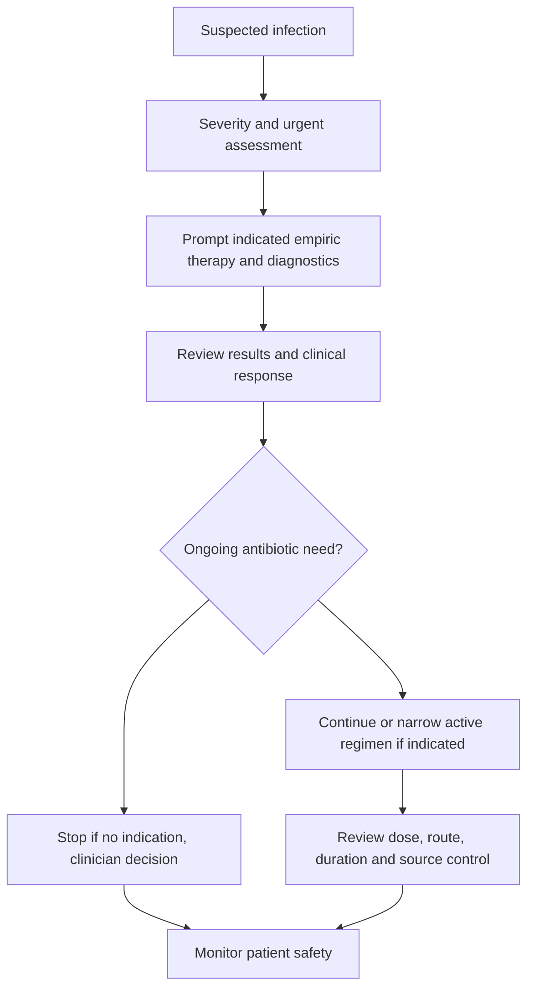

# Antimicrobial resistance and stewardship

**Study-ready, unattempted.** [40 original MCQs](../MCQs/25-Antimicrobial-Resistance-and-Stewardship-40-MCQs.md) · [Reported exam practice](../Previous-Year-Questions/AMR-Reported-PYQs.md)

## 1. AMR ka meaning

Antimicrobial resistance ka matlab microorganism kisi antimicrobial ke effect ko resist kar sakta hai. Patient ki body antibiotic-resistant nahi ban jaati. Bacteria ke alawa fungi, viruses aur parasites mein bhi respective drugs ke against resistance develop ho sakti hai. Antibiotic resistance specifically antibacterial drugs se related hai.

Intrinsic resistance organism ki usual biological characteristic hoti hai. Acquired resistance mutation ya genetic material transfer se develop ho sakti hai. Antibiotic exposure susceptible organisms ko suppress kar sakti hai aur resistant variants ko relative survival advantage de sakti hai. Har exposure har bacterium ko directly resistant nahi banata.

## 2. Mechanisms

| Mechanism | Explanation | Example clue |
|---|---|---|
| Drug inactivation | Enzyme antibiotic structure ko modify ya break karta hai | Beta-lactamase |
| Target alteration | Drug binding site change hota hai | MRSA PBP2a |
| Reduced permeability | Drug entry kam hoti hai | Altered porin |
| Efflux | Drug cell se actively bahar pump hoti hai | Multidrug efflux |
| Genetic acquisition | Resistance genes exchange ho sakte hain | Plasmid conjugation |

Biofilm mein microbial community protective matrix mein persist kar sakti hai. Altered physiology aur drug penetration treatment difficulty contribute karte hain. Biofilm tolerance aur inherited resistance exactly same concepts nahi hain. Device-associated infection mein source control review important ho sakta hai.

## 3. Important resistant organisms

MRSA methicillin-resistant Staphylococcus aureus hai. VRE vancomycin-resistant enterococci hain. ESBL-producing Enterobacterales many extended-spectrum cephalosporins ko inactivate kar sakte hain. CRE carbapenem-resistant Enterobacterales hain. Carbapenemase production ek mechanism hai, but every CRE isolate necessarily detectable carbapenemase produce nahi karta. Laboratory identification, susceptibility, local resistance patterns aur patient infection site guide treatment. Antibiotic resistance ka matlab every disinfectant ineffective hona nahi hai.

Colonization mein organism present hai without clinical infection. Colonization transmission risk create kar sakti hai, isliye IPC precautions facility guidance se follow karo. Routine systemic antibiotics solely colonization ke liye indicated nahi hote. Selected decolonization or prophylaxis protocols separately clinician-directed hote hain.

## 4. Stewardship and nursing workflow

Antimicrobial stewardship ka goal appropriate drug, dose, route aur duration se patient outcomes optimize karna aur avoidable toxicity aur resistance reduce karna hai. Severe infection mein timely empiric treatment ko unnecessary delay mat karo. Cultures promptly collect karo when feasible without material treatment delay. Clinical data available hone par prescriber-led review arrange karo.

Antibiotic time-out often 48–72 hours par clinical response aur available results review karta hai. De-escalation narrower appropriate regimen select karna hai, subtherapeutic dosing nahi. Stable patient with adequate oral absorption aur suitable active oral option mein IV-to-oral switch consider ho sakta hai. Nurse antibiotic independently prescribe, stop ya dose change nahi karti. Indication, review date, allergy history, renal function, missed dose aur critical culture result communicate karti hai.

Local antibiogram cumulative susceptibility trends describe karta hai. Ye empiric policy support karta hai but individual patient's isolate ki susceptibility guarantee nahi karta. MIC lab growth inhibition measure hai, direct bedside dose nahi.

## 5. AWaRe and stewardship programme

WHO 2025 AWaRe classification monitoring aur appropriate use ke liye hai.

- Access: appropriate indication mein preferred effective choices.
- Watch: agents with higher resistance-selection concern that merit closer monitoring.
- Reserve: selected difficult-to-treat infections where appropriate alternatives limited hain.

Classification prescribing algorithm ka substitute nahi hai. CDC hospital programme elements leadership, accountability, pharmacy expertise, action, tracking, reporting and education include karte hain. Prospective audit and feedback mein stewardship team ongoing treatment review karke recommendation discuss karti hai. Preauthorization selected drug ke initiation par approval requirement hai.

## 6. Patient safety and measurements

Nurse adverse drug reactions, kidney function aur indicated therapeutic monitoring assess karti hai. Nausea alone anaphylaxis prove nahi karti. Suspected serious allergy mein drug exposure stop aur emergency protocol activate karo. Broad-spectrum antibiotic-associated watery diarrhea CDI assessment maang sakti hai. Discharge teaching mein prescribed plan follow karna, leftover antibiotics share ya self-start na karna, aur red flags report karna include karo. Prescriber-directed change in duration is appropriate when clinical evidence warrants it.

Days of therapy (DOT) mein each antibiotic administered on a calendar day counts separately. Two different agents one day equals two DOT. Rate = total DOT / patient-days × 1000. Example 120 DOT / 400 patient-days × 1000 = 300. DDD standardized population-level consumption metric hai, actual individual dose nahi. Monitor treatment delays, mortality and adverse outcomes alongside use.

One Health human, animal and environmental sectors ko integrate karta hai. Infection prevention, vaccination, appropriate antibiotic use and surveillance jointly AMR control support karte hain.

## Sources and videos

- [WHO AWaRe classification 2025](https://www.who.int/publications/i/item/B09489)
- [WHO AWaRe antibiotic book](https://www.who.int/publications/i/item/9789240062382)
- [CDC hospital stewardship core elements](https://www.cdc.gov/antibiotic-use/hcp/core-elements/hospital.html)
- [WHO AWaRe stewardship framework](https://www.who.int/teams/surveillance-prevention-control-AMR/control-and-response-strategies/AWaRe)
- Concept: [Dr. Lokender Kumar — Antibiotic Resistance Mechanisms: Full Lecture](https://www.youtube.com/watch?v=xYhHI-ddFJI). Published 8 January 2024. Indexed chapter descriptions cover target changes, enzymes, efflux, permeability, gene transfer and biofilms.
- Concept: [Santiniketan Medical College — Lecture on AMR (NAP-AMR 2.0) and HAIs](https://www.youtube.com/watch?v=Wz1eO4HMe98). Published 9 June 2026. Indexed description covers One Health and Indian AMR policy. Surveillance definitions mentioned in teaching videos should be checked against the applicable current surveillance protocol.
- MCQ practice: [Antibiotic Stewardship — Infection Control & Safety — MCQ](https://www.youtube.com/watch?v=Nwt-QEI2vSk). Indexed dedicated quiz description covers responsible use and resistance prevention. Channel metadata not retrieved.

Video playback and answer accuracy were not independently verified. Dedicated NORCET-only stewardship practice remains pending.
