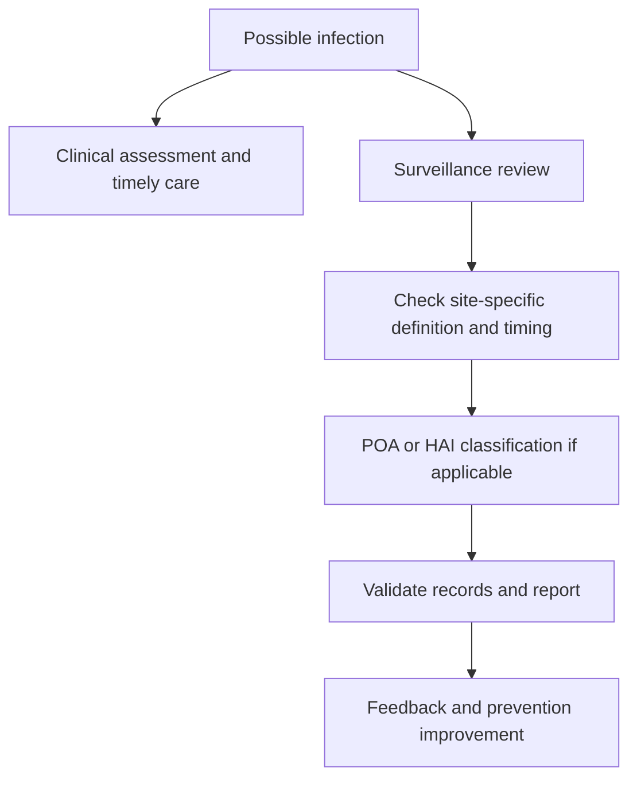

# HAI prevention and surveillance definitions

**Priority High. Study-ready, not studied.** [40 original MCQs](../MCQs/26-HAI-Prevention-and-Surveillance-Definitions-40-MCQs.md)

## HAI ka meaning aur risk

Healthcare-associated infection (HAI) care delivery ke context mein develop hone wali infection hai. Hospital-acquired ya nosocomial infection inpatient setting mein common historical term hai. Infection hospital mein detect hone ka matlab automatically hospital mein acquired hona nahi hai. Incubation, preceding healthcare exposure, organism, site and standardized criteria consider karte hain. Infection own flora se bhi arise kar sakti hai. Invasive devices skin and mucosal barriers bypass karte hain. Long device exposure, surgery, immunosuppression, severe illness and antibiotic-associated microbiota changes risk increase kar sakte hain. Standard precautions, appropriate device care, environmental cleaning and timely necessary treatment combine karna important hai.

## Clinical diagnosis versus surveillance

Clinical team patient ki illness, tests and severity dekhkar treatment decide karti hai. Surveillance team standardized definitions apply karti hai so reported data comparable ho. Dono purposes separate hain. Agar patient deteriorate kar raha hai toh surveillance criterion complete hone ka wait mat karo. Positive screening culture colonization bhi ho sakta hai. Every culture-positive result HAI nahi hai.

### Current NHSN example (2026 framework)

Applicable site-specific event rules mein admission day calendar day 1 hai. Day 1 se preceding two days and day 2 POA period mein aate hain. Applicable event date on day 3 or later HAI classification support karti hai when full criteria met. Historical exam shortcut '48 hours after admission' exact universal rule nahi hai. SSI, VAE and LabID protocols separate rules use karte hain. India mein facility/national reporting protocol follow karo, NHSN example ko automatically Indian mandatory definition mat samjho.

| Term | Meaning |
|---|---|
| Infection window period | Eligible criterion elements group karne ka seven-day interval for applicable events |
| Date of event | First qualifying element within the window, not necessarily report date |
| Repeat infection timeframe | Applicable fourteen-day period for repeat event counting rules |
| Secondary BSI attribution period | Eligible primary infection se bloodstream event association assess karne ka defined interval |
| POA | Applicable criteria and admission-related timing support present-on-admission status |
| HAI | Applicable criteria and timing support healthcare-associated classification |

**Example:** Monday admission, Wednesday applicable date of event means calendar day 3, so HAI if all applicable criteria are met. Tuesday event day 2 means POA under these rules. Post-discharge surgical wound symptoms require specific SSI surveillance follow-up, not automatic exclusion.

## Surveillance measures and data quality

Point prevalence snapshot hai. Incidence new events over observation period describe karti hai. Incidence density appropriate time-at-risk denominator use karti hai. Raw ward counts compare karte waqt exposure duration and case mix ignore nahi karna hai. Device utilization exposure ka complementary measure hai. SIR observed versus model-predicted infections compare karta hai. Confidence interval uncertainty communicate karta hai. Full calculation practice group 30 mein separately planned hai.

Structure indicator resources measure karta hai, process indicator actual recommended practices and outcome indicator infection events or harm track karta hai. Example functioning hygiene stations structure hain, observed bundle adherence process hai aur new bloodstream infections outcome hain. High reported adherence with elevated HAI should trigger review of measurement, implementation, severity and data quality. Missing surveillance data ke saath zero reported events ko zero actual infection mat samjho.

## IPC programme and nursing application

IPC committee multidisciplinary policy, education, surveillance, feedback and quality improvement coordinate karti hai. WHO multimodal strategy system changes, education, monitoring/feedback, reminders and safety culture combine karti hai. Nurses correct patient records, device insertion and removal dates, symptoms, samples and procedure details document karti hain. Conflicting records original source se reconcile karo. Confidential line lists authorized access mein rakho. Feedback nonpunitive and actionable rakho. Supply shortages promptly escalate karo. Necessary care delay, unsafe improvised equipment and false documentation avoid karo. Review balancing safety outcomes, not just low infection counts.

## Sources and video resources

[WHO HAI surveillance handbook](https://www.who.int/publications/i/item/9789240101456) · [WHO IPC core components](https://www.who.int/teams/integrated-health-services/infection-prevention-control/core-components) · [CDC NHSN patient safety protocols](https://www.cdc.gov/nhsn/psc/) · [CDC POA/HAI worksheet guidance](https://www.cdc.gov/nhsn/poa/index.html)

- Concept lecture: [Bhushan Science - Nursing, Hospital-Acquired Infection in Hindi](https://www.youtube.com/watch?v=wiefVTejwII), 29 August 2026, indexed description covers types, transmission and prevention.
- Practice: [Infection Control & Safety MCQs — Nosocomial Infection Most Important Questions](https://www.youtube.com/watch?v=QhH524vXJcg), search-indexed HAI MCQ session. Channel attribution not independently confirmed.
- Practice: [PR YADAV MCQ solution — Infection, CHN and NORCET](https://www.youtube.com/watch?v=BzAG0mCk9hU), indexed description explicitly includes HAI. Channel and full playback not verified.

## Historical exam evidence

[AIIMS Bhopal Nursing Officer 23 May 2018 shift II](https://testbook.com/question-answer/the-term-nosocomial-infection-is-used-to-refer-to--6295fb8670e381dbad578018), retrieved third-party page, tests hospital-acquired terminology. [AIIMS Raipur 31 August 2019 shift I](https://testbook.com/question-answer/nosocomial-infections-are-also-known-as--625421e3828bdf01dcba7cde) and [AIIMS Delhi 2018](https://testbook.com/question-answer/ques--62bd61ee9ad0b1c5ca75dc62) indexed related leads. These repeat one concept, no new PYQ count claimed until existing chapter source bank is reconciled. [OSSSC 2023 cross-infection lead](https://testbook.com/question-answer/when-the-patient-is-acquiring-infection-from-anoth--6a3baa92773ba703a142fcf5) full page fetch failed. Official keys unverified. Current clinical definitions above override historical shortcuts.

### Additional source verification

[India NCDC IPC training](https://ncdc.mohfw.gov.in/includes/About/CentresAndDivision/amr.php?tab=tab7) provides Indian programme context. [Reported HAI and surveillance exam adaptations](../Previous-Year-Questions/HAI-Surveillance-Reported-PYQs.md) now include two distinct concepts, historical timing and incidence. The AIIMS Delhi 2018 recall and RRB March 2026 scenario were consolidated into one timing adaptation. [Additional NORCET mixed MCQ video](https://www.youtube.com/watch?v=VIes9-YHn_w) explicitly lists HAI in indexed description. Channel and playback unverified.
