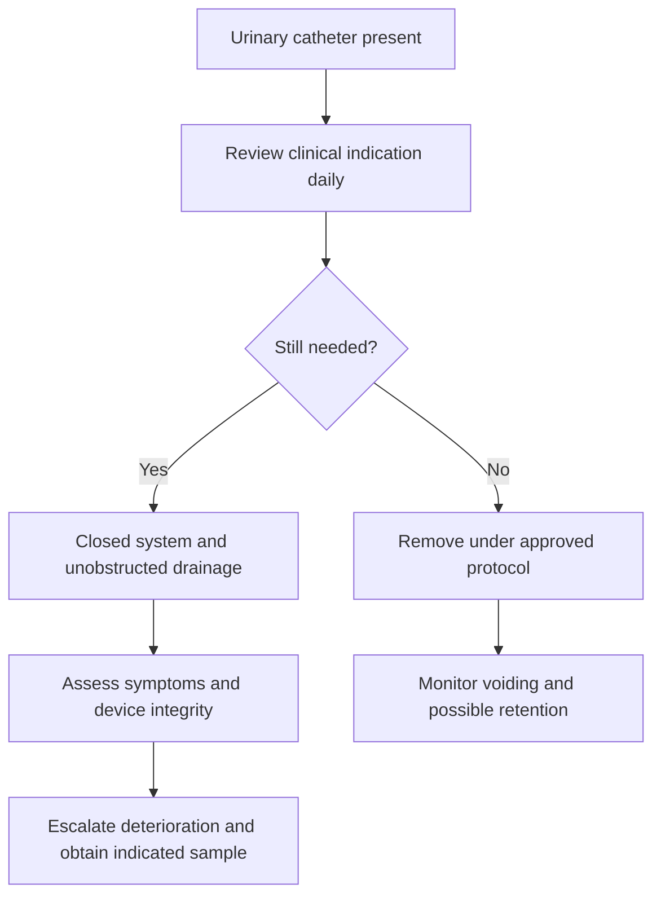

# CAUTI prevention — detailed concepts

**Study-ready, unattempted.** [40 original MCQs](../MCQs/27-CAUTI-Prevention-40-MCQs.md) · [Reported examination practice](../Previous-Year-Questions/CAUTI-Reported-PYQs.md)

## 1. CAUTI kya hai?

Catheter-associated urinary tract infection (CAUTI) urinary catheter se associated infection hai. Catheter ek flexible tube hai jo bladder se urine drain karti hai. Normal urinary tract mein urine flow microbes ko remove karne mein help karta hai. Indwelling catheter ek artificial route create karti hai. Microbes catheter ki outer surface ya drainage system ke andar travel kar sakte hain. Biofilm catheter surface par microbial community aur protective matrix ka formation hai. Isse microorganisms persist kar sakte hain.

Bacteriuria ka matlab urine mein bacteria present hain. Har bacteriuria symptomatic UTI nahi hoti. Long-term catheter mein colonization common ho sakti hai. Cloudy urine ya bad smell alone infection confirm nahi karti. Fever, flank pain, suprapubic tenderness aur systemic deterioration ko clinical context mein assess karo. Hypotension aur altered consciousness possible sepsis ke warning signs hain.

## 2. Catheter lagana kab zaroori hai?

Acute urinary retention, selected perioperative indications, critical illness mein accurate urine output assessment aur selected other clinical situations indwelling catheter justify kar sakti hain. Routine incontinence management ya staff convenience indication nahi hai. Patient ki condition change hone par catheter ki necessity daily review karo. Approved nurse-driven removal protocol use karna unnecessary catheter-days reduce kar sakta hai.

Bladder scan retention assess karne mein help karta hai. Suitable patients mein external urine collection device ya intermittent catheterization continuous indwelling catheter ka alternative ho sakta hai. External device retention treat nahi karta. Skin integrity aur device fit monitor karo. Intermittent catheterization schedule bladder overdistension prevent karne mein help karta hai.

## 3. Insertion bundle

Acute-care indwelling catheter insertion trained personnel aseptic technique aur sterile equipment se karte hain. Hand hygiene insertion se pehle aur baad mein perform karo. Patient identity, indication, allergies, procedure explanation aur privacy check karo. Approved sterile catheter, sterile gloves, appropriate cleansing supplies aur single-use sterile lubricant use karo. Sterile tip nonsterile surface touch kare toh contaminated catheter replace karo. Smallest bore consistent with adequate drainage choose karo. Balloon aur insertion details product instructions aur clinical protocol ke according honi chahiye. Resistance, significant pain ya suspected injury mein force mat karo.

Catheter ko secure karo taaki urethra par traction na aaye. Catheter indication, insertion time aur operator document karo. Nonacute chronic intermittent catheterization ke liye clean technique acceptable ho sakti hai according to clinician-approved setting and device instructions. Is exception ko acute-care sterile insertion ke saath confuse mat karo.

## 4. Maintenance bundle

| Action | Reason |
|---|---|
| Closed drainage system preserve karo | Unnecessary openings contamination risk increase karti hain |
| Bag bladder level se neeche aur floor se door rakho | Gravity drainage maintain karne aur reflux/contamination risk reduce karne mein help milti hai |
| Kink aur dependent loop assess karo | Obstruction aur urine pooling reduce hoti hai |
| Catheter secure karo | Urethral traction aur trauma reduce hote hain |
| Separate clean measuring container use karo | Patient-to-patient contamination risk kam hota hai |
| Routine gentle meatal hygiene karo | In-place catheter ke liye repeated antiseptic scrubbing routinely recommended nahi hai |
| Daily indication review karo | Unnecessary duration aur infection exposure kam hoti hai |

Drainage bag empty karte waqt spigot ko measuring container se touch mat hone do. Standard precautions aur exposure risk ke according PPE use karo. Leakage, disconnection ya aseptic breach mein CDC catheter aur collection system ko aseptically replace karne ki recommendation deta hai. Replacement clinical authority aur facility protocol ke according arrange karo.

Routine fixed-interval replacement solely for infection prevention recommended nahi hai. Obstruction, infection-related clinical indications, compromised closed system aur product-specific instructions review karo. Routine systemic antibiotic prophylaxis, antimicrobial bladder irrigation aur drainage bag mein antiseptic instillation avoid karo unless specific clinical indication and appropriate prescription exist. Anticipated clot obstruction after selected urological surgery mein prescribed closed continuous irrigation appropriate ho sakti hai.

## 5. Specimen collection and clinical escalation

Clinically indicated culture ke liye approved needleless sampling port disinfect karke fresh small urine sample aseptically collect karo. Drainage bag ka stagnant urine routine culture ke liye suitable nahi hai. Selected large-volume nonculture tests ke liye laboratory-approved bag collection possible hai. Clinical indications, specimen type aur correct labeling check karo.

Asymptomatic bacteriuria ka routine screening aur treatment most catheterized patients mein indicated nahi hai. Pregnancy aur selected invasive urological procedures important exceptions ho sakti hain. Patient with new fever, rigors, hypotension or acute deterioration needs timely assessment and clinician-directed management. Surveillance criteria complete hone ka wait karke sepsis care delay mat karo.

## 6. NHSN surveillance example — 2026

NHSN definition clinical diagnosis ka substitute nahi hai. For the applicable inpatient CAUTI criterion, an indwelling urinary catheter must have been present for more than two consecutive calendar days, counting insertion day as day one. It must be present on the date of event or have been removed the previous day, subject to the full protocol. Monday insertion and Wednesday event can satisfy the duration criterion, but the applicable UTI criterion must also be met.

Urgency, frequency and dysuria occurring while the indwelling catheter is in place are not eligible symptom elements under the specified NHSN criteria. An eligible urine culture has no more than two identified organisms and meets the applicable bacterial count and symptom requirements. Use the full current protocol rather than a single finding. External collection devices and intermittent catheterization do not count as NHSN indwelling urinary catheter-days.

CAUTI rate = eligible events / urinary catheter-days × 1000. Example: 3 events in 600 catheter-days = 5 per 1000 catheter-days. Device utilization ratio = catheter-days / patient-days. Monitor retention, reinsertion and appropriateness alongside infection rates so unnecessary harm is not hidden.

## 7. Sources and learning videos

- [CDC CAUTI prevention recommendations](https://www.cdc.gov/infection-control/hcp/cauti/summary-of-recommendations.html)
- [CDC clinical safety: CAUTI](https://www.cdc.gov/uti/hcp/clinical-safety/)
- [CDC urinary catheter culture stewardship](https://www.cdc.gov/uti/hcp/clinical-guidance/)
- [NHSN UTI surveillance protocol](https://www.cdc.gov/nhsn/psc/uti/) and [2026 UTI FAQs](https://www.cdc.gov/nhsn/faqs/faq-uti.html)
- Concept: [Catheter care bundle — How to prevent CAUTI, NORCET ESIC RRB](https://www.youtube.com/watch?v=N6UCB3JUvvY). Indexed title specifically covers CAUTI prevention. Channel attribution not independently retrieved.
- Concept: [Catheter Care Made Easy — sterile technique, daily care and CAUTI prevention](https://www.youtube.com/watch?v=jQhLFhssrNE). Indexed description covers maintenance and nursing skills. Channel not independently confirmed.
- MCQ practice: [Adda247 Nursing — Urinary Catheterization Nursing Classes MCQs, Pari Ma'am](https://www.youtube.com/watch?v=NYebC1OVWH4). Published 23 October 2025. Retrieved channel, title and description identify recruitment-exam catheterization question practice. Exact CAUTI question coverage and full playback remain unverified.

Use current clinical recommendations over coaching shortcuts. Full video playback and dedicated CAUTI-only MCQ coverage still require review.
