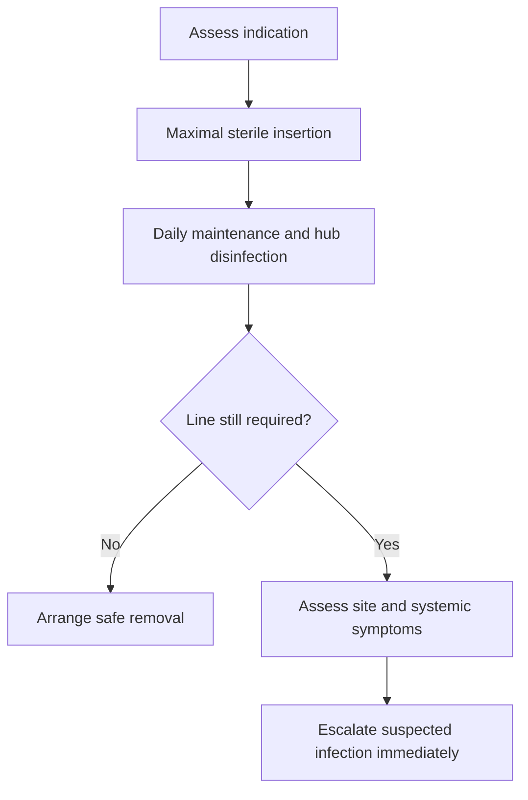

# CLABSI and vascular device infection prevention

**Study-ready, unattempted.** [40 original MCQs](../MCQs/28-CLABSI-and-Vascular-Device-Infection-Prevention-40-MCQs.md) · [Reported exam practice](../Previous-Year-Questions/CLABSI-Reported-PYQs.md)

## Basic concept

Central venous catheter (CVC) ek flexible tube hai jiska tip central circulation mein terminate karta hai. Iske through selected medicines, nutrition aur fluids diye ja sakte hain. PICC arm ki vein se insert hota hai lekin tip central location mein hoti hai. Midline ka tip central location mein nahi hota. Isliye har long IV catheter central line nahi hai.

Skin normally microbes ko blood tak pahunchne se rokti hai. Jab catheter insert hota hai toh ye barrier cross hota hai. Microbes skin se catheter ki outer surface ke along ya contaminated connector se lumen ke andar travel kar sakte hain. Biofilm ek microbial community hai jo protective matrix bana kar catheter par persist kar sakti hai. Isliye insertion ke saath har access aur maintenance step important hai.

CLABSI standardized surveillance association hai. CRBSI clinical catheter-related bloodstream infection hai jisme catheter source ko establish karne ke liye additional microbiological evidence relevant hota hai. Dono ko identical mat samjho.

## Insertion prevention bundle

Patient ki treatment requirement ke according least invasive suitable access aur minimum required lumens choose kiye jaate hain. Adult non-tunneled CVC site selection mein infection risk ke saath mechanical risk bhi consider karo. Advanced kidney disease mein subclavian stenosis future dialysis access compromise kar sakti hai. Site decision trained clinician karta hai.

Hand hygiene ke baad cap, mask, sterile gown, sterile gloves aur sterile full-body drape use karo. Ye maximal sterile barrier hai. Ultrasound guidance mein sterile field ke andar sterile probe cover aur sterile gel use karo. Guidewire contaminate ho jaaye toh sterile replacement arrange karo. Adult CVC skin preparation mein CDC alcoholic chlorhexidine above 0.5% recommend karta hai, unless contraindicated. Product ko prescribed drying time do. Allergy mein appropriate alternative use karo. Neonates mein product aur age-specific precautions important hain. Emergency insertion mein asepsis assured nahi thi toh CDC as soon as possible and within 48 hours replacement recommend karta hai.

## Maintenance

| Care | Why it matters |
|---|---|
| Hand hygiene and connector disinfection before access | Microbial entry into lumen kam hoti hai |
| Sterile site dressing | Skin barrier breach ko protect karti hai |
| Prompt replacement of wet, loose or soiled dressings | Compromised barrier restore hoti hai |
| Daily necessity review | Unnecessary line exposure reduce hoti hai |
| Monitor site and systemic symptoms | Infection ya other complication jaldi detect ho sakti hai |

CDC short-term adult CVC transparent dressings at least every seven days and gauze every two days recommend karta hai. Compromised dressing ka earlier replacement chahiye. Oozing site par sterile gauze useful hai. Pediatric dislodgement risk aur product-specific guidance consider karo. Approved chlorhexidine-impregnated dressings appropriate adults mein recommended hain. Premature neonates mein serious skin reactions ke concern se ye dressings recommended nahi hain.

Hub ko approved antiseptic method se disinfect karo aur dry hone do. Disinfected hub nonsterile surface touch kare toh repeat disinfection karo. Flush solution, frequency aur volume device-specific protocol se decide hote hain. Resistance aaye toh force mat karo. Cracked ya leaking lumen use stop karke urgent assessment arrange karo. Catheter site ko water mein submerge mat karo. Routine systemic antibiotics ya scheduled central line exchange solely for prevention recommended nahi hai. Selected recurrent CRBSI cases mein specialist antimicrobial lock consider kar sakta hai.

## Clinical scenario and diagnostic reasoning

Maan lo patient parenteral nutrition receive kar raha hai aur suddenly rigors aur hypotension develop hote hain. Nurse immediately sepsis assessment aur emergency escalation karti hai. Insertion site clean dikhne par bhi bloodstream infection possible hai. Clinician-directed paired peripheral aur catheter cultures appropriately labeled and timed collect ho sakti hain. Urgent treatment materially delay mat karo.

Validated paired cultures mein same organism catheter sample se at least two hours earlier positive ho toh catheter source support ho sakta hai. Ye differential time to positivity hai. Full clinical context check karo. Asymptomatic removed catheter tips routinely culture mat karo. Suspected infected non-tunneled line ko same guidewire par exchange karna avoid karo. Fever alone automatic line removal indication nahi hai. Source, severity, organism aur access needs clinician review karta hai.

## Surveillance and quality

NHSN 2026 CLABSI reporting mein eligible laboratory-confirmed BSI aur eligible central line on event date or previous day required hain. Full access, duration and secondary attribution criteria check karo. Line association alone catheter causation prove nahi karti. Standard inpatient location denominator mein one patient with multiple central lines generally one central line-day count hota hai. Special location/category rules manual se verify karo.

Rate = eligible CLABSI events / central line-days × 1000. Example 3 events / 750 line-days × 1000 = 4. Bundle adherence aur infection rate alag indicators hain. Persistent infections mein actual practices, denominator quality, supplies, training aur patient risk review karo.

## Sources and videos

- [WHO 2026 central venous catheter guideline](https://www.ncbi.nlm.nih.gov/books/NBK622846/)
- [WHO recommendations](https://www.ncbi.nlm.nih.gov/sites/books/NBK622835/)
- [CDC catheter prevention recommendations](https://www.cdc.gov/infection-control/hcp/intravascular-catheter-related-infections/summary-recommendations.html)
- [NHSN bloodstream infection surveillance](https://www.cdc.gov/nhsn/psc/bsi/)
- [APSIC revised CLABSI prevention guidance](https://pmc.ncbi.nlm.nih.gov/articles/PMC12877909/)
- Concept: [UAB Medicine — CLABSI Prevention: Checklists, Maintenance, and Daily Reviews](https://www.youtube.com/watch?v=AxjU5t_YstE), 7 September 2026. Indexed channel and description confirm central-line prevention.
- Hindi concept: [Prakash Nursing Academy — Hospital acquired infection, unit 1](https://www.youtube.com/watch?v=PKZJzdF4ZR0), 24 November 2025. Indexed description explicitly includes CLABSI bundle.
- MCQ practice: [Nursing MCQ Hub — DAY 13 Infection Control and Biomedical Waste Top 20 MCQs, RRB Nursing Exam](https://www.youtube.com/watch?v=A3sraYCyMr0), 17 January 2026. Channel and indexed description confirm CLABSI among covered topics. Mixed practice, not a dedicated CLABSI-only session.
- Additional clinical judgment practice: [Nursing McQs — NCLEX Infection Control Questions 1–41](https://www.youtube.com/watch?v=IRw2T7-82bg), 31 January 2026. Indexed description includes CLABSI, CAUTI and VAP. NCLEX format differs from NORCET.

Full playback and individual answers not independently reviewed. Dedicated CLABSI-only nursing MCQ video remains pending. INC revised curriculum lists HAI bundle approach, including line care, as relevant nursing study scope. [Curriculum transcription](https://www.legitquest.com/act/indian-nursing-council-revised-regulations-and-curriculum-for-bsc-nursing-program-regulations-2020/cbd2).
