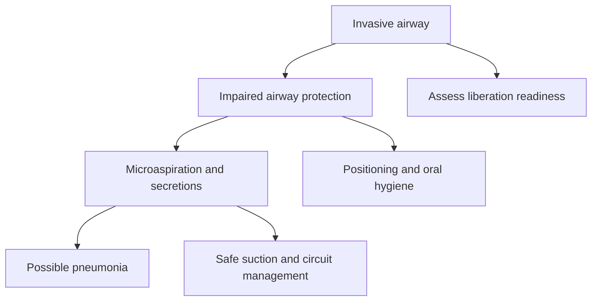

# VAP and surgical site infection prevention

**Priority High. Study-ready, unattempted.** [40 MCQs](../MCQs/29-VAP-and-Surgical-Site-Infection-Prevention-40-MCQs.md)

## VAP mechanism and recognition

Endotracheal tube normal airway protection bypass karta hai. Oral colonization, above-cuff secretions, microaspiration and prolonged invasive ventilation infection risk increase karte hain. New fever, purulent secretions, infiltrates and worsening oxygenation clinical assessment require karte hain. Positive aspirate alone pneumonia prove nahi karta. VAE surveillance defined deterioration patterns track karti hai and includes possible noninfectious causes. Clinical VAP diagnosis separate hai.

## Adult VAP prevention

Avoid intubation when suitable alternatives exist, but necessary airway support delay mat karo. Head of bed 30–45 degrees when safe, especially feeding. Contraindications document karo. Sedation minimization, spontaneous awakening/breathing trials and early mobility protocol-based hain. Regular toothbrushing and oral care important hain. SHEA 2022 routine oral chlorhexidine solely for adult VAP prevention recommend nahi karti. Historical bundles may list it. Current guidelines and individual indication distinguish karo.

Subglottic drainage tube selected prolonged intubation cases mein useful ho sakti hai. Functioning tube solely to add feature exchange mat karo. Cuff pressure prescribed safe range mein monitor karo, often 20–30 cm H2O. Low pressure leak and high pressure ischemia risk. Circuit routine frequent changes nahi. Soiled or malfunctioning circuit approved protocol se replace karo. Condensate patient airway ki taraf drain mat hone do. Open suction sterile technique, closed system device instructions and clinically indicated suction follow karo. Routine saline instillation generally discouraged hai.

High aspiration risk mein feeding strategy assess karo. Nonventilated dysphagic patient swallow assessment require kar sakta hai. Stress ulcer prophylaxis separate indications follow karti hai. Deterioration mein ABC and urgent evaluation, not delayed for surveillance.

## SSI wound classification

| Class | Typical meaning |
|---|---|
| Clean | Uninfected and no entry into specified colonized tracts |
| Clean-contaminated | Controlled entry into specified tract without unusual contamination |
| Contaminated | Gross spillage or major sterile breach or other defined contamination |
| Dirty-infected | Existing clinical infection or perforated viscera |

Wound class operative contamination describe karti hai, postoperative SSI diagnosis nahi. Superficial incisional SSI skin/subcutaneous, deep incisional fascia/muscle, organ-space deeper manipulated organ/space involve kar sakti hai. Full surveillance criteria apply karo.

## Perioperative prevention

Remove hair only when needed, clip rather than shave. Most standard IV prophylactic drugs within 60 minutes preincision, longer-infusion agents may need up to 120 minutes. Agent-specific intraoperative redosing when prolonged surgery or blood loss. Routine prophylaxis stop at closure per SHEA guidance, drain alone extension indication nahi. Established infection treatment different hai. Approved alcohol-based skin prep where safe, avoid pooling and ensure drying before electrosurgery. Correct sterile field breach. Maintain appropriate normothermia and safe glucose control. Selected procedures benefit from staphylococcal decolonization. Aseptic postoperative wound care and discharge education important hain.

Increasing pain, redness, pus, fever report karo. Rapid deterioration, hypotension, severe disproportionate pain urgent surgical and sepsis evaluation require karte hain. NHSN superficial incisional SSI generally 30 days, deep/organ-space SSI 30 or 90 days according to procedure. Universal 90-day rule incorrect hai. Postdischarge cases can qualify. Compare procedure-specific rates and risk adjustment.

## References and videos

[SHEA 2022 VAP prevention](https://pmc.ncbi.nlm.nih.gov/articles/PMC10903147/) · [SHEA 2022 SSI prevention](https://pmc.ncbi.nlm.nih.gov/articles/PMC10867741/) · [NICE SSI](https://www.nice.org.uk/guidance/ng125/chapter/Recommendations) · [CDC NHSN patient safety](https://www.cdc.gov/nhsn/psc/)

- [Utkarsh Nursing Classes — 360 Degree Series #1500 Mechanical Ventilator, Dr. Shailendra Sir](https://www.youtube.com/watch?v=qPBa47Ni6Hg), 7 May 2026, concept and MCQ session including complications.
- [Nursing McQs — NCLEX Infection Control Q1–41](https://www.youtube.com/watch?v=IRw2T7-82bg), 31 January 2026, explicitly includes VAP practice. Supplementary international format.
- [NPrep Nursing Classes — FON Recent Updates for NORCET](https://www.youtube.com/watch?v=SDrOtCmBxis&t=236s), 7 April 2026, indexed SSI surveillance section. Verify procedure-specific windows rather than assuming universal 90 days.
- Dedicated SSI-only MCQ video unconfirmed. Full playback not independently verified.

## Historical evidence gap

[Undated VAP bundle practice](https://testbook.com/question-answer/the-nurse-is-implementing-a-ventilator-associated--697871002187e3fe5cbf01bd) retrieved but no exam attribution. Its routine CHG explanation requires current guidance correction above. Retrieved [JIPMER 23 February 2020 postoperative complication question](https://testbook.com/question-answer/a-45-year-old-patient-who-underwent-exploratory-la--625eae6a15fc1762b1a498be) tests ileus, not SSI. No new recruitment PYQ count.
