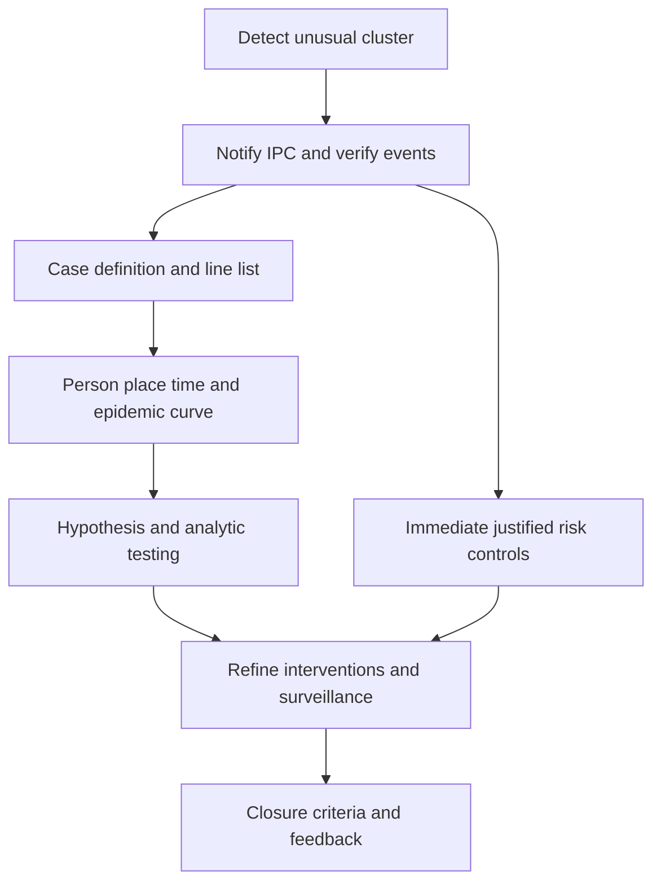

# Environmental IPC, outbreak investigation and surveillance calculations

**Priority High. Study-ready, unattempted.** [40 original MCQs](../MCQs/30-Environmental-IPC-Outbreak-Investigation-and-Surveillance-Calculations-40-MCQs.md)

## Environment and transmission

Bed rails, call buttons, tables, door handles and shared equipment frequently touch hote hain. Patient or staff hands microbes transfer kar sakte hain. Cleaning visible soil and organic matter remove karti hai. Disinfection suitable surfaces par viable pathogens reduce karti hai according to product claims. Sterilization separate validated process hai for appropriate critical devices. Correct concentration, wet contact time, compatibility, PPE and cleaning sequence important hain. Clean-to-dirty and systematic high-to-low sequence use karo according to local policy. Damp methods dust dispersal reduce karte hain. Toilet cloth and clean patient equipment separate rakho. High-touch frequency contamination likelihood, patient vulnerability and exposure ke according decide hoti hai.

Terminal cleaning discharge or transfer ke baad patient zone and appropriate equipment ko prepare karti hai. Airborne clearance when applicable ventilation requirements ke according determine hota hai. Routine fogging manual cleaning replacement nahi hai. Never mix chemicals. Blood/body fluid spill area secure karo, sharps risk identify karo, appropriate PPE and equipment se safe handling, cleaning and approved disinfection arrange karo. C. auris rooms organism-effective approved disinfectant require karte hain. Exact concentration and contact time product and facility policy-specific hain.

## Monitoring, water and air

Fluorescent markers coverage assess karte hain. ATP organic residue ka indirect indicator hai, specific organism or viable pathogen count nahi. Routine random environmental cultures recommended replacement for process audits nahi hain. Targeted sampling investigation and specific hazards mein useful ho sakti hai. Results clinical and epidemiological context mein interpret karo.

Sink drains and water systems reservoirs ho sakte hain. Medication preparation or sterile supplies splash-prone sink areas se separate rakho. Water management programme risk, plumbing, maintenance and investigation coordinate karta hai. Construction dust especially immunocompromised patients ke liye risk create kar sakti hai. IPC risk assessment, dust barriers and engineering controls essential hain. Linen point of use par contain karo and unnecessary shaking avoid karo. Shared equipment approved between-patient cleaning/disinfection follow kare.

## Outbreak investigation

Outbreak expected baseline se more cases ya concerning linked cluster ho sakta hai. Rare severe organism ka single unexpected event bhi investigation trigger kar sakta hai. Verify diagnosis, reporting changes and baseline, notify IPC/public health as required. Immediate prevention measures evidence ke saath parallel start ho sakte hain. Investigators source, mode of transmission and susceptible patients assess karte hain.

Case definition clinical/laboratory criteria and person, place, time specify karti hai. Suspected/probable/confirmed categories where relevant. Early broad definition sensitivity increase kar sakti hai, later refine and document versions. Line list relevant onset dates, unit, device/food exposures, test and outcomes include karti hai. Identifiers restricted rakho.

Epidemic curve symptom onset timing plot karti hai. Point source generally single clustered peak, continuous common source prolonged pattern, propagated spread successive waves suggest kar sakta hai. Curve alone cause prove nahi karta. Known cohort permits retrospective cohort study and attack proportions, dispersed populations may need case-control design and odds ratio. Molecular matching supports link but direction or source alone prove nahi karta. Risk controls while testing hypotheses, preserve evidence and ensure safe care. Closure pathogen-specific observation and transmission control evidence par based hai, universal fixed interval nahi.

## Calculations: NORCET traps

| Measure | Formula | Example |
|---|---|---|
| Attack proportion | Ill among defined at-risk group / at-risk group × 100 | 18/60 = 30% |
| Relative risk | Risk exposed / risk unexposed | 0.40/0.05 = 8 |
| Risk difference | Risk exposed minus risk unexposed | 40% − 5% = 35 percentage points |
| Odds ratio | a×d / b×c from 2×2 table | 30×40 / (10×20) = 6 |
| Point prevalence | Existing affected / surveyed population × 100 | 12/240 = 5% |
| Incidence density | New events / time-at-risk × scale | 9/1500 × 1000 = 6 per 1000 patient-days |
| Device-associated rate | Qualifying events / device-days × 1000 | 7/3500 × 1000 = 2 |
| Crude SSI proportion | Qualifying SSI / eligible procedures × 100 | 8/400 = 2 per 100 |
| Cumulative incidence | New affected / initially at-risk cohort | 12/160 = 7.5% |
| Secondary attack proportion | Secondary cases / eligible susceptible contacts | 6/40 = 15% |
| Hand hygiene adherence | Correct actions / eligible opportunities × 100 | 84/120 = 70% |

**Exam distinction:** Percentage versus per-thousand denominator confuse mat karo. Device-day is not patient-day. Cohort risk proportion is not person-time rate. OR and RR distinct measures hain. Risk difference percentage points hai, not relative increase. Surveillance criteria, inclusion/exclusion and denominators version-specific verify karo. Study design, ascertainment and case mix affect interpretation. Nurses correct documentation, reporting, specimen coordination, safe controls and nonpunitive feedback provide karti hain.

## Sources and video resources

[CDC environmental cleaning procedures](https://www.cdc.gov/healthcare-associated-infections/hcp/cleaning-global/procedures.html) · [CDC healthcare outbreak field guide](https://www.cdc.gov/field-epi-manual/php/chapters/healthcare-settings.html) · [CDC environmental sampling](https://www.cdc.gov/infection-control/hcp/environmental-control/environmental-sampling.html) · [CDC environmental recommendations](https://www.cdc.gov/infection-control/hcp/environmental-control/summary-recommendations.html) · [APSIC 2025 environmental hygiene update](https://www.cambridge.org/core/journals/antimicrobial-stewardship-and-healthcare-epidemiology/article/apsic-guidelines-for-environmental-hygiene-surface-cleaning-air-and-water-quality-in-hospitals-2025-update/F5B84DF349A6F40914BBE3C47FABA524)

- Concept: [Public Health Made Easy — Outbreak Investigation Made Easy to Remember](https://www.youtube.com/watch?v=nTiky8ZwE1k), 11 August 2026. Indexed chapters include case definition, line list, attack rates and relative risk.
- Applied practice: [Mary McQuilkin, NP, MPH — Outbreak Investigation](https://www.youtube.com/watch?v=Ogjv-HiBNc8), 14 May 2024. Description and timestamps include attack rate at 04:27, RR at 11:01, OR at 16:31 and multiple practice calculations from 28:07. International supplementary practice, not NORCET-specific.
- Broad NORCET practice: [Infection Control MCQ for NORCET 11](https://www.youtube.com/watch?v=GC1eAkjnqOg), search-indexed title. Channel and environmental-specific questions not confirmed.
- Dedicated environmental IPC nursing MCQ video remains unconfirmed. Full video playback not independently reviewed.
