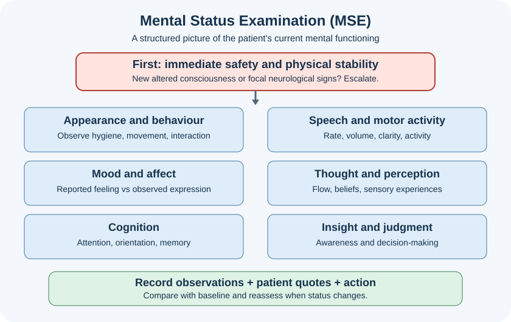
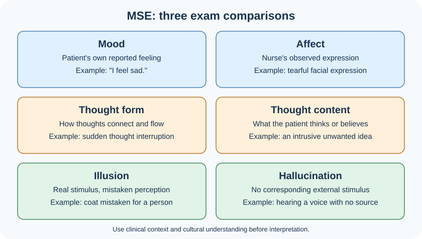

# 📚 Mental Status Examination (MSE) — detailed Hinglish concepts

**Study-ready, not yet studied.** NORCET, Staff Nurse aur CHO/community-level nursing ke liye.

[🏠 Chapter](../README.md) · [📝 30 original MCQs](../MCQs/01-Mental-Status-Examination-30-MCQs.md) · [📜 Reported exam questions](../Previous-Year-Questions/01-MSE-Reported-Exam-Practice.md) · [🔎 References](../References.md)

## Is topic mein kya padhna hai?

1. [MSE ka meaning aur purpose](#1-mse-ka-meaning-aur-purpose)
2. [Appearance, behaviour aur speech](#2-appearance-behaviour-aur-speech)
3. [Mood aur affect](#3-mood-aur-affect)
4. [Thought aur perception](#4-thought-aur-perception)
5. [Cognition, insight aur judgment](#5-cognition-insight-aur-judgment)
6. [Nursing responsibilities aur red flags](#6-nursing-responsibilities-aur-red-flags)
7. [Revision aur video practice](#7-revision-aur-video-practice)

## 1. MSE ka meaning aur purpose

🔴 **MOST IMPORTANT**

Dekho, jaise physical examination mein nurse body ka present condition assess karti hai, waise hi Mental Status Examination mein nurse patient ke mind aur behaviour ki current condition ko systematically assess karti hai. Ismein nurse patient ki baat sunti hai, behaviour observe karti hai aur kuch simple questions poochti hai. MSE ek particular time ki snapshot hoti hai. Isliye aaj ki findings kal se different ho sakti hain.

Mental health history mein hum poochte hain ki problems kab shuru hui, medicines kya chal rahi hain, sleep aur daily life kaise affect hui aur pehle kab treatment hua tha. MSE mein hum dekhte hain ki patient abhi kaise soch raha hai, feel kar raha hai aur communicate kar raha hai. Dono ek doosre ko support karte hain. MSE alone se final diagnosis nahi hota.

Diagram mein first step safety hai. Agar patient achanak confused ho, consciousness change ho ya body ka koi emergency sign ho, toh nurse routine interview ko priority nahi deti. Pehle physical stability aur urgent clinical assessment arrange hoti hai.

## 2. Appearance, behaviour aur speech

🟠 **HIGH YIELD**

Jab patient room mein aata hai, tab nurse bina judge kiye appearance observe karti hai. Nurse dekhti hai ki hygiene kaisi hai, clothes environment ke hisaab se appropriate hain ya nahi aur patient comfortable hai ya restless. Poor grooming ka matlab automatically schizophrenia nahi hota. Depression, disability, lack of resources aur physical illness jaise reasons bhi ho sakte hain.

Behaviour mein nurse cooperation, eye contact, movement aur interaction note karti hai. Eye contact culture aur comfort se bhi affect hota hai. Isliye patient aankhon mein nahi dekh raha toh use automatically uncooperative nahi bolna chahiye.

Speech assess karte waqt nurse rate, amount, volume, fluency aur clarity dekhti hai. Patient bahut jaldi bol raha hai aur interrupt karna mushkil hai toh pressured speech ho sakti hai. Agar spontaneous replies bahut kam hain toh poverty of speech ho sakti hai. Agar patient words pronounce nahi kar pa raha hai toh dysarthria jaise neurological ya motor speech causes consider karne chahiye.

| Term | Easy explanation |
|---|---|
| Pressured speech | Patient tezi se bolta hai aur uski speech ko interrupt karna difficult ho sakta hai. |
| Poverty of speech | Patient bahut kam spontaneous words use karta hai. |
| Echolalia | Patient doosre person ke bole hue words repeat kar sakta hai. |
| Neologism | Patient aisa naya word use kar sakta hai jiska meaning doosre log nahi samajhte. Culture aur language bhi check karni chahiye. |
| Dysarthria | Speech muscles ki problem se words clear pronounce nahi ho paate. |

**Clinical example:** Agar patient normal interview ke beech achanak slurred speech aur ek taraf facial weakness develop kare, toh nurse psychiatric assessment rok kar emergency stroke assessment arrange karti hai. New neurological signs ko psychiatric behaviour nahi maana jaata.

## 3. Mood aur affect

🔴 **MOST IMPORTANT**

Mood ka matlab patient ki apni emotional feeling hai. Nurse pooch sakti hai, "Aaj aap kaisa feel kar rahe ho?" Patient kehta hai, "Main sad feel kar raha hoon." Is statement ko subjective mood mein record karte hain.

Affect ka matlab feeling ka bahar dikhne wala expression hai. Nurse patient ke face, voice aur gestures ko observe karti hai. Ho sakta hai patient bole ki woh theek hai, lekin interview mein tears aayein. Is case mein nurse reported mood aur observed affect separately likhti hai. Nurse ye assume nahi karti ki patient jhooth bol raha hai.

| Finding | Iska matlab kya hai? |
|---|---|
| Euthymic mood | Patient ka mood relatively normal aur stable hai. |
| Depressed mood | Patient persistent sadness ya low mood report kar sakta hai. |
| Elevated mood | Patient unusually high ya cheerful feeling report kar sakta hai. |
| Flat affect | Emotional expression almost absent dikh sakti hai. |
| Restricted affect | Emotional expression ki range kam ho jaati hai. |
| Labile affect | Emotional expression jaldi aur markedly change ho sakti hai. |
| Incongruent affect | Visible expression reported content ya situation se match nahi karti. |

**Exam clue:** Mood patient batata hai, affect nurse observe karti hai. Mood ya affect alone se disorder confirm nahi karte.

## 4. Thought aur perception

🔴 **MOST IMPORTANT**

Thought form batata hai ki thoughts ka flow kaise chal raha hai. Thought content batata hai ki patient kya soch raha hai ya kya believe karta hai. Dono alag hain. Jaise ek book ki story uska content hai aur story ka ek chapter se doosre chapter tak connect hona uska flow hai.

### Thought form

| Finding | Easy meaning aur example |
|---|---|
| Circumstantiality | Patient bahut details deta hai, lekin aakhir mein original question ka answer de deta hai. |
| Tangentiality | Patient question se related baat shuru karta hai, phir doosri baat par chala jaata hai aur original answer tak nahi pahunchta. |
| Flight of ideas | Thoughts jaldi change hote hain aur kuch connections abhi bhi samajh aate hain. |
| Thought blocking | Soch ka flow achanak ruk jaata hai aur patient aage kya keh raha tha bhool sakta hai. |
| Loose associations | Thoughts ke beech logical connection weak ho jaata hai. |
| Word salad | Words aise mix ho sakte hain ki meaningful sentence samajhna mushkil ho jaata hai. |
| Perseveration | Patient situation ya question badalne par bhi apni purani response ko baar-baar repeat karta hai. |
| Clang association | Words ka connection meaning ke bajay sound ya rhyme se banta hai. |

### Thought content

Delusion ek fixed false belief ho sakta hai jo adequate contrary evidence se bhi change nahi hota aur patient ke cultural context mein accepted belief nahi hai. Nurse patient ki feeling ko respect karti hai, belief ko fact ke roop mein confirm nahi karti aur safety assess karti hai. Persecutory delusion mein patient ko harm kiye jaane ka belief ho sakta hai. Grandiose delusion mein special power ya importance ka unrealistic belief ho sakta hai. Delusion of reference mein ordinary event ko personal message samjha ja sakta hai.

Obsession ek unwanted recurring thought, image ya urge ho sakta hai jo distress create karta hai. Compulsion repeated behaviour ya mental ritual ho sakta hai. Nurse poochti hai ki ye experiences daily life, sleep aur functioning par kitna effect daal rahe hain. Thought content mein self-harm ya harm-to-others concern ka assessment bhi appropriate safety protocol ke hisaab se zaruri hai.

### Perception

Perception ka matlab sensory information ko samajhna hai. Illusion mein real stimulus hota hai lekin interpretation galat hoti hai. Example ke liye dark room mein coat ko person samajhna. Hallucination mein corresponding external stimulus ke bina sensory experience hota hai. Ye auditory, visual, tactile, olfactory ya gustatory ho sakti hai. Hallucination ka matlab automatically schizophrenia nahi hota. Medical illness, medicines, substance use, sensory impairment aur other causes bhi evaluate karte hain.

Depersonalization mein patient apne self se detached feel kar sakta hai. Derealization mein surroundings unreal ya dream-like lag sakti hain. Reality testing preserved bhi ho sakti hai. Nurse patient ka experience clarify karti hai aur severity, onset aur functional impact assess karti hai.

**Clinical example:** Patient kehta hai ki use aisi cheez dikh rahi hai jo doosre nahi dekh rahe. Nurse bol sakti hai, "Mujhe woh cheez nahi dikh rahi, lekin main samajh sakti hoon ki aapko ye experience distressing lag raha hai." Nurse onset, medical factors aur safety assess karti hai.

## 5. Cognition, insight aur judgment

🔴 **MOST IMPORTANT**

Cognition se matlab mind ki information process karne ki ability hai. Ismein attention, orientation, memory aur reasoning jaise parts hote hain. Nurse test ke pehle hearing, vision, language aur literacy needs check karti hai, kyunki sensory ya language barrier se test result galat interpret ho sakta hai.

| Domain | Kaise assess kar sakte hain? |
|---|---|
| Consciousness | Nurse patient ki alertness aur response observe karti hai. New reduced consciousness emergency assessment maang sakti hai. |
| Orientation | Nurse naam, place, time aur present situation ke baare mein pooch sakti hai. Har domain separately record hota hai. |
| Attention | Nurse simple instruction follow karne ya suitable concentration task se focus assess kar sakti hai. |
| Registration | Nurse kuch words bolkar patient ko turant repeat karne ko keh sakti hai. |
| Delayed recall | Nurse short delay ke baad wahi words recall karne ko keh sakti hai. |
| Remote memory | Nurse past life events ke baare mein pooch sakti hai, jab information verify karna possible ho. |
| Abstraction | Nurse familiar concepts mein common meaning samajhne ki ability assess kar sakti hai. |
| Judgment | Nurse reasonable real-life decisions aur hypothetical safety situations ke response assess karti hai. |
| Insight | Nurse dekhti hai ki patient apni symptoms aur treatment need ko kitna samajh raha hai. |

MSE comprehensive current examination hai. MMSE ek structured cognitive screening tool hai, poora psychiatric MSE nahi. Screening result alone dementia diagnosis nahi karta. Score ko education, language, culture aur clinical context ke saath interpret karte hain. Standard tool ka authorized version aur local protocol follow karo.

Insight aur judgment ko confuse mat karo. Patient maan sakta hai ki usko illness hai, lekin treatment ko lekar risky decision le sakta hai. Ismein insight aur judgment separately assess karna useful hai. Traditional psychiatric texts insight ke numerical grades alag formats mein describe kar sakte hain. Clinical documentation mein actual statement aur awareness ka level clear likhna zyada useful hai.

## 6. Nursing responsibilities aur red flags

🔴 **MOST IMPORTANT**

Nurse pehle apna introduction deti hai, privacy ensure karti hai aur patient ko batati hai ki assessment ka purpose kya hai. Nurse calm tone mein simple questions poochti hai. Agar patient distressed ho toh nurse interview pause kar sakti hai aur immediate safety assess karti hai.

- Patient ki subjective report aur nurse ki objective observation separately document karo. Zarurat par exact quote likho.
- New confusion, fluctuating attention, sudden focal weakness ya reduced consciousness ko urgent medical assessment ke liye escalate karo.
- Agar patient immobile aur minimally responsive ho, toh possible catatonia aur physical needs assess karo. Hydration, nutrition, skin safety aur medical review important ho sakte hain.
- Agar medicine ke baad excessive sedation ho, toh nurse consciousness, breathing aur vital signs check karti hai aur concerning findings report karti hai.
- Patient ko unsafe ya stigmatizing labels mat do. Agar koi domain assess nahi hua, toh reason ke saath not assessed likho.
- Community visit mein baseline functioning, family support (consent ke saath), medicine adherence aur referral need assess karo. New severe symptoms ya immediate risk ko appropriate emergency pathway se link karo.

**Example documentation:** Patient reports feeling sad. Facial expression appears tearful. Speech is slow but clear. Patient identifies name and clinic correctly. Time orientation was not assessed because the interview was interrupted. Nurse provided support and arranged reassessment.

## 7. Revision aur video practice

| Topic | Teaching video | Question practice |
|---|---|---|
| MSE domains, appearance aur behaviour | [Mental Status Examination in Hindi](https://www.youtube.com/watch?v=qMOZhOXRY08) | [Voogly by Sahu Sir — MSE](https://www.youtube.com/watch?v=L2-XhdUbGKs) |
| Mood, speech, thought, perception, cognition | Same MSE lecture candidate | Same MSE MCQ segment candidate |

**Verification status:** 28 Nov 2026 ko teaching video ka indexed title/description mila, direct retrieval failed. Channel name aur playback verify nahi hua. Voogly video description mein MCQ practice and recap 38:30 listed hai, lekin exact question coverage aur playback pending hai. Ye video links study leads hain, official paper proof nahi. Har subtopic ka exact mapping abhi pending hai.

**Quick revision:** Mood subjective aur affect observable hai. Thought form flow hai aur thought content idea ya belief hai. Illusion mein real stimulus hota hai aur hallucination mein corresponding stimulus nahi hota. Insight awareness hai aur judgment decision-making hai. Acute change mein medical safety pehle aati hai.

**Clinical sources:** [OpenStax mental health assessment](https://openstax.org/books/clinical-nursing-skills/pages/20-1-mental-health-assessment) · [Open RN mental health nursing](https://www.ncbi.nlm.nih.gov/books/NBK616961/) (direct access blocked) · [NICE delirium recommendations](https://www.nice.org.uk/guidance/cg103/chapter/Recommendations) · [BAP catatonia guidance](https://pmc.ncbi.nlm.nih.gov/articles/PMC10101189/).

[🏠 Chapter](../README.md) · [📝 30 MCQs](../MCQs/01-Mental-Status-Examination-30-MCQs.md) · [📜 Reported exam practice](../Previous-Year-Questions/01-MSE-Reported-Exam-Practice.md)
