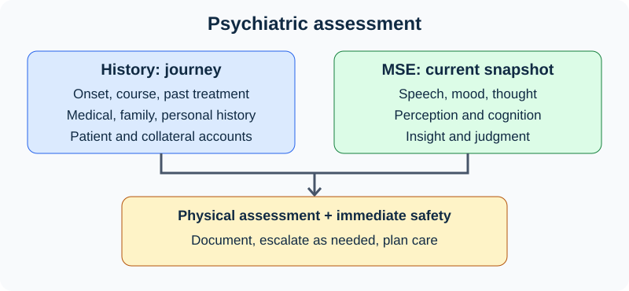

# 📚 Psychiatric History Taking — Group 02A

**Study-ready, unattempted.** Ye Mental Health Nursing ka assessment wala topic hai. Ismein hum patient ki purani aur present history ko samjhenge. Agle separate packages mein psychosocial assessment, cognitive screening aur investigations detail mein padhenge.

[🏠 Chapter](../README.md) · [📝 30 MCQs](../MCQs/02A-Psychiatric-History-Taking-30-MCQs.md) · [📜 Reported exam practice](../Previous-Year-Questions/02A-History-Assessment-Reported-Evidence.md) · [🔎 References](../References.md)

## Is guide mein kya padhenge?

- [History ka purpose](#1-history-ka-purpose)
- [Interview aur safety](#2-interview-aur-safety)
- [Current illness ki timeline](#3-current-illness-ki-timeline)
- [Past psychiatric aur medical history](#4-past-psychiatric-aur-medical-history)
- [Family aur personal history](#5-family-aur-personal-history)
- [Documentation aur case example](#6-documentation-aur-case-example)

## 1. History ka purpose

🔴 MOST IMPORTANT

Dekho, jab patient mental health clinic mein aata hai, toh nurse ko sirf ye nahi dekhna hota ki patient aaj kaisa behave kar raha hai. Nurse ko ye bhi samajhna hota hai ki patient pehle kaisa tha, problem kab shuru hui aur uski daily life par kya effect hua. Isi information ko systematic tareeke se collect karne ko history taking kehte hain.

History ek movie ki tarah patient ki journey dikhati hai. Mental Status Examination, yaani MSE, patient ki present mental condition ka ek snapshot hai. Dono ko saath padhne se team ko changes samajhne mein madad milti hai. Kisi ek observation se final diagnosis nahi banaya jaata.

Is diagram mein left side purani aur recent history hai. Right side current examination hai. Nurse dono ko physical assessment aur safety information ke saath combine karti hai.

## 2. Interview aur safety

🔴 MOST IMPORTANT

Nurse apna introduction deti hai aur patient ko batati hai ki interview kyun kiya ja raha hai. Patient ko comfortable aur private jagah milni chahiye, lekin setting patient aur staff ke liye safe bhi honi chahiye. Nurse confidentiality ki limits simple language mein explain karti hai. Jab serious safety concern ho, toh relevant team ko information deni pad sakti hai.

Nurse pehle ek open-ended question poochh sakti hai. Iska matlab aisa question hai jisme patient apne words mein jawab de sake. Example ke liye, nurse poochh sakti hai ki problem shuru hone ke baad patient ke routine mein kya change aaya. Phir specific questions se date, duration aur symptoms clarify kiye ja sakte hain.

Agar patient confused hai ya information incomplete hai, toh old clinical records aur caregiver ki report useful ho sakti hai. Isko collateral history kehte hain. Nurse patient ki permission aur applicable policy follow karti hai. Agar dono sources alag baat batate hain, toh nurse dono ko separately note karti hai.

Agar breathing, circulation, consciousness ya immediate safety concern ho, toh long routine interview ke liye emergency care delay nahi karni chahiye. Nurse current findings ke according assessment aur escalation karti hai.

## 3. Current illness ki timeline

🔴 MOST IMPORTANT

Chief complaint patient ki main problem hai. Nurse patient ke own words aur duration record karti hai. Example ke liye patient bolta hai ki do mahine se neend nahi aa rahi. Nurse bina assessment ke insomnia ka cause decide nahi karti.

History of present illness, yaani HPI, main problem ki poori journey hai. Nurse poochhti hai ki symptoms kab shuru hue, pehla change kya tha, baad mein kya changes aaye aur kya treatment liya gaya.

| Term | Easy explanation |
|---|---|
| Onset | Isse pata chalta hai ki problem pehli baar kab shuru hui aur shuruaat achanak hui ya dheere-dheere. |
| Duration | Isse pata chalta hai ki ek symptom ya episode kitni der se chal raha hai. |
| Course | Isse pata chalta hai ki symptom lagatar raha, episodes mein aaya ya time ke saath badalta raha. |
| Precipitating factor | Ye wo event ho sakta hai jiske aas-paas problem shuru hui. Sirf timing se cause prove nahi hota. |
| Aggravating factor | Ye wo condition hai jisme symptom badhne ki report milti hai. |
| Relieving factor | Ye wo condition ya action hai jisse patient ko symptom kam hone ka experience hota hai. |

Nurse sleep, appetite, energy aur daily functioning mein changes bhi assess karti hai. Appetite patient ki bhookh hai. Food intake actual khane ki quantity hai. Dono ko alag poochhna useful ho sakta hai.

**Exam clue:** Onset mein kab shuru hua poochhte hain aur course mein time ke saath pattern dekhte hain.

## 4. Past psychiatric aur medical history

🔴 MOST IMPORTANT

Past psychiatric history mein nurse earlier symptoms, hospital admissions, therapies, medicine response aur unwanted effects ke baare mein poochhti hai. Agar medicine lene mein difficulty thi, toh nurse reason samajhne ki koshish karti hai. Example ke liye kisi medicine se daytime sleepiness hui aur patient ko work karna difficult laga. Is information se team patient ke saath suitable treatment options discuss kar sakti hai.

Medical history bhi important hai. Physical illness aur kuch medicines mental symptoms ko affect kar sakti hain. Isliye existing medical conditions, allergies, neurological illness, recent treatment changes aur relevant investigations ki information team tak pahunchni chahiye. Psychiatric history hone ka matlab ye nahi ki har naya symptom psychiatric illness se hi aaya hai.

Medication history mein prescribed medicines ke saath over-the-counter aur herbal products bhi include karo. Agar medicine ka naam patient ko yaad nahi hai, toh guess mat karo. Available prescription ya discharge summary check karne ki koshish karo.

Substance history bina blame ke li jaati hai. Nurse substance ka type, approximate quantity, frequency, last use aur previous withdrawal experience poochhti hai. Withdrawal ka matlab body ko accustomed substance kam ya band hone ke baad symptoms develop ho sakte hain. Severe symptoms mein urgent clinical assessment chahiye.

## 5. Family aur personal history

🟠 HIGH YIELD

Family history mein relatives ki relevant medical aur mental health conditions poochhi ja sakti hain. Isse kuch risks samajh aate hain, lekin family history se patient ka diagnosis prove nahi hota.

Personal history mein childhood, education, work, relationships, routines aur stressful experiences samajh sakte hain. Sensitive history patient ki permission aur comfort ke hisaab se lo. Patient agar kisi question ka answer nahi dena chahta, toh nurse force nahi karti. Not disclosed ka matlab negative history nahi hota.

Premorbid personality aur functioning ka matlab hai illness shuru hone ke pehle patient ke usual behaviour, relationships, interests aur daily activities ka pattern. Isko aaj ki condition se compare karke nurse samajh sakti hai ki kitni help ki need hai. Patient ki identity ya culture ko illness ka label nahi bana dena chahiye.

Example ke liye patient pehle apne meals aur appointments manage karta tha, lekin ab inmein help chahiye. Is change se care planning mein support ki need samajh aati hai. Cause establish karne ke liye additional assessment chahiye.

## 6. Documentation aur case example

🔴 MOST IMPORTANT

Patient ke words, caregiver ki report, old records aur nurse ki own observations ko clearly identify karo. Agar exact date available nahi hai, toh approximate ya unknown likho. Patient ko stigmatizing label mat do.

**Example:** Patient batata hai ki teen hafte se sleep kam hai. Family batati hai ki work attendance pichhle hafte se change hui. Nurse dono reports source ke saath document karti hai aur current physical aur mental assessment karti hai. Phir relevant findings ko clinical team tak pahunchati hai. Is history se diagnosis automatically confirm nahi hota.

Interview khatam karte waqt nurse main points patient ko summarize karke confirm kar sakti hai. Agar patient koi correction karta hai, toh local documentation policy ke according update karo. Community setting mein medicine access, transport aur follow-up support ki need bhi poochho.

## ▶️ YouTube teaching aur practice

| Topic | Teaching candidate | Dedicated MCQ practice |
|---|---|---|
| History taking | [Psychiatric History Taking in Hindi](https://www.youtube.com/watch?v=MPaFWSR70lY) | Verification pending for Q1–30. |
| History format | [History Taking in Mental Health Nursing](https://www.youtube.com/watch?v=DsDpHbc9Lt0) | Verification pending for Q1–30. |

Dono videos ke indexed titles aur topic metadata mile. Direct page retrieval fail hua. Channel, exact duration, playback aur individual question coverage verify nahi hui. [NPrep general psychiatry question practice](https://www.youtube.com/watch?v=KOUHyWiL0eY) ka description mixed psychiatry topics list karta hai. History-taking question coverage establish nahi hui, isliye isko dedicated video nahi gina gaya.

## 📌 Exam revision

History purani aur current journey ko samjhati hai. MSE present mental condition assess karta hai. Collateral source ko separately identify karo. Patient ke words aur observation ko mix mat karo. Physical causes aur immediate safety ko ignore mat karo.

Clinical references checked 28 November 2026: [Merck Manual, initial psychiatric assessment](https://www.merckmanuals.com/professional/psychiatric-disorders/approach-to-the-patient-with-psychiatric-symptoms/initial-psychiatric-assessment) · [OpenStax, nursing assessment and clinical tools](https://openstax.org/books/psychiatric-mental-health/pages/3-3-nursing-assessment-and-clinical-tools).

[🏠 Chapter](../README.md) · [📝 30 MCQs](../MCQs/02A-Psychiatric-History-Taking-30-MCQs.md) · [📜 Reported exam practice](../Previous-Year-Questions/02A-History-Assessment-Reported-Evidence.md) · [🔎 References](../References.md)
