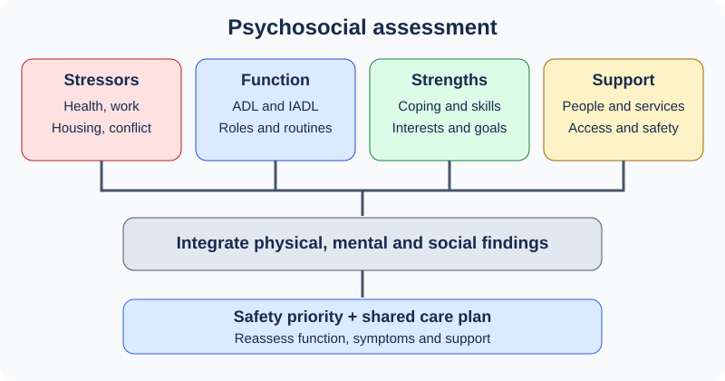

# 📚 Psychosocial Assessment — Group 02B

**Study-ready, unattempted.** Is topic mein hum patient ki feelings, daily activities, relationships, environment aur coping ko samajhenge. Ye nursing assessment hai, kisi ek finding se psychiatric diagnosis confirm nahi hota.

[🏠 Chapter](../README.md) · [📝 30 MCQs](../MCQs/02B-Psychosocial-Assessment-30-MCQs.md) · [📜 Reported exam practice](../Previous-Year-Questions/02B-Psychosocial-Assessment-Reported-Evidence.md) · [🔎 References](../References.md)

## 1. Psychosocial assessment kya hai?

🔴 MOST IMPORTANT

Dekho, patient ko samajhne ke liye uski symptoms ki list banana kaafi nahi hai. Humein ye bhi dekhna hai ki un symptoms ki wajah se patient ki daily life mein kya change aaya, patient problem ko kaise manage karta hai aur uske paas kaun si help available hai.

Psychosocial mein psycho ka relation thoughts, feelings aur behaviour se hai. Social ka relation family, work, friends, community aur living environment se hai. Dono ko combine karke nurse patient ki needs aur strengths samajhti hai. Physical health ki information bhi saath mein zaruri hai.

Is diagram ko ek map samjho. Nurse sirf problem nahi dekhti. Nurse patient ke resources bhi identify karti hai, phir patient ke saath practical care plan banati hai. Agar immediate danger ho, toh urgent assessment aur safety action ko priority milti hai.

## 2. Biopsychosocial approach

🟠 HIGH YIELD

Biological factors mein physical illnesses, sleep, pain, nutrition, substances aur medicines jaise factors aate hain. Psychological factors mein thoughts, emotions, coping aur personal experiences aate hain. Social factors mein family, work, education, financial resources, stigma aur living conditions aate hain.

Example ke liye patient ko job loss ke baad fatigue aur low mood hua. Nurse job loss ko ek social stressor ke roop mein record karti hai. Lekin nurse fatigue ke medical reasons, sleep aur medicine effects ko bhi assess karti hai. Job loss alone diagnosis ya cause confirm nahi karta.

## 3. Stressors, coping aur strengths

🔴 MOST IMPORTANT

Stressor wo demand ya situation hai jo patient ke liye pressure create karti hai. Exam, financial difficulty, relationship conflict aur illness stressors ho sakte hain. Ek hi event ka effect har person par same nahi hota.

Coping ka matlab hai patient stress aur difficult emotions ko handle karne ke liye kya karta hai. Nurse poochh sakti hai ki pichhli baar aisi problem aayi thi toh kya helpful raha. Patient ki existing useful skills ko care plan mein include karna important hai.

| Coping pattern | Simple explanation |
|---|---|
| Problem-focused coping | Patient problem ke practical solution par action leta hai. Jaise transport arrange karke follow-up ki difficulty kam karna. |
| Emotion-focused coping | Patient emotional distress ko regulate karne ki koshish karta hai. Jaise difficult conversation se pehle safe relaxation practice karna. |
| Less helpful coping | Jab koi response short-term relief deta hai lekin long-term health, safety ya functioning ko harm karta hai, toh nurse us effect ko explore karti hai. |

Emotion-focused coping ko automatically unhealthy mat samjho. Kuch problems immediately solve nahi ho sakti hain. Aise mein healthy emotional support useful ho sakta hai. Problem-focused aur emotion-focused methods ek hi situation mein saath use ho sakte hain.

Strengths assessment mein nurse patient ki abilities, interests, motivation, existing relationships aur previous successful strategies identify karti hai. Protective factor risk ko kam karne mein help kar sakta hai, lekin risk ko completely eliminate nahi karta.

## 4. Social support aur environment

🔴 MOST IMPORTANT

Social support ka matlab zarurat ke waqt practical ya emotional help milna hai. Patient ke paas bahut relatives ho sakte hain, lekin ho sakta hai ki unmein se koi bhi difficult time mein available na ho. Isi tarah akele rehne wala patient regularly friends aur neighbours ki help le sakta hai.

Nurse patient se poochhti hai ki kis person par bharosa hai, kis type ki help milti hai aur kya help zarurat ke waqt available hoti hai. Support person ke saath information share karne ke liye patient ki preference, consent aur applicable confidentiality rules follow karne hote hain.

Living environment mein housing, food, transport, safety, noise, privacy, work aur medicine access bhi assess karo. Patient ko follow-up ka time samajh aata ho sakta hai, lekin travel ya refill ka arrangement difficult ho sakta hai. Isliye knowledge aur actual access ko alag assess karna chahiye.

Stigma ka matlab hai kisi identity ya health condition ki wajah se negative attitude aur social rejection face karna. Nurse patient ko blame nahi karti. Nurse actual experience aur uska health, relationships aur treatment access par effect samajhti hai.

## 5. Functional assessment, ADL aur IADL

🔴 MOST IMPORTANT

Functional assessment se humein pata chalta hai ki patient apne daily tasks kitne independently aur safely kar pa raha hai. Pehle usual baseline samjho, phir current ability compare karo.

| Basic ADL | Instrumental ADL |
|---|---|
| Bathing, dressing, toileting, eating aur transferring jaise basic self-care tasks. | Cooking, shopping, transport, medicine management aur finances jaise independent community-living tasks. |

ADL ka full form Activities of Daily Living hai. IADL ka full form Instrumental Activities of Daily Living hai. Basic ADL normal hone ke bawajood IADL mein help ki need ho sakti hai.

Example ke liye patient khud naha aur kapde pehen sakta hai lekin bills manage karna difficult hai. Nurse dono findings ko separately note karti hai. Isse appropriate support plan ban sakta hai. Sirf is difficulty se dementia ya koi aur psychiatric diagnosis confirm nahi hota.

Nurse patient ko unnecessary dependent nahi banati. Jitna safe aur practical ho, utni independent activity encourage karti hai.

## 6. Self-concept, roles aur meaningful activity

🟠 HIGH YIELD

Self-concept ka matlab patient apne aap ko kaise samajhta hai. Self-esteem ka relation apni value aur ability ke baare mein feelings se hai. Body image ka relation apne body aur appearance ke experience se hai. Role function mein family, work aur community responsibilities aati hain.

Job change, illness ya body appearance mein change se in areas par effect ho sakta hai. Nurse patient se us change ka personal meaning poochhti hai. Har patient ko same effect hoga, aisa assume nahi karna chahiye.

Leisure aur meaningful activities bhi assessment ka part hain. Ye sirf formal hobbies nahi hain. Kisi neighbour se conversation, music, gardening ya patient ki pasand ka safe activity bhi important strength ho sakta hai. Spiritual ya cultural supports patient ki choice ke according explore karo. Unwanted practice impose mat karo.

## 7. Caregiver needs, autonomy aur safeguarding

🔴 MOST IMPORTANT

Caregiver burden ka matlab care dene wale person par physical, emotional ya practical pressure hai. Nurse caregiver ki willingness ke saath actual capacity, rest aur support needs bhi samajhti hai. Patient ki own preference ko planning mein include karna zaruri hai.

Family involvement ko automatically safe mat samjho. Agar patient threat, abuse ya controlling behaviour report kare, toh safe private setting mein appropriate safeguarding assessment karo. Local clinical policy aur legal duties follow karo. Patient ko blame ya relative ko bina risk assessment confront karna unsafe ho sakta hai.

Health literacy ka matlab health information ko samajhkar practical decisions mein use karne ki ability hai. Reading difficulty ya unfamiliar language ko lack of motivation ya decision-making incapacity mat samjho. Nurse accessible explanation, interpreter where appropriate aur teach-back use kar sakti hai. Teach-back mein patient apne words mein information explain karta hai taaki nurse samajh sake ki explanation clear thi ya nahi.

## 8. Community nursing case aur priorities

🔴 MOST IMPORTANT

Maan lo ek patient community clinic mein low mood aur poor concentration report karta hai. Patient ki job recently chali gayi hai aur ghar mein food ki shortage hai. Uski sister willing hai help karne ke liye, lekin woh din bhar kaam par hoti hai.

Nurse current physical aur mental symptoms assess karti hai aur immediate safety concerns check karti hai. Phir food access, sleep, available support aur daily functioning samajhti hai. Patient ki permission ke saath suitable community resources identify kiye ja sakte hain. Sirf sister ka phone number hona poore support plan ke liye kaafi nahi hai.

Care plan mein patient ke saath achievable goals choose karo. Reassessment mein symptoms, function aur support ko separately compare karo. Agar social contact improve hua hai lekin distress aur functioning abhi affected hain, toh care plan ko further review karna hai.

## ▶️ YouTube teaching aur MCQ practice

| Study area | Concept resource | Dedicated MCQ resource |
|---|---|---|
| Psychosocial and mental health assessment | [Mental Health Assessment One shot](https://www.youtube.com/watch?v=JOamLKIkHjs) | Q1–30 ki dedicated mapping pending hai. |
| Stress, coping and assessment | [Assessment tools in mental health nursing](https://www.youtube.com/watch?v=W3FqeDLhmww) | [Akki Sir mixed nursing MCQ candidate](https://www.youtube.com/watch?v=SB9FPVpKzLA) has indexed stress/coping context. Specific question and playback verification pending. |

Indexed descriptions se general topic relevance mili. Pehle video aur mixed question video ka direct playback verify nahi hua. Inko verified exact question video mat samjho. Har question ki specific mapping ko pending rakha gaya hai.

## 📌 Exam revision

Social support ko contact count se confuse mat karo. Coping ke short-term aur long-term effects dekho. Basic ADL aur IADL alag assess karo. Self-esteem, body image aur role function ko patient ke words se samjho. Immediate safety ko priority do aur care plan patient ke saath banao.

**Clinical references:** [OpenStax nursing assessment and clinical tools](https://openstax.org/books/psychiatric-mental-health/pages/3-3-nursing-assessment-and-clinical-tools) · [Risk and protective factors](https://openstax.org/books/psychiatric-mental-health/pages/1-2-risk-and-protective-factors-of-mental-health) · [OpenStax nursing process](https://openstax.org/books/psychiatric-mental-health/pages/28-1-nursing-process). Clinical context and assessment principles were checked against accessible OpenStax text on 28 November 2026. India-specific law and detailed crisis-management packages remain separate.

[🏠 Chapter](../README.md) · [📝 30 MCQs](../MCQs/02B-Psychosocial-Assessment-30-MCQs.md) · [📜 Reported exam practice](../Previous-Year-Questions/02B-Psychosocial-Assessment-Reported-Evidence.md) · [🔎 References](../References.md)
