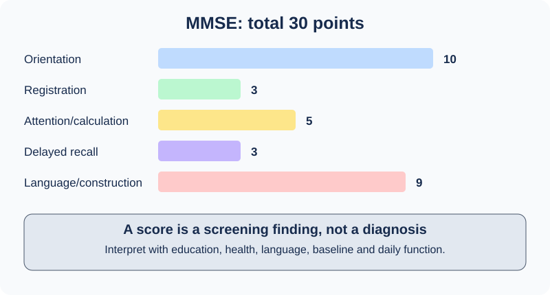

# 📚 Cognitive Screening and MMSE — Group 02C

**Study-ready, unattempted.** Ye nursing exam ke liye cognitive assessment ki theory hai. Actual protected test questions ya complete test forms yahan reproduce nahi kiye gaye hain. Clinical use mein authorized version, training aur scoring instructions follow karo.

[🏠 Chapter](../README.md) · [📝 30 original MCQs](../MCQs/02C-Cognitive-Screening-MMSE-30-MCQs.md) · [📜 Reported exam practice](../Previous-Year-Questions/02C-MMSE-Reported-Evidence.md) · [🔎 References](../References.md)

## 1. Cognition aur screening kya hai?

🔴 MOST IMPORTANT

Dekho, cognition ka matlab brain ki information receive karne, samajhne, yaad rakhne, attention dene aur daily decisions mein use karne ki ability hai. Jab patient ko ye tasks karne mein difficulty ho, toh nurse ko current ability, earlier functioning aur possible reasons assess karne hote hain.

Screening ek initial check hai. Jaise school mein short assessment se pata lag sakta hai ki kis student ko further help chahiye, waise hi cognitive screen se clinical team ko pata chal sakta hai ki patient ko detailed evaluation ki zarurat hai. Lekin brief screen final diagnosis nahi deti.

MSE aur MMSE ko confuse mat karo. Mental Status Examination mein appearance, behaviour, mood, thought, perception, cognition, insight aur judgment jaise multiple mental status domains assess hote hain. Mini-Mental State Examination ek structured cognitive screen hai jisme particular tasks ko score kiya jaata hai.

## 2. MMSE domains aur scoring

🔴 MOST IMPORTANT

MMSE ka full form Mini-Mental State Examination hai. Standard total 30 points ka hota hai. Ye multiple cognitive abilities sample karta hai. Ye intelligence test nahi hai.

| Conventional domain grouping | Maximum points | Easy explanation |
|---|---:|---|
| Orientation | 10 | Nurse current time aur place ki awareness se related standardized tasks assess karti hai. |
| Registration | 3 | Patient nayi information ko initial task mein acquire kar pata hai ya nahi, ye assess hota hai. |
| Attention and calculation | 5 | Patient mental task par focus maintain aur process kar pata hai ya nahi, ye assess hota hai. |
| Delayed recall | 3 | Short interval ke baad previously presented information retrieve karne ki performance assess hoti hai. |
| Language and construction | 9 | Language, comprehension aur visual construction se related tasks is conventional combined grouping mein aate hain. |
| **Total** | **30** | Earned points ko approved scoring instructions ke according add karte hain. |

**Worked example:** Ek hypothetical completed screen mein orientation 9, registration 3, attention 3, delayed recall 1 aur combined language/construction 8 points mile. Total 9 + 3 + 3 + 1 + 8 = 24/30 hai. Ye sirf scoring arithmetic ka example hai, actual test form nahi hai.

Registration aur delayed recall ko separate rakho. Agar patient initial information correctly acquire karta hai lekin delay ke baad recall mein difficulty hoti hai, toh nurse dono findings record karti hai. Sirf is pattern se cause ya dementia subtype confirm nahi hota.

## 3. Score interpretation aur limitations

🔴 MOST IMPORTANT

Exam books mein conventional cutoff ke roop mein 24 se kam score ko possible cognitive impairment ke clue ki tarah use kiya jaata hai. Actual clinical interpretation mein cutoff population, language, education, instrument version aur purpose ke according differ kar sakta hai. Score se universal mild, moderate ya severe dementia category automatically decide nahi hoti.

Low score ke possible reasons mein limited schooling, language difficulty, sensory problem, acute illness, sleep loss, medicine effects aur other cognitive conditions aa sakti hain. Nurse in factors ko record karti hai aur clinical team ke saath appropriate further assessment arrange karti hai.

High score se bhi har cognitive problem exclude nahi hoti. Patient ki earlier ability high ho sakti hai aur subtle decline brief screening mein miss ho sakta hai. Agar patient ya reliable informant progressive everyday difficulty report kare, toh further evaluation ki zarurat ho sakti hai.

Cognitive score ko patient ki decision-making capacity ka automatic substitute mat samjho. Capacity specific decision aur applicable clinical/legal framework ke according assess hoti hai. Patient ko samajhne aur communicate karne ke liye suitable support do.

## 4. Dusre important screening tools

🟠 HIGH YIELD

| Tool | Use aur score |
|---|---|
| MoCA | Montreal Cognitive Assessment executive aur visuospatial functions ko relatively more extensively sample karta hai. Standard version ka maximum 30 hai. Education adjustment aur use requirements specific approved version ke according follow karo. |
| Mini-Cog | Brief screen mein delayed word recall aur clock drawing combine hote hain. Standard scoring mein recall 0–3 aur clock 0 ya 2 hota hai. Total 0–5 hota hai. |
| 4AT | Acute setting mein possible delirium aur cognitive impairment detect karne mein useful tool hai. Alertness, brief cognitive tasks aur acute change/fluctuation assess hote hain. Total 0–12 hai. |
| Informant-based tools | Reliable caregiver ya informant se everyday functioning mein previous change ki structured information mil sakti hai. Ye clinical evaluation ka supplement hai. |

Mini-Cog mein 0–2 score clinically important cognitive impairment ki higher likelihood suggest karta hai. 3–5 lower likelihood suggest karta hai, lekin impairment ko completely exclude nahi karta. Actual scoring aur use ke liye [official Mini-Cog guidance](https://mini-cog.com/scoring-the-mini-cog/) follow karo.

4AT mein 4 ya usse zyada score possible delirium suggest karta hai. Score 1–3 possible cognitive impairment suggest karta hai. Zero result se delirium ya cognitive impairment completely exclude nahi hoti. [Official 4AT user guide](https://www.the4at.com/userguide) mein approved instructions aur limitations di gayi hain.

MMSE aur MoCA dono 30 points ke hain, lekin raw scores directly interchangeable nahi hote. Tasks aur validated cutoffs different ho sakte hain.

## 5. Delirium concern aur nursing priorities

🔴 MOST IMPORTANT

Delirium mein attention, alertness aur mental functioning mein acute change aa sakta hai. Symptoms din ke andar fluctuate kar sakte hain. Earlier dementia ya cognitive difficulty hone se new delirium rule out nahi hota.

Agar patient ki consciousness suddenly kam ho ya medical instability develop ho, toh routine screen finish karne ke liye urgent assessment delay mat karo. Clinical situation ke according airway, breathing, circulation aur neurological status assess karo aur urgently escalate karo. Stable patient mein suitable delirium assessment tool use karke possible causes ki evaluation arrange ki ja sakti hai.

## 6. Standardized assessment aur documentation

🟠 HIGH YIELD

Standardized ka matlab assessment same approved instructions aur scoring method ke according hota hai. Nurse patient ko purpose explain karti hai aur suitable environment arrange karti hai. Patient ko unnecessary pressure mat do aur answer coaching mat karo.

Agar language, motor ya visual limitation task ko affect karti hai, toh nurse actual limitation document karti hai. Uncompleted items ko arbitrary full points ya zero points mat do. Instrument ki authorized procedure aur suitable alternatives follow karo.

Record mein instrument aur version, date, obtained score, testing conditions aur relevant limitations include karo. Follow-up mein comparable tool aur clinical functioning ke changes ko saath interpret karo.

## 7. Sensitivity aur reliability basics

🟡 IMPORTANT

Sensitivity ka matlab actual affected people mein kitne correctly screen-positive milte hain. Formula true positives divided by all actual affected people, multiplied by 100 hai. Agar 80 affected people mein 72 positive hain, toh sensitivity 72/80 × 100 = 90% hai. Specificity unaffected people mein kitne correctly negative milte hain, ye batati hai.

Reliability result ki consistency se related hai. Koi tool consistent ho sakta hai lekin har patient mein perfect diagnosis na de. Screening ki accuracy aur cutoff ko study population ke context mein samjho.

## 8. Community aur clinical example

🔴 MOST IMPORTANT

Maan lo ek older adult clinic mein memory concern lekar aata hai. Brief cognitive screen ka score high hai lekin patient medicines organize karne mein naye errors report karta hai. Nurse actual medication management ki difficulty assess karti hai aur safe support aur clinical follow-up arrange karti hai. High score se problem ko dismiss nahi karti.

Positive screen ke baad bhi diagnosis decide karne se pehle clinical history, medical contributors, physical examination aur daily functioning evaluate ki jaati hai. Acute concern aur routine referral ki priorities alag hoti hain.

## ▶️ YouTube resources

| Topic | Teaching candidate | MCQ practice candidate |
|---|---|---|
| MMSE concept and components | [Mini-Mental Status Examination in Hindi](https://www.youtube.com/watch?v=96guD-IOrMM) | [Psychiatric Nursing Hard MCQs](https://www.youtube.com/watch?v=rKTtExgOdMk) indexed description mentions MMSE questions. |
| Scores and scales | [MMSE psychiatric term in Hindi](https://www.youtube.com/watch?v=iAJrYgXYkdw) | [All medical scores and scales](https://www.youtube.com/watch?v=U1Xef6qqO4A) indexed metadata mentions MMSE MCQs. |

Indexed descriptions identify topic relevance. Direct YouTube opens failed or were throttled. Exact question-level coverage, creator details, playback and timestamps remain pending. Mini-Cog, MoCA and 4AT dedicated practice-video verification is also pending. These links are study leads, not official examination evidence.

**References checked 28 November 2026:** [Healthdirect MMSE](https://www.healthdirect.gov.au/procedures/diagnostic-tests-and-scans/mini-mental-state-examination-mmse) · [Published review with MMSE score domains](https://pmc.ncbi.nlm.nih.gov/articles/PMC3782167/) · [CAMH cognitive screening](https://www.camh.ca/en/professionals/treating-conditions-and-disorders/dementia/dementia---screening-and-assessment) · [Mini-Cog scoring](https://mini-cog.com/scoring-the-mini-cog/) · [4AT user guide](https://www.the4at.com/userguide) · [USPSTF cognitive screening evidence](https://www.uspreventiveservicestaskforce.org/uspstf/recommendation/cognitive-impairment-in-older-adults-screening). NICE dementia, delirium and capacity guidance was indexed, but direct dementia/delirium pages returned 403. Clinical implementation must follow current local guidance and appropriate instrument licensing.

[🏠 Chapter](../README.md) · [📝 30 original MCQs](../MCQs/02C-Cognitive-Screening-MMSE-30-MCQs.md) · [📜 Reported exam practice](../Previous-Year-Questions/02C-MMSE-Reported-Evidence.md) · [🔎 References](../References.md)
