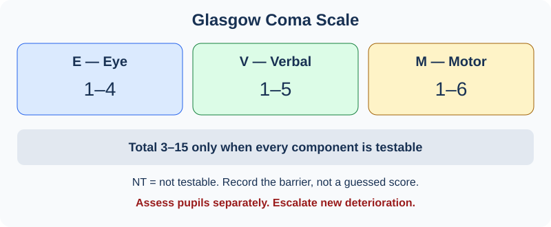

# 📚 Neurological Examination in Psychiatric Nursing — Group 02D

**Study-ready, unattempted.** Is topic mein hum mental health setting mein nervous system assessment, neurological warning signs aur nursing responsibilities samjhenge. Detailed neurological diagnosis clinician karta hai. EEG, imaging aur laboratory investigations alag packages mein aayenge.

[🏠 Chapter](../README.md) · [📝 30 original MCQs](../MCQs/02D-Neurological-Examination-30-MCQs.md) · [📜 Reported exam practice](../Previous-Year-Questions/02D-Neurological-Examination-Reported-Evidence.md) · [🔎 References](../References.md)

## 1. Neurological examination kyun karte hain?

🔴 MOST IMPORTANT

Dekho, brain aur nerves hamari movement, sensation, consciousness aur communication mein important role play karte hain. Jab inmein problem hoti hai, toh patient ka behaviour bhi change ho sakta hai. Isliye har behavioural change ko automatically psychiatric illness ka symptom nahi maan sakte.

Maan lo patient psychiatric ward mein admission ke time normally alert tha. Aaj woh unusually sleepy hai aur ek side ki movement weak lag rahi hai. Nurse ko ye naya neurological change samajhkar urgent medical assessment arrange karna hai. Routine counselling ke liye emergency assessment delay nahi karna hai.

Baseline ka matlab patient ki pehle se documented condition hai. Baseline aur current findings compare karne se improvement ya deterioration identify kar sakte hain.

## 2. Nursing assessment ka practical sequence

🔴 MOST IMPORTANT

1. Patient ko procedure explain karo aur appropriate consent, privacy aur safe environment ensure karo.
2. Patient ki immediate stability, breathing, circulation aur responsiveness assess karo. Agar emergency sign ho, toh help bulao aur local emergency protocol follow karo.
3. Relevant history, medications, recent changes, pain, glucose concern aur neurological baseline check karo.
4. Patient ki level of consciousness, pupils, speech, limb strength, sensation, coordination aur gait ko clinical need aur scope ke according assess karo.
5. Actual findings, side, time, testing limitations aur baseline se difference document karo. New concerning changes promptly escalate karo.

## 3. Glasgow Coma Scale (GCS)

🔴 MOST IMPORTANT

GCS patient ki responsiveness ko structured tareeke se describe karta hai. Standard adult assessment mein eye opening, verbal response aur best motor response ko separately observe karte hain.

| Component | Score range | Meaning |
|---|---:|---|
| Eye opening | 1–4 | Patient eyes spontaneously, sound ya pressure par kholta hai ya koi response nahi deta. |
| Verbal response | 1–5 | Patient ki conversation, words ya sounds ka response assess hota hai. |
| Motor response | 1–6 | Patient commands aur clinically appropriate stimulus par movement ka response deta hai. |

| Score | Eye | Verbal | Motor |
|---|---|---|---|
| 6 | — | — | Obeys commands |
| 5 | — | Oriented | Localises |
| 4 | Spontaneous | Confused | Normal flexion |
| 3 | To sound | Words | Abnormal flexion |
| 2 | To pressure | Sounds | Extension |
| 1 | None | None | None |

Agar teenon components testable hain, toh total 3 se 15 ke beech hota hai. Example ke liye E4 V3 M5 ka total 12 hai. Sirf total record karne se individual response ka difference hide ho sakta hai. Isliye E, V aur M separately document karo.

**Not testable (NT):** Agar intubation, local injury ya other barrier ki wajah se component test nahi ho sakta, toh barrier record karo. Structured GCS guidance ke according missing component ko 1 assign karke artificial numerical total mat banao. Sedation aur paralysis jaise factors ko bhi note karo. Trained staff approved assessment technique use karte hain.

GCS 15 hone ka matlab har neurological problem absent hona nahi hai. Lower score ya new decline urgent assessment ki need indicate kar sakta hai. Airway management ka decision overall clinical state aur qualified emergency team ke assessment par depend karta hai.

## 4. Cranial nerves aur pupil examination

🟠 HIGH YIELD

Cranial nerves head aur neck ke important sensory aur motor functions mein help karti hain. Basic nursing assessment mein selected functions examine kiye jaate hain. Comprehensive examination patient ki need aur clinician ke scope ke according hota hai.

| Nerve | Main exam-oriented function |
|---|---|
| I Olfactory | Smell |
| II Optic | Vision aur pupillary reflex ka sensory limb |
| III Oculomotor | Eye movements, eyelid elevation aur pupil constriction |
| IV Trochlear | Superior oblique muscle |
| V Trigeminal | Facial sensation aur chewing |
| VI Abducens | Lateral eye movement |
| VII Facial | Facial expressions aur anterior tongue ke kuch taste functions |
| VIII Vestibulocochlear | Hearing aur balance |
| IX Glossopharyngeal | Posterior tongue sensation/taste aur swallowing functions |
| X Vagus | Voice, swallowing aur visceral regulation |
| XI Accessory | Shoulder shrug aur head turning |
| XII Hypoglossal | Tongue movements |

Pupil assessment mein size, shape, symmetry aur light response note karte hain. PERRLA ka full form Pupils Equal, Round, Reactive to Light and Accommodation hai. Is abbreviation ko tabhi use karo jab actual required findings assess ki gayi hon.

Jab ek eye mein light di jaati hai, toh stimulated eye ki constriction direct response aur doosri eye ki constriction consensual response kehlati hai. Optic nerve incoming signal carry karti hai aur oculomotor pathway constriction mein involved hota hai. New unequal pupils ke saath headache ya reduced consciousness emergency concern ho sakta hai.

GCS aur pupil assessment separate hain. Standard GCS mein pupil response fourth component nahi hota.

## 5. Motor, sensory aur coordination examination

🔴 MOST IMPORTANT

Motor assessment mein movement, muscle tone, strength, symmetry aur involuntary movements observe karte hain. Strength ko conventional 0–5 grading se describe kiya ja sakta hai.

| Grade | Meaning |
|---:|---|
| 0 | Koi detectable contraction nahi hoti. |
| 1 | Contraction hoti hai lekin joint movement nahi hoti. |
| 2 | Gravity eliminate karne par movement possible hai. |
| 3 | Gravity ke against movement possible hai lekin extra resistance overcome nahi hoti. |
| 4 | Kuch resistance overcome hoti hai lekin strength expected normal se kam hai. |
| 5 | Expected normal strength present hai. |

Sensory assessment mein light touch aur clinically relevant sensation compare karte hain. Proprioception body position ka sense hai. Stereognosis familiar object ko touch se recognize karne ki ability hai, jab basic sensation intact ho.

Coordination mein movement ki accuracy observe hoti hai. Finger-to-nose task ek example hai. Romberg test mein visual input remove karne par balance change observe hota hai. Is test ko fall precautions ke saath trained examiner perform karta hai. Positive finding se isolated cerebellar disease prove nahi hoti.

Reflex involuntary response hota hai. Patellar reflex knee extension aur Achilles reflex plantar flexion se related hai. Adult mein new extensor plantar response further neurological assessment ka clue hai. Baseline, symmetry aur other findings ko saath interpret karo.

## 6. Psychiatric medicines aur motor findings

🔴 MOST IMPORTANT

Kuch dopamine-blocking medicines se stiffness, slow movement ya involuntary movements develop ho sakte hain. Nurse onset, pattern aur medication timing record karti hai. In symptoms se automatically idiopathic Parkinson disease diagnose nahi hota.

AIMS ka full form Abnormal Involuntary Movement Scale hai. Ye abnormal movements monitor karne mein help karta hai. Ye standalone diagnostic test nahi hai. Detailed antipsychotic adverse effects baad ke package mein padhenge.

Patient unsteady ho toh gait assessment ke time proper assistance aur fall precautions use karo. Agar swallowing par cough, wet voice ya choking concern ho, toh oral intake pause karke prompt assessment aur appropriate nutrition, hydration aur medicine plan ke liye team ko inform karo. Gag reflex alone safe swallow prove nahi karta.

## 7. Emergency clues

🔴 MOST IMPORTANT

New reduced consciousness, sudden weakness, facial asymmetry, new speech difficulty, seizure, severe sudden headache, unequal pupils with deterioration ya breathing change ko urgent clinical assessment ki need samjho. Patient ki psychiatric history physical emergency exclude nahi karti.

New confusion ke saath sweating aur missed meals mein hypoglycaemia possible hai. Local protocol ke according glucose aur vital signs check karo aur immediate care arrange karo. Routine psychiatric test ki wajah se medical assessment delay mat karo.

## ▶️ Teaching aur MCQ practice videos

| Topic | Teaching candidate | MCQ practice |
|---|---|---|
| General neurological examination | [Alka Pandey — Neurological Examination in Hindi](https://www.youtube.com/watch?v=0FF50qlSVIU) | Dedicated question coverage verification pending. |
| Cranial nerves | [Cranial nerve assessment for nurses](https://www.youtube.com/watch?v=9Fqvy1fwt5M) | [Verma's Tutor VT — KD Sir cranial nerves with MCQs](https://www.youtube.com/watch?v=QuQETVFbaq0), description-level topic candidate for Q1–6, Q8–10. |
| GCS | [Bhushan Science Nursing — GCS in Hindi](https://www.youtube.com/watch?v=BfJT_KiTrLg) | [NursesPro — head injury lecture and practice section](https://www.youtube.com/watch?v=3r1lcFXstUI), published description lists practice at 24:51. Specific GCS questions not confirmed. [Official GCS self-test](https://www.glasgowcomascale.org/self-test/) is non-video practice. |

Video metadata and descriptions were retrieved. Direct opens for KD Sir and Alka Pandey failed or were throttled. No exact question timestamp or playback is certified. Q7 and Q11–30 have explicit dedicated practice gaps.

**Clinical sources:** [OpenStax psychiatric assessment](https://openstax.org/books/psychiatric-mental-health/pages/3-3-nursing-assessment-and-clinical-tools) · [OpenStax neurological assessment](https://openstax.org/books/clinical-nursing-skills/pages/26-2-physical-assessment) · [GCS recording](https://www.glasgowcomascale.org/recording-gcs/) · [GCS FAQ](https://www.glasgowcomascale.org/faq/) · [Open RN neurological examination](https://www.ncbi.nlm.nih.gov/sites/books/NBK593206/) · [Canadian Stroke Best Practices swallowing](https://www.strokebestpractices.ca/recommendations/stroke-rehabilitation-delivery/6-swallowing-nutrition-and-oral-care).

[🏠 Chapter](../README.md) · [📝 30 original MCQs](../MCQs/02D-Neurological-Examination-30-MCQs.md) · [📜 Reported exam practice](../Previous-Year-Questions/02D-Neurological-Examination-Reported-Evidence.md) · [🔎 References](../References.md)
