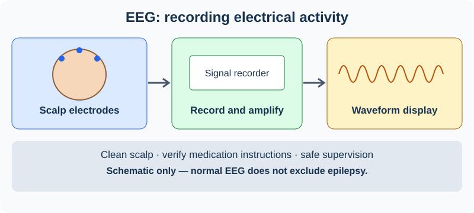

# 📚 Electroencephalogram (EEG) — Group 02E

**Study-ready, unattempted.** Is topic mein hum EEG ka basic principle, psychiatric indications, preparation, safety aur limitations samjhenge. Detailed seizure classification aur ECT baad ke relevant packages mein cover honge.

[🏠 Chapter](../README.md) · [📝 30 original MCQs](../MCQs/02E-Electroencephalogram-EEG-30-MCQs.md) · [📜 Reported exam practice](../Previous-Year-Questions/02E-EEG-Reported-Evidence.md) · [🔎 References](../References.md)

## 1. EEG kya hota hai?

🔴 MOST IMPORTANT

Dekho, brain ke nerve cells ek doosre ke saath electrical signals ke through communicate karte hain. EEG, yaani electroencephalogram, scalp par placed electrodes se brain ki electrical activity record karta hai. Computer in signals ko waveforms ke form mein display karta hai.

Routine scalp EEG mein electrodes signals receive karte hain. Ye electrical shock dene wala treatment nahi hai. Isko ECT se confuse mat karo. ECT ek medically supervised treatment hai jisme controlled electrical stimulus se therapeutic seizure induce ki jaati hai.

EEG brain ki electrical function ki information deta hai. CT aur MRI mainly structure ki images provide karte hain. Isliye clinical question ke according appropriate investigation choose ki jaati hai.

## 2. Psychiatric nursing mein EEG ki importance

🔴 MOST IMPORTANT

Har psychiatric patient ko EEG karana compulsory nahi hai. Agar history mein recurrent altered awareness, unusual episodes, suspected seizures, unexplained reduced consciousness ya encephalopathy ka concern ho, toh clinical team EEG consider kar sakti hai.

Maan lo patient repeatedly kuch seconds ke liye surroundings se disconnected ho jaata hai. Nurse event ka onset, duration, movement, response aur recovery document karti hai. History aur examination ke basis par clinician decide karta hai ki EEG useful hoga ya nahi.

Normal routine EEG se epilepsy completely exclude nahi hoti. Brief recording ke samay abnormal activity absent ho sakti hai. Isliye patient ki actual clinical history important rehti hai. Abnormal EEG finding bhi apne aap psychiatric diagnosis establish nahi karti.

## 3. EEG ke important types

🟠 HIGH YIELD

| Type | Easy understanding |
|---|---|
| Routine EEG | Short scheduled recording. Patient awake ya drowsy ho sakta hai. |
| Sleep EEG | Recording sleep ke dauran ki jaati hai. |
| Sleep-deprived EEG | Patient ko clinician ke specific instructions ke according sleep restrict karne ko kaha ja sakta hai. Isse selected abnormalities detect hone ki possibility improve ho sakti hai. |
| Ambulatory EEG | Portable recorder longer period ke liye electrical activity collect karta hai. |
| Video EEG | Video aur electrical recording synchronized hoti hain, taaki clinical event aur trace ka time relationship examine ho sake. |
| Continuous EEG | Selected hospitalized ya critically ill patients mein ongoing electrographic seizure activity detect karne ke liye use ho sakta hai. |

Routine aur sleep-related EEG inconclusive hon aur suspicion persist kare, toh specialist further assessment decide kar sakta hai. Exact duration service, indication aur protocol ke according vary karti hai.

## 4. Patient preparation aur nursing responsibilities

🔴 MOST IMPORTANT

### Before EEG

1. Patient ko test ka purpose, recording process aur possible activation procedures explain karo. Consent aur comfort address karo.
2. Clean hair aur scalp preparation ke liye service instructions follow karo. Hair oil, gel, spray aur conditioner contact quality affect kar sakte hain.
3. Prescribed medicines ka list verify karo. Antiseizure medicine apne aap band, double ya replace mat karo. Specific change responsible clinician decide karta hai.
4. Caffeine restriction aur sleep preparation service-specific instructions ke according verify karo. Preparation deviation conceal mat karo.
5. Routine unsedated EEG ke liye generally fasting ki need nahi hoti. Sedation, diabetes management ya concurrent procedures ke liye specific plan confirm karo.
6. Sleep-deprived procedure mein safe transport aur escort arrangements check karo.

### During EEG

Patient ko comfortable position mein rakho aur unnecessary movement reduce karne mein help karo. Jaw clenching, eye movement aur loose electrode contact recording mein artifact create kar sakte hain. Artifact aisa unwanted signal hota hai jo interpretation ko difficult bana sakta hai.

Selected recording mein deep breathing ya flashing light use ki ja sakti hai. Ye activation procedures trained EEG staff ke supervision mein hoti hain. Har patient ke liye suitable nahi hoti hain, isliye contraindications aur consent check karna zaruri hai.

Agar clinical seizure develop ho, provoking stimulus stop karke patient ko injury se protect karo. Airway aur breathing assess karo aur local emergency protocol follow karo. Forcefully limbs restrain mat karo aur impaired awareness mein oral fluids mat do.

### After EEG

Electrodes remove karne ke baad gentle scalp cleaning mein help karo. Routine unsedated EEG ke baad generally usual activities possible hoti hain, lekin service instructions follow karne hain. Sleep deprivation ya sedation ke baad additional transport aur recovery precautions zaruri ho sakti hain.

Recording specialist analyze karta hai. Nurse patient ko result follow-up aur clinical plan samjhane mein help karti hai.

## 5. Basic brain waves

🟠 HIGH YIELD

Frequency ka matlab ek second mein wave cycles ki number hai. Unit Hertz (Hz) hai. Textbooks mein frequency boundaries thodi differ kar sakti hain.

| Wave | Common approximate range | Typical exam association |
|---|---|---|
| Delta | 0.5–4 Hz | Deep non-REM slow-wave sleep |
| Theta | 4–7 Hz | Drowsiness aur selected sleep states |
| Alpha | 8–12 Hz | Relaxed awake adult with closed eyes |
| Beta | 13–30 Hz | Faster activity, often alert wakefulness |

Ye simplified revision table hai, complete clinical interpretation system nahi hai. Age, alertness, sleep stage, medicines aur recording location se patterns change hote hain. Alpha rhythm eyes open hone par less prominent ho sakta hai. Generalized slowing nonspecific finding ho sakti hai aur clinical correlation chahiye.

## 6. Event documentation aur safety

🔴 MOST IMPORTANT

Ambulatory recording mein patient ko event diary ya service-provided event marker ka use sikhaya ja sakta hai. Typical event ka approximate time aur symptoms record karne se specialist relevant trace review kar sakta hai.

Electrode detach ho ya skin irritation ho, approved service instructions follow karo. Household glue ya unapproved product use mat karo. Equipment ko moisture se protect karne ke liye service-specific guidance follow karo.

Continuous EEG urgent clinical care ka replacement nahi hai. Persistent reduced awareness after apparent convulsion mein ongoing electrical seizure activity possible ho sakti hai. Medical team urgent assessment continue rakhti hai aur continuous EEG consider kar sakti hai.

## 7. Exam revision

- EEG electrical function record karta hai, CT/MRI anatomical structure show karte hain.
- Routine scalp EEG diagnostic recording hai. ECT treatment hai.
- Normal routine EEG epilepsy ko rule out nahi karta.
- Medicines clinician ke instructions ke bina stop nahi karni hain.
- Relaxed awake closed eyes = alpha. Deep slow-wave sleep = delta.
- Recording artifact aur real abnormality ko specialist distinguish karta hai.
- EEG result history aur clinical assessment ke saath interpret hota hai.

## ▶️ YouTube teaching and practice

| Resource | Evidence level |
|---|---|
| [Girdhari Sir — Neuro Diagnostic Tests: CT, MRI, EEG and LP](https://www.youtube.com/watch?v=158b3Jlkdaw) | Indexed title and description identify nursing diagnostic teaching. Exact playback and EEG timestamp pending. |
| [Subodh Infinite Education — Mental Health Assessment](https://www.youtube.com/watch?v=JOamLKIkHjs) | Indexed description explicitly includes EEG and other investigations. Teaching candidate, not a verified MCQ video. |
| [Level Up RN — Nervous System Diagnostic Tests](https://www.youtube.com/watch?v=RSR2jD2K-xQ) | Published description lists EEG teaching at 2:13 and a mixed quiz at 6:53. EEG-specific quiz contents not verified. |
| [Nursing Path — EEG written practice](https://www.nursingpath.in/2018/12/mcq-electoencephalography-eeg.html) | Indexed written practice resource, not a YouTube question video or an authenticated exam paper. Some historical wording requires clinical cross-checking. |

All 30 original questions have dedicated question-level video verification pending. No exact question timestamp or playback certified.

## Clinical references

- [NHS — EEG](https://www.nhs.uk/tests-and-treatments/electroencephalogram/)
- [MedlinePlus — EEG](https://medlineplus.gov/ency/article/003931.htm)
- [NICE NG217 diagnosis and assessment](https://www.nice.org.uk/guidance/ng217/chapter/diagnosis-and-assessment-of-epilepsy) — recommendation against using EEG to exclude epilepsy retrieved in indexed result. Direct page returned 403.
- [Normal EEG Waveforms](https://www.ncbi.nlm.nih.gov/books/NBK539805/)
- [Canadian EEG standards](https://www.cambridge.org/core/journals/canadian-journal-of-neurological-sciences/article/update-on-minimal-standards-for-electroencephalography-in-canada-a-review-by-the-canadian-society-of-clinical-neurophysiologists/8924E913C3C6F9AF9021A6A889A432B9)
- [Neuropsychiatric assessment review](https://pmc.ncbi.nlm.nih.gov/articles/PMC9177704/)

[🏠 Chapter](../README.md) · [📝 30 original MCQs](../MCQs/02E-Electroencephalogram-EEG-30-MCQs.md) · [📜 Reported exam practice](../Previous-Year-Questions/02E-EEG-Reported-Evidence.md) · [🔎 References](../References.md)
