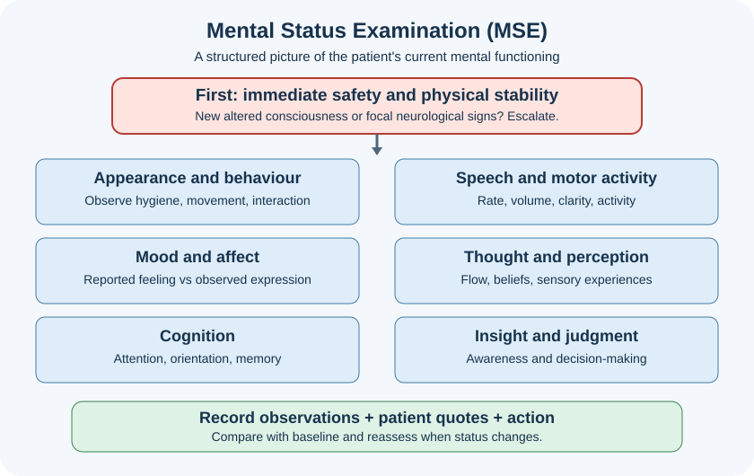

# 🧠 Mental Health and Psychiatric Nursing

**Study-ready in progress, not yet studied.** NORCET, HPRCA/HP Staff Nurse, India-wide Staff Nurse aur CHO/community exams ke liye. Abhi poora chapter complete nahi hua hai.

## 📚 Chapter navigation

| Section | Open |
|---|---|
| Curriculum and progress | [Complete working coverage map](Concepts/Mental-Health-Nursing-Topic-Coverage-Map.md) |
| Topic 01 — Mental Status Examination | [Detailed Hinglish concepts](Concepts/01-Mental-Status-Examination.md) · [30 original MCQs](MCQs/01-Mental-Status-Examination-30-MCQs.md) · [3 reported exam adaptations](Previous-Year-Questions/01-MSE-Reported-Exam-Practice.md) |
| Earlier practice preserved | [4 starter MCQs](MCQs/Mental-Health-Nursing-Topic-Wise-Starter-MCQs.md) |
| Previous Year Questions | [Research register](Previous-Year-Questions/Mental-Health-Nursing-Past-Paper-Research-Register.md) · [1 earlier reported adaptation](Previous-Year-Questions/Mental-Health-Nursing-Source-Linked-Reported-PYQs.md) · [2 earlier India-wide adaptations](Previous-Year-Questions/Mental-Health-Nursing-India-Wide-Additional-Reported-PYQs.md) |
| Mock Tests | [Ten 120-question original-only mock plan](Mock-Tests/Mental-Health-Nursing-Mock-Test-Plan.md) |
| Clinical sources and videos | [References and video verification register](References.md) |

## 📝 Verified local inventory

| Material | Count |
|---|---:|
| Original starter questions preserved | 4 |
| Newly authored MSE questions | 30 |
| Total original questions indexed | 34 |
| Source-linked reported adaptations preserved and added | 6 |
| Authenticated official exact questions newly verified | 0 |
| New chapter mock-exclusive questions | 0 / 1,200 |
| Original MSE diagrams | 2 |

30 naye MCQs mein 2 Easy, 22 Medium aur 6 Difficult questions hain. Har question mein 4 English options aur hidden Hinglish answer hai. Ye original practice hai, official exam questions nahi. Reported exam adaptations separately rakhe gaye hain.

## 🎯 Kaise padhna hai?

Pehle detailed Concepts padho, diagram se comparison samjho aur phir topic-wise questions solve karo. Answer select karne ke baad hidden explanation kholo. Correct answer ke saath teen incorrect options ka reason bhi padho. Video links ka exact item coverage abhi verified nahi hai, isliye unko evidence proof mat samjho.

🔴 MOST IMPORTANT · 🟠 HIGH YIELD · 🟡 IMPORTANT · 🟢 FOUNDATION. Difficulty alag se Easy, Medium aur Difficult mein di gayi hai. Priority editorial hai, official exam weightage nahi.

**Next topic:** Mental health history, psychosocial assessment, cognitive screening, investigations and related nursing responsibilities. Full chapter, independent clinical and semantic audit, historical official-key matching, video playback and rendered UI validation remain pending.

[Full syllabus index](../NORCET-Full-Chapter-Index.md) · [Repository home](../../README.md)
