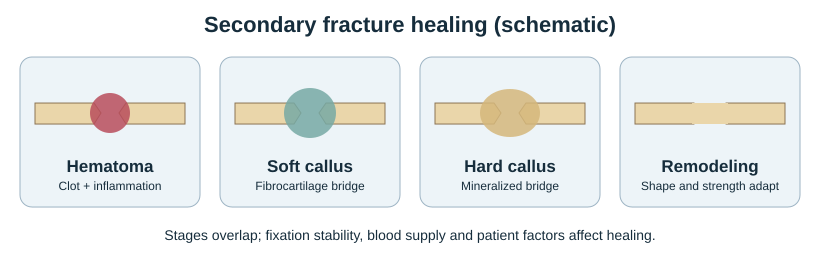

# Fracture healing, casts and traction — concept guide

**Draft candidate. Not studied.** Roman Hinglish concept notes, original schematic, clinical sources and video leads. Independent clinical and curriculum review pending.

[Chapter](../README.md) · [Fracture practice (20)](../MCQs/01A-Fracture-Patterns-Bone-Healing-20-MCQs.md) · [Cast and traction practice (20)](../MCQs/01B-Cast-Traction-Neurovascular-Care-20-MCQs.md)

## 1. Fracture patterns and mechanism

Fracture ka matlab bone continuity ka break hai. Open fracture mein wound ka fracture site se connection ho sakta hai, chahe bone bahar visible na ho. Closed fracture mein skin communication nahi hota, lekin internal bleeding possible hai. Spiral pattern twisting force ke saath, impacted pattern fragments ke ek doosre mein drive hone ke saath, aur avulsion tendon/ligament attachment se fragment pull hone ke saath associate hota hai. Stress fracture repetitive loading aur insufficient recovery se develop ho sakta hai. Mechanism alone se definitive diagnosis nahi hota.

Intra-articular injury joint surface involve karti hai. Residual incongruity abnormal contact stress aur subsequent OA risk ko increase kar sakti hai. Reduction alignment restore karna hai; fixation alignment ko stable maintain karne ka method hai. Definitive method site, displacement, soft tissues aur patient condition par depend karta hai.

## 2. Secondary fracture healing

Fracture ke turant baad vessels damage hote hain, clot aur inflammation develop hoti hai. Healing cells injured area mein aate hain. Soft callus fibrocartilage bridge provide karta hai; hard callus mineralized woven bone ka bridge banata hai. Remodeling load aur time ke according shape aur bone architecture modify karti hai. Stages overlap; rigid fixation ke saath primary healing ka pattern different ho sakta hai. Har patient ke liye fixed universal timeline assume mat karo.

Smoking, poor perfusion, infection, instability aur inadequate nutrition healing ko affect kar sakte hain. Delayed union expected course se slow healing hai; nonunion mein healing fail/cease hone ka clinical determination hota hai; malunion mein union ho chuka hai lekin alignment inappropriate hai. Weight bearing surgeon/physiotherapist ke prescribed plan par depend karta hai, pain relief alone par nahi.

## 3. Assessment, immediate priorities and complications

Trauma mein ABCDE aur hemodynamic status priority hain. Stable suspected limb fracture ko appropriate support/splint, pain assessment aur distal neurovascular check chahiye. Open injury ko sterile protection, urgent orthopedic review, prescribed antibiotics and tetanus review as indicated chahiye; wound ko unnecessarily probe mat karo. Closed pelvic injury bhi occult hemorrhage kar sakti hai. New pallor, tachycardia, hypotension urgent escalation demand karte hain.

Long-bone injury ke baad hypoxemia, confusion aur petechial rash fat embolism syndrome ka concern raise karte hain. Respiratory and circulatory assessment urgent hai. Severe increasing pain, particularly passive stretch pain, compartment syndrome ka red flag ho sakta hai. Palpable pulse early compartment syndrome exclude nahi karta. Do not delay escalation for absent pulse or all classic signs. Normal initial X-ray occult fracture exclude nahi karta; persistent focal tenderness follow-up and appropriate imaging/support demand kar sakti hai.

## 4. Cast nursing

Wet plaster ko palms se support karo, fingertips se dents create mat karo. Plaster setting heat generate kar sakti hai; extreme heat or burning pain evaluate karo. Cast type ke according dry care instructions follow karo. Conventional cast soak hone, crack, looseness, pressure pain, foul smell ya drainage mein orthopedic service contact karo. Cast ke andar sharp object insert mat karo. Bivalving trained clinician ka procedure hai; splitting swelling-related restriction reduce kar sakti hai, par distal reassessment still required hai.

Baseline and after application distal color, temperature, capillary refill, pulses, sensation, movement and pain document karo; local protocol frequency follow karo. Routine swelling aur suspected compartment syndrome ko same home-care scenario mat samjho. Red flags mein urgent medical assessment, not routine elevation-only advice. Prescribed allowed joints ki movement maintain karo.

## 5. Traction nursing

Traction longitudinal pull apply karti hai; countertraction opposite force provide karti hai. Skin traction force skin interface se transmit karti hai, skeletal traction bone pin/wire through. Prescribed weights freely hang karne chahiye, ropes pulley groove mein aur line of pull aligned. Nurse unauthorized weight change, release ya device adjustment na kare. Linen change aur repositioning prescribed continuous traction preserve karte hue trained assistance se karo.

Skin interface folds, heel pressure and immobility risk assess karo. Pin sites local protocol according monitor karo; purulent drainage, spreading redness, fever or loosening report karo. Distal status, pain, alignment and permitted activity reassess karo.

## References and video leads

- [OpenStax fractures and bone repair](https://openstax.org/books/anatomy-and-physiology-2e/pages/6-5-fractures-bone-repair) — retrieved text.
- [Merck fracture overview](https://www.merckmanuals.com/en-ca/professional/injuries-poisoning/fractures/overview-of-fractures) — retrieved text.
- [RCH cast care](https://www.rch.org.au/rchcpg/hospital_clinical_guideline_index/Cast_Care/) and [skin traction](https://www.rch.org.au/rchcpg/hospital_clinical_guideline_index/Skin_traction/) — retrieved pediatric guidance; adult practice requires local protocol applicability review.
- [NICE complex fractures](https://www.nice.org.uk/guidance/ng37/chapter/recommendations) — indexed; direct retrieval restricted.
- [Fracture lecture candidate](https://www.youtube.com/watch?v=OkV1dxRpTpU), [bone healing candidate](https://www.youtube.com/watch?v=AmHJKhtJObs), [cast/plaster MCQ-section lead](https://www.youtube.com/watch?v=dEmY2d0fpf4&t=2280s), [traction/cast lead](https://www.youtube.com/watch?v=SG8WcKWCbJA&t=780s). Title/description leads only, not independently watched or question-mapped.

This grouped guide is an initial supplement, not complete coverage of all individual fracture, cast, traction, neurovascular and rehabilitation topics.
