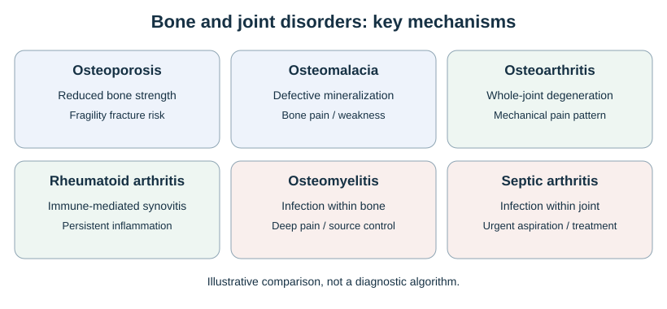

# Metabolic bone disorders, arthritis and musculoskeletal infection

**Draft candidate. Not studied.** Roman Hinglish concept notes; independent clinical, curriculum, semantic and resource review pending.

[Chapter](../README.md) · [Metabolic bone MCQs](../MCQs/01C-Metabolic-Bone-Disorders-20-MCQs.md) · [Arthritis MCQs](../MCQs/01D-Osteoarthritis-Rheumatoid-Arthritis-20-MCQs.md) · [Infection MCQs](../MCQs/01E-Osteomyelitis-Septic-Arthritis-20-MCQs.md)

## 1. Osteoporosis

Osteoporosis mein bone strength reduce hoti hai, including mass and microarchitecture; minor trauma se fragility fracture possible hai. Postmenopausal women aur men aged 50 or above mein appropriate DXA T-score of −2.5 or less osteoporosis classification support karta hai. Younger adults mein age-matched Z-score and clinical context important hain; low BMD alone diagnosis establish nahi karta. Vertebral fragility fracture sudden back pain, height loss ya asymptomatic deformity ke form mein aa sakta hai.

Fracture risk history, age, previous fracture, glucocorticoids and other factors se assess karo; DXA alone all risk capture nahi karta. High risk patient ka treatment review unnecessarily delay mat karo. Individualized exercise, fracture-safe movement, strength/balance support, adequate calcium and vitamin D where indicated, tobacco cessation and fall-risk management complementary components hain.

Oral alendronate immediate-release prescribed tablet generally fasting, plain water, upright posture for at least 30 minutes and until after first food, according to product instructions. Painful swallowing or retrosternal discomfort prompt evaluation demand karta hai. Denosumab planned dosing aur discontinuation transition require karta hai; unplanned interruption rebound vertebral fracture risk badha sakti hai. Preexisting hypocalcemia correct karna aur clinician-directed monitoring important hai. Anabolic therapy ke baad appropriate maintenance antiresorptive strategy discuss hoti hai.

## 2. Osteomalacia, rickets and Paget disease

Osteomalacia mein newly formed osteoid mineralize properly nahi hota; bone pain and proximal muscle weakness ho sakte hain. Vitamin D deficiency, malabsorption or phosphate metabolism disorder possible causes hain. Normal serum calcium alone condition exclude nahi karta because compensatory regulation calcium maintain kar sakti hai. Persistent hypophosphatemia needs cause-directed evaluation; empiric high-dose supplementation bina review unsafe ho sakti hai. Rickets growing skeleton ke growth plate mineralization ko involve karta hai; osteomalacia adult bone mineralization defect hai, and children can have both.

Paget disease mein focal accelerated and disorganized remodeling hoti hai; enlarged but structurally abnormal bone pain, deformity ya fracture cause kar sakti hai. ALP increase suggestive ho sakta hai, lekin total ALP liver sources se bhi elevate hota hai. Skull involvement with new hearing loss requires evaluation. Treatment disease activity, symptoms and specialist assessment par depend karta hai.

## 3. Osteoarthritis

OA whole-joint disease hai involving cartilage, subchondral bone and other structures. Typical mechanical pain activity ke saath badhta hai; brief stiffness after rest common hai. Typical presentation mein routine imaging har patient ke liye necessary nahi. Atypical features, trauma, red flags ya alternative diagnosis mein assessment different ho sakta hai.

DIP joint bony enlargement Heberden node, PIP Bouchard node ke naam se describe hoti hai. Individualized therapeutic exercise, weight management when indicated and joint protection function improve kar sakte hain. Topical NSAID especially knee OA mein discuss kiya ja sakta hai; systemic treatment individual GI, renal and cardiovascular risk ke according. Melena plus dizziness potential GI bleeding ka warning sign hai. Joint replacement referral pain, function and response to appropriate nonsurgical management consider karta hai, radiographic severity alone nahi.

## 4. Rheumatoid arthritis

RA immune-mediated inflammatory synovitis hai; persistent swelling aur prolonged stiffness concern raise karte hain. Negative RF or normal inflammatory markers clinical suspicion mein referral delay karne ka reason nahi. Anti-CCP diagnostic evidence support kar sakta hai but standalone test nahi. Early DMARD disease activity aur structural damage reduce karne ke liye use hote hain; painkiller alone disease-modifying nahi.

Low-dose methotrexate for RA generally once weekly prescribed hota hai; dosing day explicitly confirm karo. Daily dosing error severe toxicity cause kar sakta hai. Mouth ulcers, fever, bruising or new severe symptoms urgent review demand karte hain. CBC, renal and liver monitoring schedule specialist protocol ke according. Folic acid as prescribed toxicity reduce karne mein help karta hai. Live vaccine before immunosuppressive therapy review requires coordination. Rest and graded activity balance karo. Treat-to-target mein remission or low disease activity achieve karne ke liye objective assessment and medication review hota hai. Sudden hot swollen single joint with fever ko RA flare assume mat karo; septic arthritis urgent differential hai.

## 5. Osteomyelitis

Osteomyelitis bone infection hai. Hematogenous route bloodstream se, contiguous route nearby wound or infected tissue se, and direct inoculation open injury or procedure ke through ho sakta hai. Staphylococcus aureus common pathogen hai but culture-directed choice essential hai. Deep focal pain, swelling, fever or draining sinus may occur; fever absent hone se infection exclude nahi hota. Vertebral infection with new leg weakness or bladder dysfunction is an emergency concern.

Sequestrum devitalized detached bone, involucrum reactive new bone shell, and sinus tract deep infected site se skin tak communication ho sakta hai. Early radiograph normal ho sakta hai; MRI and appropriate sampling clinician decide karta hai. Deep specimen superficial swab se more representative ho sakta hai. CRP trend clinical findings ke saath interpret karo. Necrotic bone or abscess source control demand kar sakta hai. Antibiotic choice, route and duration culture, clinical response and specialist plan ke according; selected patients oral highly bioavailable agent par switch ho sakte hain. Symptoms improve hone par self-discontinuation mat karo.

## 6. Septic arthritis

Acute painful swollen joint, limited movement and possible systemic signs urgent assessment demand karte hain. Joint infection rapid damage cause kar sakti hai. Stable patient mein prompt synovial aspiration before empirical antibiotics generally culture yield preserve karti hai; sepsis/septic shock mein urgent treatment delay mat karo. Crystals milne se infection exclude nahi hoti. Joint lavage/drainage infected material remove karne aur source control ke liye ho sakta hai.

After infection control, team-directed mobility restore karna stiffness and functional loss reduce karta hai. Renewed pain/swelling, fever or rising inflammatory markers treatment failure assessment demand karte hain. Urgent escalation and local clinical protocols take precedence over exam mnemonics.

## Clinical references and video leads

- [NOGG clinical guideline summary](https://www.nogg.org.uk/full-guideline/summary-main-recommendations) — retrieved.
- [NHS rickets and osteomalacia](https://www.nhs.uk/conditions/rickets-and-osteomalacia/) and [NHS alendronate](https://www.nhs.uk/medicines/alendronic-acid/) — indexed; full item-level verification pending.
- [NICE osteoarthritis](https://www.ncbi.nlm.nih.gov/books/NBK588843/) and [NICE rheumatoid arthritis](https://www.ncbi.nlm.nih.gov/books/NBK519103/) — retrieved.
- [Open RN musculoskeletal assessment](https://www.ncbi.nlm.nih.gov/books/NBK613072/) — retrieved.
- [Merck osteomyelitis](https://www.merckmanuals.com/professional/musculoskeletal-and-connective-tissue-disorders/infections-of-joints-and-bones/osteomyelitis), [SANJO native-joint septic arthritis guideline](https://jbji.copernicus.org/articles/8/29/2023/) — retrieved.
- [OA vs RA MCQ lead](https://www.youtube.com/watch?v=aEQj0MjItnQ), [osteomyelitis review/quiz lead](https://www.youtube.com/watch?v=iUGlzzzpawE&t=280s), [infection teaching lead](https://www.youtube.com/watch?v=wHtGUICFuQ4). Title/description leads only. Playback, exact MCQ coverage and metabolic-bone video verification pending.

Grouped introductory guide only. Expand individual disorders and clinical skills to full topic-level target before mocks.
