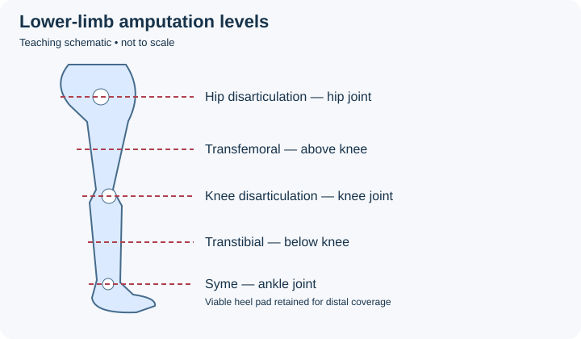

# Joint dislocation, amputation and prosthetic nursing

**Draft study guide | Original educational content | Clinical review pending**

## Joint dislocation
Dislocation mein joint ki articular surfaces ka normal contact completely lost ho jata hai. Subluxation partial loss of contact hai. Trauma ke baad deformity, pain, swelling aur movement limitation ho sakte hain. Fracture saath mein bhi ho sakta hai.

**Nursing priorities:** affected joint ko found position mein support karo. Forceful manipulation ya reduction independently mat karo. Skin integrity, distal pulse, capillary refill, sensation aur motor function assess karo. Abnormal findings promptly escalate karo. Prescribed analgesia, imaging aur reduction preparation mein help karo. Sedation ke dauran local monitoring aur recovery policy follow karo. Reduction ke baad neurovascular assessment repeat aur document karo.

Knee dislocation mein popliteal artery injury ka risk important hai. Joint khud reduce ho jaye ya pulse present ho, tab bhi vascular injury exclude nahi hoti. Shoulder dislocation mein axillary nerve function aur posterior dislocation ki possibility assess karna relevant hai. Seizure ke baad posterior shoulder injury miss ho sakti hai.

## Amputation and perioperative nursing
Amputation ka level viable tissue, perfusion, pathology aur expected function ke according specialist team decide karti hai. Elective procedure aur urgent infection source control ka clinical pathway different ho sakta hai. Preoperative assessment mein comorbidities, wound, perfusion, patient goals, analgesia aur rehabilitation planning include hote hain.

Postoperative phase mein bleeding, vital signs, pain, wound appearance aur infection signs monitor karo. Sudden bleeding, hemodynamic instability ya rapidly increasing swelling urgent escalation demand karte hain. Dressing aur compression orders procedure aur vascular condition ke hisaab se follow karo. Hip ya knee flexion contracture prevent karne ke liye prolonged flexed positioning avoid karna useful ho sakta hai, lekin wound protection aur surgical restrictions first hain.

Phantom sensation missing limb ki nonpainful perception ho sakti hai. Phantom limb pain missing limb mein felt pain hai aur real clinical symptom hai. Residual limb pain present tissue mein local pathology, pressure, infection ya nerve irritation ke karan ho sakta hai. Har new pain ko phantom pain assume mat karo. Pain assessment, psychological support aur individualized multimodal management important hain.

## Prosthesis and residual limb care
Prosthetic fitting wound healing, residual limb volume, skin tolerance, strength, balance aur patient goals par depend karti hai. Prosthetist socket fit aur alignment review karta hai. Residual limb inspect karo, gentle cleaning aur drying ensure karo, aur liner care manufacturer-specific instruction ke according karo. Persistent redness, blister, wound, drainage ya new pain mein wear continue karne ke bajay assessment arrange karo. Impaired sensation wale patient ko inspection ke liye mirror ya caregiver support chahiye ho sakta hai.

Compression, shrinker, liner, wear schedule aur gait training individualized plan ke according honi chahiye. Improvised socket modifications avoid karo. Patient ki privacy, body image, independence aur family participation respect karo. Safe transfer aur fall prevention practice rehabilitation team ke saath coordinate karo.

## References and scope
- [Merck Manual: Overview of dislocations](https://www.merckmanuals.com/professional/injuries-poisoning/dislocations/overview-of-dislocations)
- [Society for Vascular Surgery: amputations](https://vascular.org/pmg/vascular-conditions/amputations)
- [VA/DoD rehabilitation of individuals with lower limb amputation](https://www.healthquality.va.gov/guidelines/Rehab/amp/)
- [Merck Manual: skin care of residual limb](https://www.merckmanuals.com/professional/special-subjects/limb-prosthetics/skin-care-of-the-residual-limb)

References support educational principles. Item-level source matching, independent clinical review and video verification remain pending.

## Practice banks
- [Joint dislocations](../MCQs/02A-Joint-Dislocations-20-MCQs.md)
- [Amputation perioperative nursing](../MCQs/02B-Amputation-Perioperative-Nursing-20-MCQs.md)
- [Prosthesis and residual limb care](../MCQs/02C-Prosthesis-Residual-Limb-Care-20-MCQs.md)
