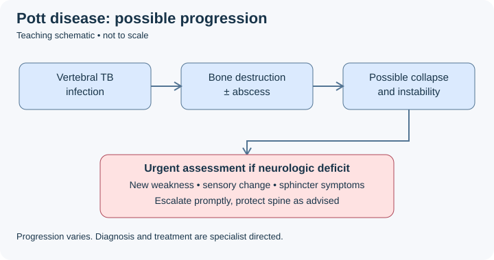

# Bone tumors, spinal disorders and Pott disease

**Draft study guide | Original educational content | Clinical review pending**

## Bone tumors
Benign lesion metastatic nahi hota, lekin local growth bone strength aur nearby structures ko affect kar sakti hai. Malignant bone tumor primary bone se arise ho sakta hai ya another cancer ki metastasis ho sakti hai. Persistent focal pain, progressive swelling, unexplained pathological fracture ya suspicious imaging further evaluation demand karte hain. Symptoms alone diagnosis prove nahi karte.

Osteosarcoma commonly adolescent age group mein long-bone metaphysis, especially knee ke around, involve kar sakta hai. Ewing sarcoma ka presentation pain, swelling aur kabhi fever ke saath infection jaisa lag sakta hai. Chondrosarcoma cartilage-producing malignancy hai. Tumor type aur stage pathology aur imaging se determine hote hain.

**Nursing:** suspicious lesion mein unplanned invasive procedure avoid karo. Biopsy route multidisciplinary sarcoma team plan karti hai because tract future surgery ko influence kar sakta hai. Fracture-risk lesion mein weight bearing prescribed restrictions ke according ho. Pain, nutrition, body image, functional recovery aur psychosocial support assess karo. Chemotherapy monitoring drug-specific protocol ke according karo. Limb salvage ya amputation ka selection tumor clearance, function aur patient preference par depend karta hai.

## Spinal disorders
Disc herniation nerve root irritation ya compression produce kar sakti hai. Radicular pain, sensory disturbance aur weakness assess karo. Lumbar stenosis mein neurogenic claudication standing ya walking se increase aur sitting ya flexion se relieve ho sakti hai. Spondylolisthesis vertebral slip hai. Scoliosis lateral curvature with rotation hai. In conditions mein symptom severity, function aur neurologic findings guide assessment.

Routine low back pain mein imaging automatically indicated nahi hoti. Red flags, progressive neurologic changes aur suspected serious pathology prompt medical evaluation require karte hain. New saddle sensory change, bladder/bowel dysfunction ya progressive weakness emergency assessment demand kar sakte hain. Avoid forced movement when instability suspected. Prescribed physiotherapy, safe mobility and individualized pain management support recovery.

## Pott disease (spinal tuberculosis)
Mycobacterium tuberculosis vertebral structures involve kar sakta hai. Gradual pain, vertebral destruction, abscess, kyphosis, instability aur neurologic compression possible hain. Har patient mein fever, pulmonary symptoms ya severe deformity present hona necessary nahi hai.

MRI soft tissue, vertebral involvement, abscess aur neural compression assess karne mein useful hai. Contrast use appropriateness aur contraindications ke according decide hota hai. Microbiological testing, histopathology aur drug susceptibility ke liye appropriate specimen handling important hai. Pulmonary involvement ki assessment aur indicated infection control precautions follow karo.

Treatment national TB programme guidance, drug susceptibility, disease severity aur specialist evaluation ke according hota hai. Universal fixed duration assume mat karo. Adherence, adverse effects, follow-up, nutrition, pain aur serial neurological assessment monitor karo. Surgery selected instability, compression ya other indications mein consider ho sakti hai.

## References and scope
- [NCI osteosarcoma PDQ](https://www.cancer.gov/types/bone/hp/osteosarcoma-treatment-pdq)
- [NCI Ewing sarcoma PDQ](https://www.cancer.gov/types/bone/hp/ewing-treatment-pdq)
- [NICE low back pain and sciatica](https://www.nice.org.uk/guidance/ng59)
- [India TB programme](https://tbcindia.mohfw.gov.in/) — skeletal TB content checked against 2023 extrapulmonary TB training material, screenshot and exact page-level mapping pending.

This guide covers the selected Batch 02 groups, not the complete individual-topic syllabus. Independent clinical review and question-level source mapping remain pending.

## Practice banks
- [Bone tumors](../MCQs/02D-Bone-Tumors-20-MCQs.md)
- [Spinal disorders and Pott disease](../MCQs/02E-Spinal-Disorders-Pott-Disease-20-MCQs.md)
