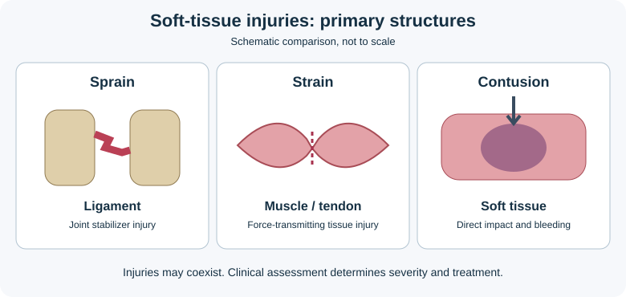

# Soft tissue trauma, bursitis and synovitis

**Draft candidate | Unattempted | Not studied.** Original Roman Hinglish concept guide. Independent clinical review and video mapping pending.

[Chapter](../README.md) · [Sprains](../MCQs/03A-Ligament-Sprains-20-MCQs.md) · [Muscle strains and contusions](../MCQs/03B-Muscle-Strains-Contusions-20-MCQs.md) · [Bursitis and synovitis](../MCQs/03C-Bursitis-Synovitis-20-MCQs.md)

## 1. Soft-tissue injury ko identify kaise karein?

Sprain ligament ka injury hai, jo joint ko stabilize karta hai. Grade I mein minor fiber damage, grade II mein partial tear aur grade III mein complete tear ho sakta hai. Pain ka level hamesha grade ke equal nahi hota. Mechanism, local tenderness, swelling, stability aur functional findings ko clinician assess karta hai. Inversion ankle injury lateral ligament complex ko stress kar sakti hai. Eversion medial structures ko stress karti hai. High ankle sprain distal tibiofibular syndesmosis involve karti hai.

Ottawa ankle aur foot decision rules eligible patients mein fracture imaging guide kar sakte hain. Specified bony tenderness ya weight-bearing criteria positive hone par indicated radiograph arrange hoti hai. Rule exclusions aur local policy consider karo. Normal toe movement ya mild swelling fracture exclude nahi karti.

Knee mein valgus force MCL ko aur posterior tibial force PCL ko injure kar sakti hai. Rapid joint effusion internal injury suggest karti hai, lekin definite ACL diagnosis nahi. Locking aur joint-line symptoms meniscal injury concern raise karte hain. Severe pain aur guarding mein clinician stability examination postpone kar sakta hai. Thumb forced abduction UCL injury cause kar sakti hai. Stener lesion mein displaced UCL aur insertion ke beech adductor aponeurosis healing obstruct kar sakti hai. Wrist malalignment despite no fracture visible significant ligament injury ka clue ho sakta hai.

## 2. Strain, contusion aur tendon injury

Strain muscle-tendon unit ki injury hai. Sudden sprint, overstretch ya heavy loading fibers injure kar sakte hain. Muscle contraction aur stretch local pain provoke kar sakte hain. Severe proximal hamstring bruising aur weakness tendon avulsion concern raise karte hain. MRI selected injuries mein tendon involvement aur retraction describe kar sakti hai. Graded rehabilitation muscle length, strength aur load tolerance restore karne mein help karti hai.

Contusion direct blunt force se muscle aur vessels damage hone par develop hoti hai. Bleeding surrounding tissue planes mein track kar sakti hai. Expanding swelling, dizziness ya anticoagulant exposure bleeding concern raise karte hain. Severe pain aur passive stretch pain compartment syndrome ke red flags hain, isliye urgent escalation chahiye. Aggressive early massage avoid karo. Delayed firm painful intramuscular mass with movement loss myositis ossificans ka concern raise kar sakta hai.

Achilles rupture mein calf squeeze test par expected plantarflexion absent ho sakti hai. Some active plantarflexion still possible hai because other muscles contribute karte hain. Prescribed boot wedges aur progression schedule follow karo. Quadriceps tendon rupture suprapatellar defect ke saath aur patellar tendon rupture high patella ke saath associate ho sakti hai. Active knee extension loss urgent specialist assessment demand karta hai.

Protection, short skin-safe cold sessions for comfort, appropriate compression, elevation aur early protected movement selected stable injuries mein useful ho sakte hain. Severity aur healing structure ke according rehabilitation plan vary karta hai. Return to sport sirf pain kam hone ya elapsed time par decide nahi hota.

## 3. Bursitis aur synovitis

Bursa small friction-reducing fluid-containing sac hai. Repetitive kneeling prepatellar bursa aur repeated elbow pressure olecranon bursa irritate kar sakta hai. Clearly aseptic microtraumatic bursitis mein pressure modification, padding aur symptom management useful hain. Unnecessary aspiration se infection introduce ho sakti hai. Warm painful swelling, skin breach ya systemic signs septic bursitis ka concern raise karte hain. Diagnostic aspiration trained clinician plan karta hai aur infected skin ke through puncture avoid karne ka safe route assess karta hai. Possible infection mein corticosteroid injection appropriate nahi hai until infection addressed.

Superficial bursal swelling mein passive joint motion relatively preserved ho sakti hai. Is finding alone se infection exclude nahi hoti. Ultrasound localized fluid aur surrounding tissue assess karne mein help karti hai. Lateral hip pain may involve gluteal tendons and trochanteric bursa together. Shoulder bursa aur rotator cuff pathology bhi coexist kar sakti hain.

Synovitis joint lining inflammation hai. Children mein transient hip synovitis recent viral illness ke baad acute limp cause kar sakti hai. Serious pathology exclude karna important hai. Fever, refusal to bear weight ya worsening pain urgent reassessment demand karte hain. Ultrasound effusion ka cause alone establish nahi karta. Diffuse tenosynovial giant cell tumor, formerly diffuse PVNS, synovial tissue ko involve karta hai. Local recurrence aur joint damage follow-up demand kar sakte hain.

## Clinical references

- [AAOS ankle sprain](https://www.orthoinfo.org/bodypart/foot-ankle/sprained-ankle/) and [Merck knee sprains](https://www.merckmanuals.com/professional/injuries-poisoning/sprains-and-other-soft-tissue-injuries/knee-sprains-and-meniscal-injuries).
- [ACR ankle imaging criteria](https://acsearch.acr.org/docs/69436/Narrative/) and [ACR foot imaging criteria](https://acsearch.acr.org/docs/70546/Narrative/). Indexed evidence, direct ankle page restricted.
- [AAOS muscle strain](https://www.orthoinfo.org/en/diseases--conditions/muscle-strains-in-the-thigh/), [contusion](https://www.orthoinfo.org/diseases--conditions/sports-injuries/muscle-contusion-bruise) and [Achilles rupture](https://www.orthoinfo.org/bodypart/foot-ankle/achilles-tendon-rupture-tear/).
- [AAFP superficial bursitis](https://www.aafp.org/afp/2017/0215/p224), [RCH limping child](https://www.rch.org.au/clinicalguide/guideline_index/Child_with_limp/) and [RCH transient synovitis](https://www.rch.org.au/kidsinfo/fact_sheets/Transient_synovitis/).
- [Orthopedic nursing MCQ quiz candidate](https://www.youtube.com/watch?v=WbPH2_qObLo). Title-level dedicated quiz lead only. Exact learning-task coverage, timestamps and playback remain unverified.

These notes support the selected grouped practice banks. Individual-topic depth, independent reviewer signoff and source applicability remain open.
