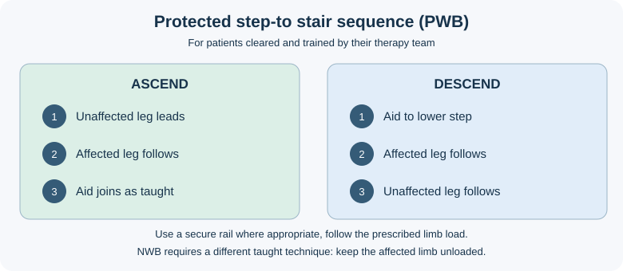

# Joint replacement and crutch gait rehabilitation

**Draft candidate | Unattempted | Not studied.** Original Roman Hinglish concept guide. Independent clinical review and video mapping pending.

[Chapter](../README.md) · [Joint replacement MCQs](../MCQs/03D-Orthopedic-Joint-Replacement-Nursing-20-MCQs.md) · [Crutch gait MCQs](../MCQs/03E-Orthopedic-Crutch-Gait-Rehabilitation-20-MCQs.md)

## 1. Joint replacement basics

Total hip replacement mein femoral-side component aur acetabular cup dono replace hote hain. Conventional hemiarthroplasty native acetabulum preserve karti hai. Cemented implant mein bone cement immediate mechanical fixation provide kar sakta hai. Uncemented implant porous or textured surface se biological bone integration support karta hai. Cup liner articulating surface ka part hai. Revision arthroplasty previous prosthetic components ko repair ya replace karne ki additional surgery hai.

Preoperative education mein realistic recovery, current function, exercises, home equipment, medication and comorbidity review include hote hain. Tranexamic acid antifibrinolytic hai, jo selected perioperative regimens mein blood loss reduce karne ke liye use hoti hai. Prescribed prophylaxis aur bleeding risk ka balance reassess karo. New significant bleeding ko ignore nahi karna chahiye.

## 2. Postoperative safety and rehabilitation

Stable cleared patient mein early rehabilitation encourage hoti hai. NICE primary elective hip, knee aur shoulder replacement mein surgery ke din if possible aur 24 hours ke andar rehabilitation offer karne ko recommend karta hai. Patient-specific restrictions aur medical stability consider karo. Hip precautions surgical approach aur surgeon instructions ke according vary karti hain. Prescribed posterior precautions mein reacher ya assistance se deep bending aur twisting avoid kar sakte hain. Knee rehabilitation mein extension aur flexion dono prescribed plan ke according regain karna important hai. Selected scar-related postoperative stiffness mein manipulation under anesthesia consider ho sakti hai after other causes assessed.

New persistent wound drainage aur increasing pain possible infection ka concern hai. Implant biofilm bacterial eradication difficult bana sakta hai. Selected two-stage exchange mein antibiotic spacer interim space maintenance and local antibiotic delivery support kar sakta hai, systemic antimicrobial plan still relevant hai. Dental procedure antibiotic prophylaxis every arthroplasty patient ke liye automatic nahi hai. Individual risk and clinician advice follow karo.

New prosthetic pain years after surgery also warrants assessment for loosening, wear, infection or other causes. Discharge readiness sirf walking distance nahi hai. Patient wound warning signs, contact pathway, restrictions aur rehabilitation plan understand kare aur safe performance demonstrate kare.

## 3. Loading prescriptions

NWB mein affected limb par weight nahi dalna hai. Partial weight bearing mein exact prescribed limit follow karo. Toe-touch contact ka definition institution aur surgeon order ke according vary kar sakta hai. Weight bearing as tolerated ka matlab clinician ne tolerance-guided loading permit ki hai. Patient independently order change nahi karta.

Example: 80 kg patient ko 25% loading prescribe hui ho toh static target 20 kg hai. Therapist-directed scale practice approximate awareness provide kar sakti hai, dynamic gait load separately assess hota hai. Crutches ki rubber ferrules, adjustment locks, actual footwear aur patient upper-limb capacity check karo. Painful wrists, fatigue ya poor balance ordinary crutch use unsuitable bana sakte hain. Alternative aid or assisted mobility plan reassess karo.

## 4. Protected gait and stairs

Level-ground gait mein therapist prescribed support sequence teach karta hai. Partial weight bearing mein aids affected limb ki load limit maintain karne mein help karte hain. NWB mein affected limb unloaded rehna chahiye. Excessive reach, slippery surface aur unsafe turning fall risk badha sakte hain. Small controlled steps aur safe support transition use as taught.

Stair practice sirf assessed and cleared patient ke liye hai. Partial weight-bearing step-to ascent mein unaffected leg usually lead karti hai, affected side aur aid follow karte hain. Descent mein aid aur affected side usually pehle move karte hain, unaffected leg follows. Secure rail if appropriate and prescribed technique use karo. NWB stair technique different hai, affected foot support ke liye load nahi leti. Stairs without safe rail, home access aur endurance separately assess karna important hai.

Verbal teach-back aur observed safe performance dono needed hain. Patient essential daily route sustain nahi kar pata toh alternative equipment, rest plan ya assistance arrange karo. Hot drinks carry karte waqt grip sacrifice nahi karna chahiye. Escalator ke bajay safer accessible route choose karo.

## Clinical references

- [NICE NG157](https://www.nice.org.uk/guidance/ng157/chapter/Recommendations), [NG89](https://www.nice.org.uk/guidance/ng89/chapter/Recommendations).
- [AAOS hip replacement](https://www.orthoinfo.org/bodypart/hip-thigh/total-hip-replacement/), [knee replacement](https://www.orthoinfo.org/bodypart/kneelower-leg/total-knee-replacement), [joint replacement infection](https://www.orthoinfo.org/treatment/joint-replacement/joint-replacement-infection/) and [dental procedures guideline](https://www.idsociety.org/practice-guideline/aaos-dental-procedures-guideline/).
- [MedlinePlus crutches](https://medlineplus.gov/ency/patientinstructions/000344.htm), [Kent NHS partial weight bearing](https://www.kentcht.nhs.uk/leaflet/partial-weight-bearing/), [Sussex NHS NWB stairs](https://www.uhsussex.nhs.uk/resources/managing-the-stairs-non-weight-bearing/) and [Cleveland Clinic crutch use](https://my.clevelandclinic.org/health/treatments/15543-how-to-use-crutches).
- [Two-point gait demonstration](https://www.youtube.com/watch?v=qjukAMe3qJE). Teaching demonstration lead, not a dedicated verified MCQ video. [Orthopedic nursing MCQ quiz](https://www.youtube.com/watch?v=WbPH2_qObLo) is a dedicated quiz title lead, not confirmed at individual question or timestamp level.

Grouped coverage only. Independent question-level clinical review, guideline applicability, video playback and rendering remain open.
