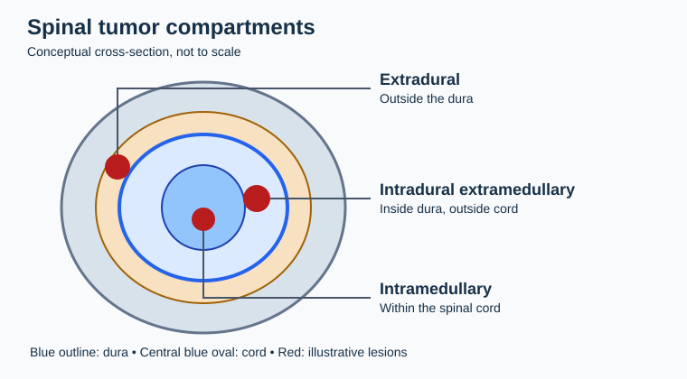

# Spinal tumors, assessment and investigations — Batch 04 concept guide

**Status:** Draft learning material. Independent clinical review pending.

## 1. Spinal tumor localization

Spinal canal ke lesion ko location ke basis par classify karte hain. Extradural lesion dura ke bahar hota hai, intradural extramedullary lesion dura ke andar but cord ke bahar hota hai, aur intramedullary lesion cord ke tissue ke andar hota hai. Metastatic vertebral disease epidural compression cause kar sakti hai. Location aur histology alag concepts hain.

Cancer history ke saath progressive back pain, weakness, gait changes, sensory disturbance ya new bladder/bowel symptoms metastatic spinal cord compression (MSCC) ka concern raise karte hain. Neurological deficit ke saath urgent specialist coordination essential hai. NICE NG234 ke relevant suspected-MSCC scenario mein MRI as soon as possible and within 24 hours recommend hai. Position aur transfer spinal stability aur respiratory tolerance ke hisab se plan hote hain. Suspected instability mein unsupported movement avoid karein.

NICE NG234 neurological symptoms/signs wale MSCC mein 16 mg dexamethasone initial dose as soon as possible recommend karta hai, followed by guideline-directed treatment and taper. Ye prescription-only, clinician-directed scenario hai, universal spinal-pain treatment nahi. Glucose monitoring aur gastric protection bhi guideline mein specified hain. Suspected lymphoma/myeloma without neurological signs mein steroid start karne se pehle specialist haematology advice relevant hai. Local oncology policy aur individual contraindications verify karein.

## 2. Musculoskeletal history and examination

Patient se onset, duration, progression, trauma, activity relation, morning stiffness, night pain, previous disease, medication aur ADL impact poochhein. Intermittent swelling absent examination ke bawajood relevant hai. Joint movement ko inspect karein and appropriate active/passive range compare karein. Pain, weakness aur true restriction distinguish karein. Forceful manoeuvres suspected fracture ya instability mein avoid karein.

Goniometer joint angles document karta hai. Muscle grading mein grade 1 trace contraction aur grade 2 gravity-eliminated movement denote karta hai. Standardized position aur side comparison important hain. Distal sensation, movement, colour, temperature and pulses findings ke context mein document karein. Sudden new deficit urgently escalate karein.

## 3. Choose the investigation for the question

- Plain radiography bone alignment aur many fractures assess karne mein useful hai. CT detailed bone geometry aur complex fracture planning mein useful ho sakta hai.
- MRI marrow, soft tissue, spinal cord aur neural structures assess karti hai. Hardware artifact image quality affect kar sakta hai. Safety screening separately required hai.
- Dynamic ultrasound tendon movement aur superficial soft tissues assess kar sakti hai. Arthrography contrast-assisted joint imaging hai.
- Bone scintigraphy increased tracer uptake show karti hai, lekin uptake alone infection ya malignancy prove nahi karta.
- EMG muscle electrical activity assess karta hai. CK muscle damage ka marker ho sakta hai but isolated result etiology establish nahi karta.
- Polarized microscopy mein monosodium urate aur calcium pyrophosphate crystals ki characteristic appearance differentiate hoti hai. Crystals infection coexistence exclude nahi karte.
- HLA-B27 ko compatible clinical history aur other findings ke context mein interpret karein. Positive marker alone axial spondyloarthritis confirm nahi karta.

## Practice banks

[04A spinal tumors and MSCC](../MCQs/04A-Spinal-Tumors-and-Metastatic-Cord-Compression-20-MCQs.md) · [04B history and examination](../MCQs/04B-Musculoskeletal-History-and-Physical-Assessment-20-MCQs.md) · [04C investigations](../MCQs/04C-Musculoskeletal-Investigations-20-MCQs.md)

## Clinical reading

[NICE NG234](https://www.nice.org.uk/guidance/ng234/chapter/Recommendations) · [Merck joint symptom evaluation](https://www.merckmanuals.com/professional/musculoskeletal-and-connective-tissue-disorders/approach-to-the-patient-with-joint-symptoms/evaluation-of-the-patient-with-joint-symptoms) · [Synovial fluid recommendations](https://pmc.ncbi.nlm.nih.gov/articles/PMC7394252/) · [Axial spondyloarthritis diagnosis](https://pmc.ncbi.nlm.nih.gov/articles/PMC8612900/).

Source-based author review only. Dedicated item-mapped YouTube MCQ verification and independent reviewer approval remain pending.
