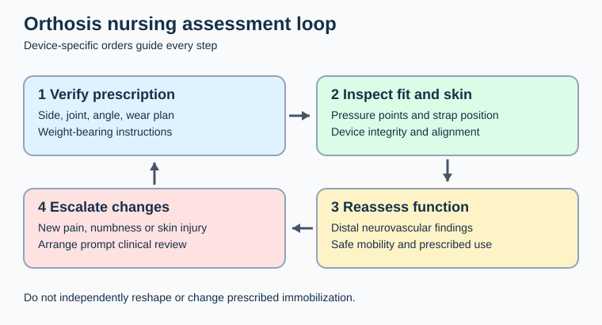

# Splints, orthoses and special therapies — Batch 04 concept guide

**Status:** Draft learning material. Independent clinical and pharmacy review pending.

## 1. Splint versus orthosis

Splint selected region ko immobilize ya protect kar sakta hai. Orthosis support, alignment ya function improve karne ke liye prescribed device hai. Actual use, angle, duration aur weight-bearing restrictions diagnosis aur treating team ke orders par depend karte hain.

Sugar-tong splint forearm rotation limit karne mein useful hai. Ulnar gutter ulnar-side hand injuries ke liye selected ho sakta hai. Thumb spica thumb region protect karta hai. Long-arm support elbow motion control kar sakta hai. Mallet finger mein prescribed DIP extension maintain karna important hai. Skin care ke time bhi treatment-specific uninterrupted extension instructions follow karein.

AFO ankle-foot alignment aur toe clearance assist kar sakta hai. KAFO knee, ankle aur foot ko support karta hai. Knee locking system use karne wale learner ko device-specific supervised training chahiye. Cervical collar fit, skin and spinal precautions prescribed plan se assess karein. Thermoplastic splint excessive heat se deform ho sakta hai. Independently reshape na karein.

## 2. Nursing care

Prescription, side, fit, alignment aur allowed activity verify karein. Skin, pressure points, strap position aur device integrity inspect karein. New numbness, severe pain, discolouration, motor change ya skin injury promptly assess and escalate karein. Corrective action device-specific instructions aur clinical findings par depend karta hai. Patient ko wear schedule, hygiene, safe mobility aur follow-up samjhayen. Teach-back se understanding assess karein.

## 3. Evidence-based special therapies

Osteoarthritis mein therapeutic exercise fundamental treatment hai. NICE NG226 manual therapy ko hip/knee OA mein exercise ke alongside consider karta hai, not as standalone replacement. OA ke liye routine TENS, ultrasound and certain electrotherapies offer nahi karne ki recommendation hai. Ye recommendation har diagnosis par automatically apply nahi hoti.

Water buoyancy load reduce kar sakti hai aur water resistance exercise progression mein useful ho sakta hai. Hydrotherapy suitability wound status, medical stability, infection risk, access aur safe supervision se evaluate karein.

NICE low-back pain aur chronic primary pain recommendations acupuncture ke liye different hain. WHO chronic primary low-back pain guideline selected needling therapies ko conditional option maanta hai. Condition, setting, evidence certainty aur patient preferences clearly identify karein. Complementary treatment ko emergency assessment, infection treatment ya prescribed disease-directed care ka substitute na banayen.

TENS use mein device contraindications aur placement instructions verify karein. Pacemaker or other implanted electronic device, pregnancy aur altered skin sensation relevant safety concerns ho sakte hain. Supplements medication history mein include karein. Glucosamine-warfarin interaction concern report hua hai, isliye clinician/pharmacist review essential hai. Independently anticoagulant dose alter na karein.

Shockwave therapy aur low-intensity pulsed ultrasound different modalities hain. Indication-specific evidence assess karein. Fresh fracture healing ke liye routine LIPUS use ko BMJ rapid recommendation support nahi karti. Degenerative OA ke liye routine arthroscopic lavage/debridement NICE recommend nahi karta.

## Practice banks

[04D splint and orthotic nursing](../MCQs/04D-Splinting-and-Orthotic-Nursing-20-MCQs.md) · [04E special and complementary therapies](../MCQs/04E-Evidence-Based-Special-and-Complementary-Therapies-20-MCQs.md)

## Clinical reading

[NICE NG226](https://www.nice.org.uk/guidance/ng226/chapter/Recommendations) · [NICE NG59](https://www.nice.org.uk/guidance/ng59/chapter/Recommendations) · [NICE NG193](https://www.nice.org.uk/guidance/ng193/chapter/Recommendations) · [WHO chronic primary low-back pain guideline](https://www.who.int/publications/i/item/9789240081789) · [NHS TENS](https://www.nhs.uk/tests-and-treatments/transcutaneous-electrical-nerve-stimulation-tens/) · [Plymouth splint care](https://www.plymouthhospitals.nhs.uk/display-pil/pil-hand-therapy-care-of-your-splint-5727) · [BMJ LIPUS recommendation](https://www.bmj.com/content/356/bmj.j576).

Clinical sources and evidence limitations are documented in individual questions. Independent item-level and video verification pending.
