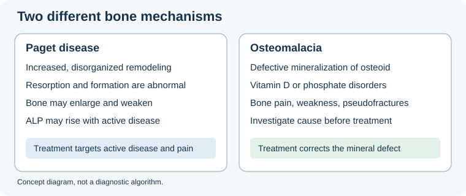

# Paget disease and osteomalacia — concept depth

> Draft educational material. Independent clinical review remains pending.

## Paget disease

Paget disease mein bone remodeling bahut tez aur disorganized ho sakti hai. Nayi bone moti dikh sakti hai, lekin mechanically kamzor bhi ho sakti hai. Isliye deformity, pain aur fracture ka risk clinical context mein assess karna zaroori hai. ALP ko liver tests ke saath interpret karo, kyunki elevated ALP sirf bone disease ka proof nahi hai. Localized disease mein total ALP normal bhi ho sakta hai. Radiographs aur bone scan ka role alag hai: radiograph characteristic changes dikhata hai aur scan active involvement ka extent map karne mein madad karta hai.

Bisphosphonate treatment ka decision symptoms, complications, contraindications aur patient preference par depend karta hai. Sirf ALP ko normal karna har patient ka treatment target nahi hai. IV zoledronic acid ke liye renal function, hydration, calcium status aur prescribed infusion instructions check karna nursing safety ka important part hai. Label-specific contraindications ko ignore nahi karna chahiye.

## Osteomalacia

Osteomalacia mein osteoid ka mineralization inadequate hota hai. Adult patient ko diffuse bone pain, proximal muscle weakness aur walking difficulty ho sakti hai. Vitamin D deficiency ek cause hai, lekin phosphate wasting aur doosre causes bhi consider karne padte hain. Investigation mein history, calcium, phosphate, ALP, PTH, vitamin D aur kidney function clinical indication ke according useful ho sakte hain. Normal calcium se osteomalacia automatically exclude nahi hoti.

Tumor-induced osteomalacia mein renal phosphate wasting aur FGF23 ki inappropriate activity important clues ho sakte hain. Specialist evaluation ke bina phosphate supplements ya active vitamin D ko arbitrary dose mein start nahi karna chahiye. Nursing follow-up mein falls, mobility, adherence, symptoms aur treatment-related laboratory monitoring par dhyan do.

## Practice

- [Paget disease — 17 new questions](../MCQs/05A-Paget-Disease-of-Bone-17-MCQs.md)
- [Osteomalacia — 16 new questions](../MCQs/05C-Osteomalacia-16-MCQs.md)

## Clinical source leads

- [2019 Paget guideline](https://academic.oup.com/jbmr/article/34/4/579/7606010)
- [DailyMed official drug label search](https://dailymed.nlm.nih.gov/dailymed/search.cfm?query=Reclast)
- [Osteomalacia and Vitamin D Status: A Clinical Update 2020](https://doi.org/10.1002/jbm4.10447)
- [Global guidance for tumor-induced osteomalacia](https://doi.org/10.1111/joim.13593)

Paget guideline and drug-label text retrieved. Osteomalacia source leads were indexed but full-text access was restricted. Independent review and exact item-to-video mapping remain pending.
