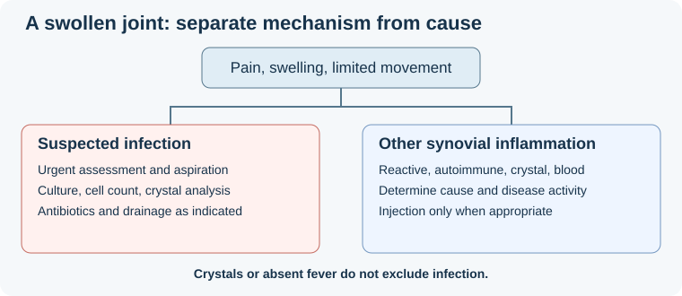

# Septic arthritis, synovitis and PIVD — concept depth

> Draft educational material. Independent clinical review remains pending.

## Septic arthritis and synovitis

Synovitis ka matlab synovial lining ki inflammation hai. Iska cause infection, autoimmune disease, crystals, bleeding ya reactive inflammation ho sakta hai. Suspected septic arthritis mein urgent clinical assessment aur joint aspiration important hai. Fever absent hone se infection exclude nahi hoti. Synovial cell count ek clue hai, lekin crystals milne par bhi infection ko rule out nahi kar sakte. Samples aur antibiotic timing treating team ke protocol ke according coordinate karo. Sepsis ya shock mein urgent treatment ko unnecessary delay nahi karna chahiye.

Ultrasound par synovial hypertrophy aur Doppler signal alag observations hain. Clinical findings aur disease activity ko saath mein interpret karo. Intra-articular glucocorticoid injection se pehle infection aur contraindications assess karna essential hai. Injection ke baad worsening pain, fever ya systemic illness urgent evaluation ki wajah ho sakti hai.

## Prolapsed intervertebral disc

Disc herniation mein nerve root compression ya irritation se radiating pain, sensory changes aur weakness ho sakti hai. L4 involvement mein knee extension aur patellar reflex affected ho sakte hain, L5 mein great-toe extension aur S1 mein plantar flexion aur Achilles reflex affected ho sakte hain. Root patterns overlap bhi kar sakte hain, isliye isolated finding se final diagnosis nahi banana chahiye. Disc level aur compressed root ko automatically ek hi cheez mat samjho.

New urinary retention, saddle sensory change ya progressive neurological deficit emergency assessment ki demand kar sakte hain. Uncomplicated radicular pain mein management individualized hota hai. Postoperative care mein new weakness, bladder dysfunction, wound changes aur safe mobilization ko evaluate karo. Medication choice, imaging aur surgery ke decisions clinician assessment aur current guidelines ke according hote hain.

## Practice

- [Septic arthritis — 14 new questions](../MCQs/05B-Native-Joint-Septic-Arthritis-14-MCQs.md)
- [PIVD — 17 new questions](../MCQs/05D-Prolapsed-Intervertebral-Disc-17-MCQs.md)
- [Synovitis — 14 new questions](../MCQs/05E-Synovitis-14-MCQs.md)

## Clinical source leads

- [SANJO native-joint septic arthritis guideline](https://jbji.copernicus.org/articles/8/29/2023/)
- [EULAR intra-articular therapies recommendations](https://doi.org/10.1136/annrheumdis-2021-220266)
- [MSD Manual — lumbar disc herniation](https://www.msdmanuals.com/professional/musculoskeletal-and-connective-tissue-disorders/neck-and-back-pain/lumbar-disc-herniation)
- [NICE NG59](https://www.nice.org.uk/guidance/ng59)

SANJO and MSD clinical text retrieved. Other leads have varying access limitations. Independent review and exact item-to-video mapping remain pending.
