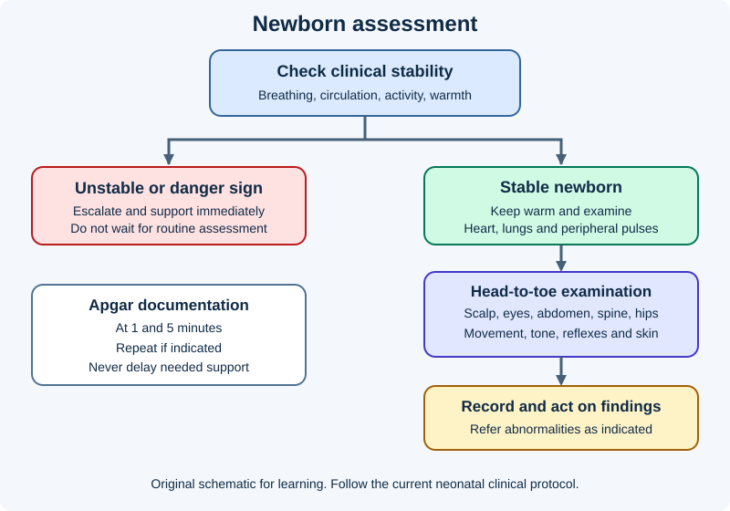

# Normal newborn physical assessment and Apgar

**Study-ready draft, abhi studied nahi hai.** Is guide mein newborn examination aur Apgar documentation ko step by step samjhenge.

[Chapter](../README.md) · [20 original MCQs](../MCQs/01A-Normal-Newborn-Physical-Assessment-and-Apgar-20-MCQs.md) · [Evidence and gaps](../Previous-Year-Questions/01A-Newborn-Assessment-Evidence-and-Gaps.md)

## 🟠 HIGH YIELD — Pehle stability check karo

Newborn assessment ka matlab hai ki hum baby ko birth ke baad carefully observe karke samajhte hain ki woh uterus ke bahar adapt kar raha hai ya nahi. Pehle breathing, color, circulation, activity aur temperature ko check karna zaroori hai. Agar breathing mein problem hai, toh routine head-to-toe exam ke liye treatment delay nahi karna hai. Stable baby ko warm rakho aur unnecessary separation avoid karo.

Baby ka respiratory rhythm adult ke comparison mein irregular ho sakta hai. Isliye quiet baby mein chest ya abdomen ki movement ko ek full minute count karo. Grunting ka matlab expiration ke waqt awaaz aana hai. Nasal flaring mein nostrils zyada open hoti hain aur retraction mein chest ke soft areas andar khinch sakte hain. Yeh signs breathing effort badhne ki taraf ishara karte hain.

Acrocyanosis mein hands aur feet blue dikh sakte hain, jabki tongue aur trunk pink rehte hain. Lekin tongue aur oral mucosa blue hona central cyanosis ka warning sign hai. Is situation mein immediate clinical assessment chahiye. Color akela oxygen saturation ka reliable measure nahi hai. Indicated assessment aur local protocol follow karo.

## 🟠 HIGH YIELD — Heart, pulses aur breathing

Heart aur lungs ko tab examine karna useful hota hai jab baby quiet ho. Nurse brachial aur femoral pulses compare karti hai. Femoral pulse groin ke paas feel hota hai. Agar arm ka pulse strong hai lekin leg pulse repeatedly weak mil raha hai, toh aorta ki narrowing jaise coarctation ko exclude karna zaroori hai. Yeh finding diagnosis confirm nahi karti, lekin referral ka reason ban sakti hai.

## 🟠 HIGH YIELD — Head, eyes aur scalp

Delivery mein pressure ke kaaran head shape temporarily change ho sakti hai. Isko molding kehte hain. Caput mein superficial scalp tissue swollen hota hai. Isliye swelling suture line cross kar sakti hai. Cephalhematoma mein skull bone aur periosteum ke beech blood jama hota hai. Periosteum ek bone ki boundary par attached rehti hai, isliye yeh swelling sutures cross nahi karti.

Sirf sutures dekhkar har swelling ko harmless label mat karo. Agar swelling badh rahi hai ya baby pale, tachycardic ya unwell ho raha hai, toh serious bleeding possible hai. Urgent evaluation arrange karo.

Red reflex ek light reflection hai jo eye examination mein assess ki jaati hai. Dono eyes ke reflex mein clear difference, absent reflex ya white reflection important finding hai. Eye ke lens ya retina ki problem ho sakti hai. Clinician aur ophthalmic assessment prompt arrange karna chahiye.

## 🟠 HIGH YIELD — Abdomen, genital findings aur birth trauma

Stable newborn ka abdomen usually rounded hota hai. Agar abdomen andar dhansa hua dikhe aur saath mein breathing distress ho, toh congenital diaphragmatic hernia suspect ho sakta hai. Diaphragm mein opening hone se abdominal organs chest mein pahunch sakte hain aur lungs ko space kam mil sakti hai. Yeh urgent specialist assessment ki situation hai.

Term baby girl mein maternal hormones birth ke baad kam hone ki wajah se kabhi temporary blood-tinged vaginal mucus aa sakta hai. Lekin heavy bleeding, persistent discharge ya illness ko normal maan kar ignore mat karo.

Clavicle collar bone ko kehte hain. Difficult birth ke baad localized tenderness ya crepitus fracture ka clue ho sakta hai. Brachial plexus nerves shoulder aur arm ki movement control karti hain. Stretch injury mein ek arm ki spontaneous movement kam ho sakti hai. Dono situations mein baby ko gently handle karo aur clinician ko findings batao.

## 🟠 HIGH YIELD — Spine, hips aur neurological findings

Spine ke overlying skin ko inspect karo. Low midline simple dimple aur high, off-midline ya hidden-base dimple alag findings hain. Atypical dimple ko document karke appropriate referral karvao. Blind probing nahi karna hai.

Developmental dysplasia of the hip mein hip socket aur femoral head ka relation unstable ho sakta hai. Breech history risk factor hai. Barlow aur Ortolani assessment trained clinician karta hai. Barlow mein hip ki dislocatability assess hoti hai aur Ortolani mein dislocated head ki relocation assess hoti hai. Normal first examination ke baad bhi breech infant ko local risk-based follow-up ki zaroorat ho sakti hai.

Rooting reflex mein cheek ya lip touch hone par baby stimulus ki taraf mouth turn karta hai. Sucking reflex milk lene mein help karta hai. Moro reflex startle response hai. Tone assessment mein posture, movement aur resistance observe karte hain. Marked limpness ko hypotonia kehte hain aur iski clinical evaluation chahiye.

## 🟡 IMPORTANT — Skin findings

Petechiae chhote nonblanching blood spots hote hain. Delivery pressure ke baad presenting part par kuch spots mil sakte hain, lekin diffuse spots mein platelet problem ya infection evaluate karna chahiye. Erythema toxicum ek common transient rash hai jisme red base par small white-yellow lesions dikh sakte hain. Well baby mein yeh benign ho sakta hai, lekin fever, blisters ya poor activity ho toh reassessment zaroori hai.

## 🔴 MOST IMPORTANT — Apgar scoring

Apgar birth ke baad baby ki clinical condition ko describe karne ka standardized score hai. Iske five components hain: appearance (color), pulse, grimace (response to stimulation), activity (tone) aur respiration. Har component ko zero se two points tak score karte hain. Total zero se ten hota hai.

| Component | 0 | 1 | 2 |
|---|---|---|---|
| Appearance | Pale or blue throughout | Pink body, blue extremities | Pink throughout |
| Pulse | Absent | Below 100/min | 100/min or above |
| Grimace | No response | Grimace | Vigorous response |
| Activity | Limp | Some flexion | Active movement |
| Respiration | Absent | Slow or irregular | Good cry |

Example: Baby ka pulse 130/min hai, breathing strong cry ke saath hai, limbs mein some flexion hai, stimulation par grimace hai aur trunk pink lekin extremities blue hain. Ismein pulse 2, respiration 2, activity 1, grimace 1 aur appearance 1 add karne par 7 milta hai.

Apgar one aur five minutes par record hota hai. Agar five-minute score seven se kam hai, toh standard repeat scoring five-minute intervals par twenty minutes tak hoti hai. Resuscitation need decide karne ke liye Apgar ka wait mat karo. Apgar akela asphyxia ka cause ya individual long-term prognosis establish nahi karta. Prematurity aur maternal medicines score ko affect kar sakti hain.

## Sources and video evidence

- [MSD Manual — Physical Examination of the Newborn](https://www.msdmanuals.com/professional/pediatrics/care-of-newborns-and-infants/physical-examination-of-the-newborn)
- [AAP/ACOG — The Apgar Score](https://publications.aap.org/pediatrics/article/136/4/819/73821/The-Apgar-Score)
- [WHO — Essential Newborn Care](https://www.who.int/teams/maternal-newborn-child-adolescent-health-and-ageing/newborn-health/essential-newborn-care)
- Teaching resource lead: [First Examination of a Newborn Baby](https://www.youtube.com/watch?v=yHXbsp84u-0). Indexed description indicates vital signs, Apgar and examination. Channel and playback verification pending.
- MCQ practice lead: [Top 80 Newborn Health Care MCQs](https://www.youtube.com/watch?v=ZPyBhWQdkd4). Indexed description mentions neonatal assessment. Exact question coverage, playback and creator verification pending. Yeh verified item-level reference nahi hai.

[20 original MCQs](../MCQs/01A-Normal-Newborn-Physical-Assessment-and-Apgar-20-MCQs.md) · [Evidence and gaps](../Previous-Year-Questions/01A-Newborn-Assessment-Evidence-and-Gaps.md) · [Chapter](../README.md)
