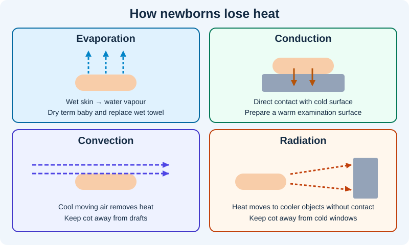

# Neonatal thermoregulation and warm chain

**Study-ready draft, not yet studied.** Hum samjhenge ki newborn heat kyun lose karta hai aur nurse usko safe temperature par kaise rakhti hai.

[Chapter](../README.md) · [20 original MCQs](../MCQs/01B-Neonatal-Thermoregulation-and-Warm-Chain-20-MCQs.md) · [Evidence](../Previous-Year-Questions/01B-Thermoregulation-Evidence-and-Gaps.md)

## 🟠 HIGH YIELD — Thermoregulation kya hai?

Thermoregulation ka matlab body temperature ko suitable range mein maintain karna hai. Newborn ka body surface area uske weight ke comparison mein zyada hota hai. Preterm baby mein skin aur fat ka insulating effect kam ho sakta hai. Isliye jab baby warm uterus se cooler delivery room mein aata hai, toh heat loss jaldi ho sakti hai.

Conventional axillary target 36.5–37.5°C hai. Agar reading low ya high hai, toh nurse reading verify karti hai aur baby ki overall condition check karti hai. Temperature measurement ke liye approved device ko axilla ki skin se contact mein rakhna aur arm gently close karna important hai.

## 🔴 MOST IMPORTANT — Four heat-loss mechanisms

| Mode | Kaise heat lose hoti hai? | Nurse kya kar sakti hai? |
|---|---|---|
| Evaporation | Wet skin par liquid vapor banta hai aur body se heat le jaata hai. | Term baby ko promptly dry karke wet towel replace karo. |
| Conduction | Baby directly cold surface touch karta hai aur heat us surface mein transfer hoti hai. | Weighing aur examination surface ko suitable tarike se prewarm karo. |
| Convection | Cool moving air body ke aas-paas se heat le jaati hai. | Cot ko direct draft aur AC airflow se door rakho. |
| Radiation | Baby bina touch kiye nearby cooler surface ki taraf heat lose kar sakta hai. | Cold windows aur walls ke paas cot rakhne se bacho. |

Ek example samjho. Agar wet newborn cold metal scale par hai aur AC air uske upar aa rahi hai, toh teen mechanisms ek saath possible hain. Wet skin evaporation kar rahi hai, scale conduction kar raha hai aur airflow convection kar raha hai. Question mein agar sirf ek mechanism poochha gaya hai, toh specific clue identify karo.

## 🔴 MOST IMPORTANT — Cold stress aur energy demand

Newborn heat banane ke liye brown fat ka metabolism use karta hai. Isko nonshivering thermogenesis kehte hain. Jab baby cold stress mein hai, toh body temperature maintain karne ke liye extra oxygen aur glucose use kar sakti hai. Agar reserve limited hai, toh blood glucose gir sakta hai aur breathing effort badh sakta hai. Preterm aur growth-restricted babies mein yeh risk aur important hota hai.

Cold stress ko sirf blanket lagane se solved mat samjho. Baby ki temperature repeat measure karo, activity, feeding, breathing aur glucose ko indicated protocol ke hisaab se assess karo. Persistent hypothermia ke saath poor feeding ya reduced activity ho toh infection ya doosri serious illness possible hai. Urgent neonatal clinical review arrange karo.

## 🟠 HIGH YIELD — Warm chain

Warm chain birth se transfer aur postnatal care tak linked steps hain. Delivery room aur supplies warm prepare karo. Stable term newborn ko dry karo aur wet towel remove karo. Appropriate supervised skin-to-skin care aur feeding support do. First bath ko generally at least 24 hours postpone karo jab feasible ho aur baby stable ho. Warm clothing, mother-baby togetherness, warm transport, warm resuscitation aur staff education bhi important hain.

Very preterm infant ke liye neonatal protocol mein occlusive wrap aur additional warming measures ho sakte hain. In measures ka use trained team gestation aur clinical condition ke hisaab se karti hai. Temperature monitor karo kyunki overheating bhi harmful hai.

## 🟠 HIGH YIELD — Warmer, incubator aur monitoring

Radiant warmer open system hai jo procedures ke waqt access deta hai. Incubator enclosed environment provide karta hai aur indicated humidity control mein helpful ho sakta hai. Neutral thermal environment aisa suitable range hai jahan baby normal temperature maintain karne ke liye minimum extra metabolic energy use karta hai. Yeh range infant ke weight, maturity aur clinical condition ke saath badal sakti hai.

Servo-controlled warmer skin probe ke feedback se heat output adjust karta hai. Loose probe room air read kare toh false low value ke kaaran heating badh sakti hai. Warm mattress ke against trapped probe false high value de sakta hai. Isliye probe approved position par secure karo, independent axillary reading compare karo aur equipment alarms ko check karo. Sirf machine display se clinical stability assume mat karo.

Agar baby ka temperature high hai, toh warming device aur environment check karo. Excess heat safely adjust karo, lekin infection aur doosri illness ko exclude karne ke liye timely clinical assessment bhi chahiye. Direct ice ya uncontrolled cooling routine neonatal care nahi hai.

## 🟡 IMPORTANT — Transport aur audit

Transport ke pehle incubator ya approved thermal support prepare aur check karo. Birth, transfer aur admission par temperature aur thermal-care steps record karne se warm chain ki weak link identify ho sakti hai. Rewarming ke baad sirf last temperature record karne se earlier hypothermia miss ho sakti hai.

## Sources and video leads

- [Royal Children's Hospital — Thermoregulation for neonates and infants](https://www.rch.org.au/rchcpg/hospital_clinical_guideline_index/Thermoregulation_for_neonates_and_infants/)
- [OpenStax — Neutral Thermal Environment](https://openstax.org/books/maternal-newborn-nursing/pages/22-3-neutral-thermal-environment)
- [WHO — Essential Newborn Care](https://www.who.int/teams/maternal-newborn-child-adolescent-health-and-ageing/newborn-health/essential-newborn-care)
- [Indian Journal of Pediatrics — Care of the Normal Newborn](https://www.ijppediatricsindia.in/care-of-the-normal-newborn/)
- Teaching lead: [Warm Chain | Thermal Management in Neonates](https://www.youtube.com/watch?v=6X6U0jj6HME). Indexed description names Dr Himadri and describes the warm chain. Playback and channel confirmation pending.
- MCQ lead: [Top 80 Newborn Health Care MCQs](https://www.youtube.com/watch?v=ZPyBhWQdkd4). Indexed description mentions thermoregulation. Exact coverage and playback remain pending.

[20 original MCQs](../MCQs/01B-Neonatal-Thermoregulation-and-Warm-Chain-20-MCQs.md) · [Evidence](../Previous-Year-Questions/01B-Thermoregulation-Evidence-and-Gaps.md) · [Chapter](../README.md)
