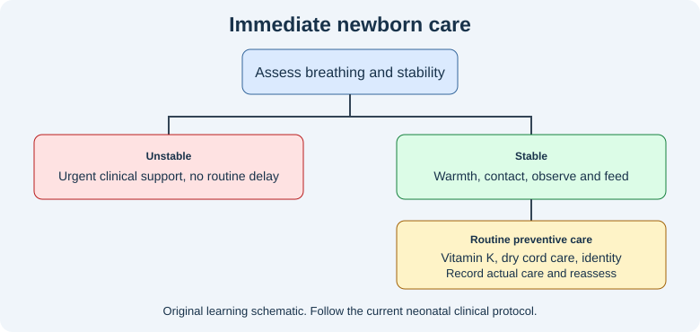

# Immediate newborn care and prophylaxis

**Study-ready draft, abhi studied nahi hai.** Hum healthy newborn ki birth ke baad routine care aur preventable bleeding ko samjhenge. Sick newborn ko indicated emergency care pehle milni chahiye.

[Chapter](../README.md) · [20 original MCQs](../MCQs/01C-Immediate-Newborn-Care-and-Prophylaxis-20-MCQs.md) · [Evidence](../Previous-Year-Questions/01C-Immediate-Newborn-Care-Evidence-and-Gaps.md)

## 🟠 HIGH YIELD — Stable baby aur first hour

Birth ke baad pehle dekho ki baby spontaneously breathe kar raha hai aur clinically stable hai ya nahi. Vigorous baby ko unnecessary separation ke bina observe karo. Gentle drying ke waqt vernix ko zor se remove mat karo. Vernix ek natural protective skin coating hai. Wet linen replace karna heat loss kam karne mein help karta hai. Agar baby effective breathe kar raha hai aur airway clear hai, toh routine suction ki zaroorat nahi hai. Deep suction se mucosa ko injury ya vagal response ho sakta hai.

Cord placenta aur baby ko connect karta hai. Vigorous baby mein WHO guidance ke hisaab se clamping ko roughly 1–3 minutes delay kiya ja sakta hai. Agar baby ko ventilation chahiye aur intact cord ke saath effective support possible nahi hai, toh routine delay complete hone ke liye resuscitation mat roko. Trained team current protocol ke hisaab se manage karti hai. Early supervised mother-baby contact aur feeding support ke saath observation continue rakho. Nonurgent procedures ko stable first-hour care ke around coordinate karo.

## 🔴 MOST IMPORTANT — Vitamin K prophylaxis

Vitamin K liver mein kuch clotting factors ko functional banane mein help karta hai. Jab baby born hota hai, tab body mein vitamin K reserves limited hote hain. Deficiency mein bleeding rukne mein difficulty ho sakti hai. Kabhi internal bleeding bhi hoti hai, jisme brain ke andar bleeding serious emergency ho sakti hai.

Indian CEmONC 2024 guidance ke hisaab se healthy 3-kg term newborn ke liye 1 mg vitamin K1 IM prophylaxis hai. Preterm ya very small newborn ke liye weight-specific current facility protocol verify karna zaroori hai. Different international guidance mein dose aur timing thresholds vary kar sakte hain. Standard IM site anterolateral thigh hai. Medicine draw karne se pehle correct baby, drug, dose, route, time aur vial concentration check karo.

Example: order 1 mg hai aur vial 2 mg/mL hai. Volume = 1 mg ÷ 2 mg/mL = 0.5 mL. Yeh calculation given concentration ke liye hai. Har vial same concentration ka assume mat karo.

Parents injection refuse karte hain toh unke concerns respectfully suno. Explain karo ki apparently healthy baby mein bhi later deficiency bleeding ho sakti hai. Clinician ko involve karo aur actual consent decision, counselling aur handover document karo. Agar administration status uncertain hai, toh order ko administration proof mat samjho. Sending aur receiving team record reconcile karein.

## 🟠 HIGH YIELD — Cord aur eye care

Facility birth ke baad clean dry cord care follow karo. Unnecessary oil, powder ya wet bandage contamination aur moisture badha sakte hain. Indian CEmONC 2024 clean facility context mein routine chlorhexidine 4% use recommend nahi karta. Other settings aur policies different ho sakti hain. Fresh cord bleeding ko promptly assess aur control karo. Pus aur redness jo abdominal skin par spread kar rahi hai, possible omphalitis yani umbilical infection ka clue hai. Baby ko urgent clinical assessment chahiye.

Routine eye care mein kajal avoid karo. Indian guidance aur international ocular prophylaxis policies ko mix mat karo. Local protocol follow karo. Agar baby ki eyelid swollen hai aur pus aa raha hai, toh prophylactic routine care enough nahi hai. Prompt clinical assessment se organism-specific management decide hota hai.

## 🟡 IMPORTANT — Identification aur handover

Baby ko approved identification band ke saath mother ke identifiers se match karo. Bed number, clothing ya weight alone reliable identity nahi hai. Har transfer par clinical stability aur preventive treatment ka actual status handover karo. Missed prophylaxis ko complete mark karna aur uncertain dose ko blindly repeat karna dono unsafe hain.

## Sources and video leads

- [India CEmONC 2024, chapter 13](https://nhm.gov.in/images/pdf/programmes/maternal-health/guidelines/Revised_CEmONC_curriculum_2024-Part_2.pdf)
- [NHM vitamin K operational guideline](https://nhm.gov.in/images/pdf/programmes/child-health/guidelines/Vitamin_K_Operational_Guidelines.pdf)
- [WHO essential newborn care](https://www.who.int/teams/maternal-newborn-child-adolescent-health-and-ageing/newborn-health/essential-newborn-care)
- [CDC vitamin K and breastfeeding](https://www.cdc.gov/breastfeeding-special-circumstances/hcp/diet-micronutrients/vitamin-k.html)
- [WHO 2025 cord clamping recommendation](https://www.ncbi.nlm.nih.gov/books/NBK619233/table/ch3.tab23/)
- Teaching lead: [Vitamin K in newborns (kanakion) - Neonatology and Pediatrics](https://www.youtube.com/watch?v=P-XgDUvX1sY). Indexed metadata only. Playback, channel and full clinical content verification pending.
- Practice lead: [Neonatal Care MCQs: Test Your Knowledge Today! AIIMS NORCET 2026](https://www.youtube.com/watch?v=FhJsG8Pdzp4). Indexed general neonatal MCQ description. Specific item coverage and playback pending.

[20 MCQs](../MCQs/01C-Immediate-Newborn-Care-and-Prophylaxis-20-MCQs.md) · [Evidence](../Previous-Year-Questions/01C-Immediate-Newborn-Care-Evidence-and-Gaps.md) · [Chapter](../README.md)
