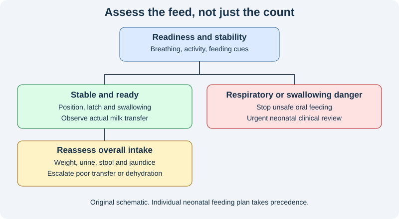

# Neonatal breastfeeding assessment and feeding support

**Study-ready draft, abhi studied nahi hai.** Hum baby ki feeding readiness, effective milk transfer aur feeding safety samjhenge. Sick, preterm aur medically unstable newborn ka feeding plan individual neonatal assessment se decide hota hai.

[Chapter](../README.md) · [20 original MCQs](../MCQs/01D-Neonatal-Breastfeeding-Assessment-and-Feeding-Support-20-MCQs.md) · [Evidence](../Previous-Year-Questions/01D-Breastfeeding-Assessment-Evidence-and-Gaps.md)

## 🟠 HIGH YIELD — Pehla feed aur feeding cues

Colostrum first milk hai. Yeh thick yellowish ho sakta hai aur protective substances provide karta hai. Stable mother aur infant mein first hour ke andar breastfeeding initiate karne mein support karo. Routine honey, water ya other prelacteal feeds avoid karo. Honey young infants mein botulism ka risk bhi carry karta hai. Agar mother ya baby clinically unstable hain, toh safety needs pehle address karke appropriate feeding plan arrange karo.

Baby jab haath mouth ke paas laata hai, mouth open karta hai ya licking movements karta hai, toh yeh feeding readiness ke clues ho sakte hain. Crying late cue ho sakti hai. Healthy newborn mein 8–12 feeds per day common hain, lekin fixed number alone adequate intake prove nahi karta. Rooming-in mein mother aur baby clinically appropriate situation mein saath rehte hain. Isse mother cues jaldi pehchan sakti hai.

## 🔴 MOST IMPORTANT — Position aur attachment

Feeding ke liye baby ka head aur trunk ek line mein hona useful hai. Neck twisted ho toh suck aur swallow coordinate karna difficult ho sakta hai. Baby ka whole body support karo aur mother ki taraf face karvao. Good attachment mein mouth wide hota hai, lower lip outward turn hoti hai aur chin breast ko touch kar sakti hai. Deep slow sucks ke saath swallowing observe karo. Agar mother ko persistent pain hai ya baby repeatedly slip kar raha hai, toh feed observe karke latch improve karo. Baby upset ho toh gentle contact se calm karo, forceful attachment mat karo.

## 🟠 HIGH YIELD — Expression aur alternative feeding

Temporary separation mein breast milk production establish ya maintain karne ke liye regular expression support karna useful hai. Hand expression mein clean hands aur container use karo. Breast tissue ko nipple ke peeche gently compress aur release karo, nipple ko repeatedly pinch ya pull mat karo.

Clinically stable infant ko prescribed cup feeding di ja rahi hai toh supported upright position rakho. Cup ko lower lip tak lao aur baby ko apni pace par sip ya lap karne do. Milk mouth mein pour nahi karna hai. Agar infant breathe ya swallow safely nahi kar raha, toh oral feeding stop karke assessment karao. Preterm aur sick baby ke liye trained team route aur volume decide karti hai.

## 🔴 MOST IMPORTANT — Milk transfer aur danger signs

Sirf feed count se milk transfer confirm nahi hota. Nurse attachment, swallowing, weight trend, urine aur stool pattern ko saath assess karti hai. Birth weight 3200 g aur current weight 2848 g ho toh weight loss 352 g hai. Percentage = 352 ÷ 3200 × 100 = 11%. Excessive weight loss ke saath low urine output ya shallow latch ho toh prompt feeding aur clinical review chahiye. Automatic permanent breastfeeding cessation appropriate nahi hai.

Jab baby ka intake kam hai, toh stool output kam ho sakta hai. Bilirubin intestine se reabsorb hone ka chance badh sakta hai. Worsening jaundice ko sirf poor feeding bolkar ignore mat karo. Feeding aur bilirubin assessment dono chahiye. Tachypnea, retractions aur repeated coughing during feeds aspiration aur respiratory compromise ke clues hain. Oral feeding stop karke urgent neonatal assessment arrange karo.

## 🟠 HIGH YIELD — Supplementation aur discharge

Agar clinical assessment ke baad supplement medically indicated hai, toh mother ka available milk priority hai. Approved screened donor milk available ho toh consider kiya ja sakta hai. Formula zaroorat ke hisaab se prescribed plan mein use hota hai. Saath mein milk production support karo. Unscreened informal donor milk ya glucose water nutritionally appropriate safe substitute nahi hai.

Discharge se pehle baby ki feeding ability, weight, hydration aur reliable follow-up plan review karo. Mother ka medically fit hona baby ko automatically discharge-ready nahi banata. Agar safe plan establish nahi hai aur clinical concerns hain, toh clinician discharge timing reconsider kare.

## Sources and video gaps

- [WHO early essential newborn care](https://www.who.int/news-room/questions-and-answers/item/early-essential-newborn-care)
- [WHO infant and young child feeding](https://www.who.int/news-room/fact-sheets/detail/infant-and-young-child-feeding)
- [CDC newborn breastfeeding basics](https://www.cdc.gov/infant-toddler-nutrition/breastfeeding/newborn-basics.html)
- [ABM discharge protocol 2022](https://pmc.ncbi.nlm.nih.gov/articles/PMC9206473/)
- [WHO/UNICEF helping with a breastfeed](https://www.ncbi.nlm.nih.gov/sites/books/NBK153488/)

Specific teaching and question-solving video coverage remains pending. No exact video match or official exam appearance is claimed.

[20 MCQs](../MCQs/01D-Neonatal-Breastfeeding-Assessment-and-Feeding-Support-20-MCQs.md) · [Evidence](../Previous-Year-Questions/01D-Breastfeeding-Assessment-Evidence-and-Gaps.md) · [Chapter](../README.md)
