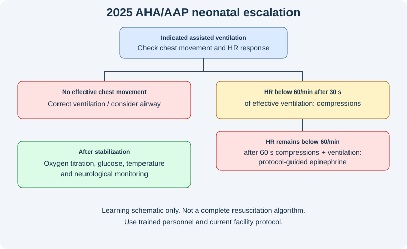

# Neonatal resuscitation and post-resuscitation care

**Study-ready draft.** Yeh 2025 AHA/AAP birth-resuscitation guidance par based nursing exam preparation hai. Actual clinical resuscitation trained team, current facility protocol aur equipment ke saath hoti hai.

[Chapter](../README.md) · [20 original MCQs](../MCQs/02A-Neonatal-Resuscitation-and-Postresuscitation-Care-20-MCQs.md) · [Evidence](../Previous-Year-Questions/02A-Neonatal-Resuscitation-Evidence-and-Gaps.md)

## 🔴 MOST IMPORTANT — Birth se pehle preparation

Newborn birth ke baad placenta ki jagah lungs se oxygen lene lagta hai. Agar lungs mein air effectively nahi ja rahi, toh oxygenation aur heart rate dono affect ho sakte hain. Isliye neonatal resuscitation mein effective ventilation central role rakhti hai. Har birth par ek dedicated trained newborn care provider hona chahiye jo needed ventilation de sake. Team equipment check, role assignment aur escalation plan pehle ready rakhe.

## 🔴 MOST IMPORTANT — Ventilation response

Agar initial steps ke baad baby apne aap breathe nahi kar raha ya persistent bradycardia hai, toh indicated assisted ventilation promptly start ki jaati hai. 2025 AHA/AAP reasonable ventilation rate 30–60 inflations/min batati hai. Heart rate rise hona effective ventilation ka primary indicator hai. Chest movement bhi assess karo. Mask se air leak ho rahi hai toh seal correct karo. Airway obstruction ya insufficient lung inflation ke liye trained team appropriate corrective steps aur alternative airway consider karti hai.

Pulse oximeter ka preductal sensor right hand ya wrist par lagta hai. Term baby mein initial respiratory support air se start ho sakta hai. 32 to less than 35 weeks gestation mein 21–30% oxygen range reasonable hai. More immature infants ke liye different starting range aur titration requirements hoti hain. Saturation targets birth ke baad minute aur gestation ke context mein interpret karo. Adult oxygen target directly apply mat karo.

## 🔴 MOST IMPORTANT — When compressions and epinephrine are indicated

AHA/AAP 2025 guidance ke hisaab se agar 30 seconds effective ventilation se chest move karne ke baad bhi heart rate 60/min se kam hai, toh compressions start ki jaati hain. Alternative airway preferably established hota hai. Ineffective mask ventilation ka elapsed time adequate ventilation nahi maana jaata. Agar chest move nahi hui hai, toh ventilation optimize karo.

Newborn mein recommended synchronized ratio 3 compressions to 1 ventilation hai. Two-thumb encircling technique mein lower third sternum par pressure apply hota hai aur xiphoid avoid hota hai. Depth approximately chest ke anterior-posterior diameter ka one-third hai. Har cycle mein 4 actions hain. 15 cycles mein 45 compressions aur 15 breaths hote hain.

Agar adequate ventilation ke saath 60 seconds compressions ke baad HR still below 60/min hai, toh protocol-guided epinephrine indicated hai. Umbilical venous route preferred vascular route hai. Agar IV access feasible nahi hai toh IO access trained team consider kar sakti hai. Exact drug dose aur preparation current protocol se verify karo. Suspected blood loss ke context mein standard interventions ke bawajood severe bradycardia ho toh volume expansion indicated ho sakti hai. Yeh har newborn ke liye routine fluid bolus nahi hai.

## 🟠 HIGH YIELD — Post-resuscitation care

Circulation recover hone ke baad excessive oxygen exposure avoid karne ke liye oxygen requirement reassess karo. Advanced resuscitation receive karne wale baby mein respiratory status, heart rate, temperature, oxygenation aur blood glucose close monitoring chahiye. Neurological status bhi important hai. Selected infants 36 weeks ya above mein hypoxic-ischemic encephalopathy ke criteria assess kiye jaate hain. Therapeutic hypothermia sirf defined eligibility, monitoring aur capable facility mein specialist team deliver karti hai. Uncontrolled cooling routine care nahi hai.

## Evidence and video gaps

- [2025 AHA/AAP neonatal resuscitation full web guideline](https://cpr.heart.org/en/resuscitation-science/cpr-and-ecc-guidelines/neonatal-resuscitation)
- [2025 AHA/AAP Pediatrics article](https://publications.aap.org/pediatrics/article/157/1/e2025074352/205237/Part-5-Neonatal-Resuscitation-2025-American-Heart)
- [Indian CEmONC 2024 chapter 13](https://nhm.gov.in/images/pdf/programmes/maternal-health/guidelines/Revised_CEmONC_curriculum_2024-Part_2.pdf)

Specific teaching and question-solving video playback and item-level mapping remain pending. Current guideline scope is explicitly identified to avoid conflating different resuscitation protocols.

[20 MCQs](../MCQs/02A-Neonatal-Resuscitation-and-Postresuscitation-Care-20-MCQs.md) · [Evidence](../Previous-Year-Questions/02A-Neonatal-Resuscitation-Evidence-and-Gaps.md) · [Chapter](../README.md)
