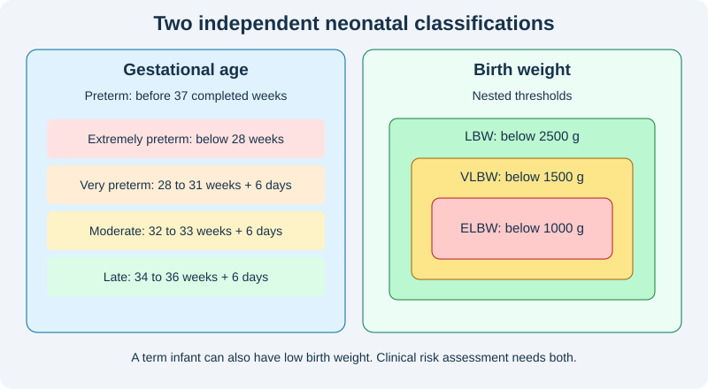

# Prematurity and low birth weight nursing care

**Study-ready draft.** Hum prematurity aur low birth weight ka difference, monitoring aur nutritional support samjhenge. Actual care individual neonatal plan ke according hoti hai.

[Chapter](../README.md) · [20 original MCQs](../MCQs/02B-Prematurity-and-Low-Birth-Weight-Nursing-Care-20-MCQs.md) · [Evidence](../Previous-Year-Questions/02B-Prematurity-and-LBW-Evidence-and-Gaps.md)

## 🔴 MOST IMPORTANT — Gestational age aur birth weight

Gestational age pregnancy ki duration ka clinical estimate hai. Baby 37 completed weeks se pehle born ho toh preterm kehte hain. Extremely preterm 28 weeks se pehle hota hai. Very preterm 28 se 31 weeks 6 days, moderate preterm 32 se 33 weeks 6 days aur late preterm 34 se 36 weeks 6 days hota hai. New Ballard score physical aur neuromuscular maturity assess karne mein help karta hai. Best obstetric dating ke saath ise interpret karo.

Birth weight alag classification hai. 2500 g se kam low birth weight, 1500 g se kam very low birth weight aur 1000 g se kam extremely low birth weight kehte hain. Yeh nested cutoffs hain. 39-week baby 2100 g ka ho toh term bhi hai aur LBW bhi. Gestation-specific growth chart se assess karo ki baby gestational age ke comparison mein small hai ya nahi. Sirf birth weight se gestational age infer mat karo.

## 🟠 HIGH YIELD — Immaturity aur monitoring

Preterm baby ki lungs, neurological control, feeding coordination aur metabolic reserves immature ho sakte hain. Late preterm ka weight normal range mein ho tab bhi feeding, temperature aur blood glucose monitoring important ho sakti hai. Serial weight, length aur head circumference suitable growth chart par plot karo. Early weight change fluid shifts bhi reflect kar sakta hai. Weight decline ke saath sodium rise aur reduced urine output concern raise karte hain. Team ko report karke complete fluid balance assess karo.

Very preterm infants mein intraventricular hemorrhage kabhi clinical symptoms ke bina bhi hoti hai. Isliye gestation-specific cranial ultrasound screening indicated ho sakti hai. Actual screening timing local protocol aur baby ki condition se decide hoti hai. Retinal aur other risk-based screening bhi prescribed schedule se coordinate karo.

## 🔴 MOST IMPORTANT — Nutrition aur fluid calculations

WHO 2022 preterm/LBW infant mein mother's own milk recommend karta hai. Very preterm ya VLBW infant mein individual nutrition review ke baad multicomponent fortifier consider kiya ja sakta hai. Har newborn ke liye mandatory nahi hai. Human milk-fed preterm/LBW infants jinhe other iron source nahi mil raha, unke liye prescribed enteral iron important preventive measure hai. Dose aur timing individualized hoti hai.

Hospitalized infant born before 34 weeks mein scheduled feeding consider ki ja sakti hai jab cues immature hain. Route, interval aur volume clinical team decide karti hai. Unstable infants ke liye feeding initiation individualized hai. Suck-swallow-breathe coordination safe nahi hai toh oral feeds force mat karo.

Example 1: Given order 120 mL/kg/day, weight 1.25 kg aur 8 equal feeds. Daily volume 120 × 1.25 = 150 mL. Per feed 150 ÷ 8 = 18.75 mL. Rounding aur prescribed delivery method verify karo.

Example 2: Total fluid order 100 mL/kg/day aur weight 1.4 kg. Total 140 mL/day hai. Agar enteral 56 mL/day aur koi other source nahi hai, toh IV remainder 140 − 56 = 84 mL/day. Actual infusion, medication carrier fluids aur all other sources account karne hote hain.

## 🟠 HIGH YIELD — Respiratory support aur escalation

Apnea of prematurity mein immature respiratory control ki wajah se breathing pauses ho sakte hain. Caffeine prescribed treatment ho sakti hai. Lekin new or worsening apnea ke saath temperature instability ya poor perfusion ho toh serious illness evaluate karni chahiye. Isko automatic routine apnea mat label karo.

CPAP continuous distending pressure provide karti hai, jisse alveoli expiration ke waqt open rehne mein help milti hai. WHO preterm infants mein clinical RDS ke signs ke saath CPAP recommend karta hai. Device settings aur saturation targets specialist team manage karti hai. Respiratory effort aur clinical response monitor karna zaroori hai.

## 🟠 HIGH YIELD — Discharge readiness

Preterm infant ko discharge karne ke liye sirf weight cutoff enough nahi hai. Stable temperature, cardiorespiratory stability, safe feeding aur caregiver readiness assess karo. Recurrent significant apnea ya ongoing thermal dependence hai toh clinician review aur individualized discharge plan chahiye. Follow-up aur danger sign counselling document karo.

## Sources and video gaps

- [MSD professional preterm infants](https://www.msdmanuals.com/professional/pediatrics/perinatal-problems/preterm-infants)
- [WHO 2022 recommendations for preterm or LBW infants](https://www.ncbi.nlm.nih.gov/books/NBK586699/)

Dedicated topic teaching and MCQ-practice video verification remains pending. No exact historical question claim.

[20 MCQs](../MCQs/02B-Prematurity-and-Low-Birth-Weight-Nursing-Care-20-MCQs.md) · [Evidence](../Previous-Year-Questions/02B-Prematurity-and-LBW-Evidence-and-Gaps.md) · [Chapter](../README.md)
