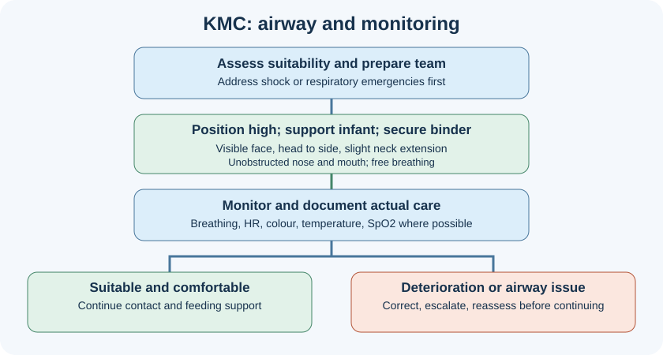

# Kangaroo mother care — clinical nursing concept guide

**Original study guide | isolated draft | independent clinical review pending**

[20 practice MCQs](../MCQs/02C-Kangaroo-Mother-Care-Positioning-and-Monitoring-20-MCQs.md) · [Evidence and verification gaps](../Previous-Year-Questions/02C-Kangaroo-Mother-Care-Evidence-and-Gaps.md)

## High-yield definition and eligibility

Kangaroo mother care (KMC) combines prolonged skin-to-skin contact with the mother and breast-milk feeding. The 2025 WHO practice guide distinguishes additional caregiver skin-to-skin contact from maternal KMC. WHO 2022 recommends routine KMC for all preterm or low-birth-weight infants, for 8–24 hours daily, maximizing feasible duration. A term infant weighing below 2,500 g is also low birth weight.

## Immediate initiation and clinical exceptions

Initiate as soon as possible. In a facility with appropriate monitoring, initiation can precede complete clinical stability, except when the infant cannot breathe spontaneously after resuscitation, is in shock, or requires mechanical ventilation. Stabilization and prescribed respiratory support are never delayed for contact. Non-invasive CPAP is not an automatic exclusion; neonatal staff assess suitability and assist with safe transfers.

## Nursing positioning checklist

- Hand hygiene, identify infant, assess condition, explain the procedure and prepare supportive seating.
- Place the infant high against the bare maternal chest, in a supported prone/upright position. Turn the head to one side, with slight neck extension and the face visible.
- Avoid chin-to-chest flexion, excessive extension, slipping, and obstruction of nose or mouth.
- Support neck and buttocks. Keep hips and knees flexed comfortably and hips partly abducted, without forcing joints.
- Secure the binder so the infant is held firmly without restriction of breathing. Check position again after movement.
- Coordinate staff support for CPAP interface, tubing and other prescribed lines; do not disconnect treatment simply to initiate contact.

## Monitoring and escalation

Observe airway, breathing, heart rate, colour, temperature and oxygen saturation where possible, with intensity appropriate to the infant's condition. Record actual start and stop times, feeding and clinical observations. Correct slipping or unsafe neck position immediately; assess breathing. Acute desaturation or dislodged respiratory support requires immediate clinical response, help from the neonatal team and reassessment before continuation.

## Feeding, caregiver support and follow-up

Help with breast-milk feeding, expression and prescribed feeding methods as appropriate. Provide supportive seating and practical assistance. A trained additional caregiver can provide skin-to-skin contact when the mother is temporarily unavailable. Inadequate growth requires evaluation of feeding, intake, illness and growth trajectory; do not assume contact alone resolves it. Individualize discharge and follow-up according to the neonatal team and local protocol. At home, poor feeding or difficult breathing warrants urgent medical assessment.

## Exam focus

- WHO 2022 duration: 8–24 hours daily, as many as possible.
- Do not confuse low birth weight with prematurity.
- Airway patency and clinical stability take precedence over contact duration.
- Document actual delivered care, excluding interruptions.
- WHO 2025 guide does not set a single universal discharge weight.

## References

- [WHO 2022 recommendations, A.1a and A.1b](https://www.ncbi.nlm.nih.gov/books/NBK586699/)
- [WHO 2025 clinical practice guide](https://www.who.int/teams/maternal-newborn-child-adolescent-health-and-ageing/newborn-health/kangaroo-mother-care-practice-guide)

[Return to chapter](../README.md)
