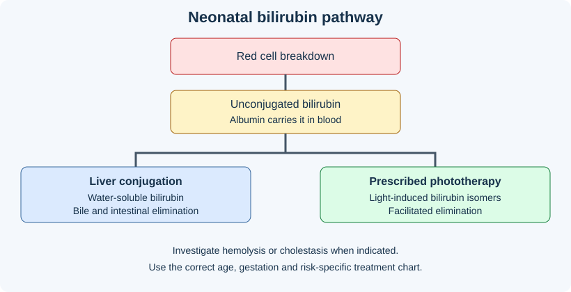

# Neonatal jaundice and phototherapy

**Study-ready draft.** Abhi learner completion record nahi kiya gaya hai.

[Chapter](../README.md) · [20 MCQs](../MCQs/03A-Neonatal-Jaundice-and-Phototherapy-20-MCQs.md) · [Evidence](../Previous-Year-Questions/03A-Neonatal-Jaundice-Evidence-and-Gaps.md)

## 🟠 HIGH YIELD — Bilirubin kaise banta hai?

Jab red blood cells breakdown hote hain, tab haemoglobin se bilirubin banta hai. Pehle yeh unconjugated form mein hota hai, jo water soluble nahi hota. Albumin blood mein ise carry karta hai. Liver bilirubin ko conjugate karta hai, jisse bile ke through intestine tak elimination possible hoti hai. Newborn mein red cell turnover aur immature liver processing ki wajah se bilirubin rise ho sakta hai. Immune hemolysis ya liver disease jaise causes bhi possible hain. DAT red cells par antibody coating ka clue deta hai, lekin result ko clinical context mein interpret karna hota hai.

## 🔴 MOST IMPORTANT — Assessment aur treatment thresholds

Skin color dekhkar bilirubin level accurately decide nahi kar sakte. Treatment ke liye age in hours, gestation aur applicable risk factors ke hisaab se appropriate chart use karo. NICE CG98 aur AAP 2022 charts interchangeable nahi hain. AAP guideline 35 weeks ya usse zyada gestation ke infants ke liye hai. Early jaundice ya clinical deterioration urgently assess karo. Serial values se rate calculate ho sakti hai. Example mein 180 se 234 micromol/L six hours mein rise hua, toh 54 ÷ 6 = 9 micromol/L/hour. NICE rapid-rise criterion 8.5 se zyada hai. Prompt neonatal review chahiye.

## 🔴 MOST IMPORTANT — Phototherapy nursing care

Controlled visible blue light unconjugated bilirubin ko aise forms mein convert karti hai jo body eliminate kar sakti hai. Phototherapy bilirubin production ka har cause treat nahi karti. Immune hemolysis ongoing rahe toh treatment ke baad bilirubin dobara rise kar sakta hai. Nurse prescribed light setup, manufacturer-specific distance, skin exposure, protective eye covering, temperature, weight aur wet nappies check karti hai. Serum sample ko light se protect karke lab protocol follow karo. Unregulated sunlight prescribed light ka substitute nahi hai.

Routine phototherapy mein clinically suitable short feeding breaks ho sakti hain. NICE intensified phototherapy mein feeding ke liye interruption avoid karne aur prescribed enteral ya IV nutrition continue karne ko kehta hai. Lactation support maintain karo. High-pitched cry, reduced responsiveness ya abnormal extensor posture acute bilirubin neurotoxicity ke warning signs ho sakte hain. Urgent escalation aur exchange-transfusion assessment chahiye. Permanent injury ko kernicterus kehte hain.

## 🟠 HIGH YIELD — Prolonged aur conjugated jaundice

NICE term infant mein 14 days se zyada aur preterm mein 21 days se zyada jaundice par underlying cause evaluate karta hai. Pale chalky stool aur dark urine cholestasis ka concern raise karte hain. Conjugated bilirubin >25 micromol/L par NICE expert advice recommend karta hai. Total bilirubin chart use karte waqt conjugated fraction subtract mat karo. Biliary obstruction ka definitive treatment phototherapy nahi hai. Urgent cause-specific referral arrange karo.

## Sources

- [NICE CG98 (2023 version)](https://www.ncbi.nlm.nih.gov/books/NBK553311/)
- [RCH phototherapy nursing guideline](https://www.rch.org.au/rchcpg/hospital_clinical_guideline_index/phototherapy_for_neonatal_jaundice/)
- [AAP 2022 guideline FAQ](https://www.aap.org/en/patient-care/hyperbilirubinemia/frequently-asked-questions-about-the-2022-aap-guideline-on-the-management-of-hyperbilirubinemia/)

[20 MCQs](../MCQs/03A-Neonatal-Jaundice-and-Phototherapy-20-MCQs.md) · [Evidence](../Previous-Year-Questions/03A-Neonatal-Jaundice-Evidence-and-Gaps.md) · [Chapter](../README.md)
