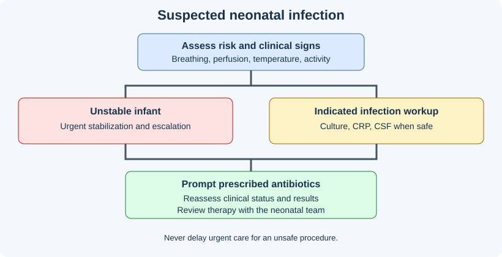

# Neonatal sepsis and infection nursing care

**Study-ready draft, unattempted.** Yeh learning material hai. Local antibiotic policy, neonatal orders aur emergency protocols follow karo.

[Chapter](../README.md) · [20 MCQs](../MCQs/03B-Neonatal-Sepsis-and-Infection-Nursing-Care-20-MCQs.md) · [Evidence](../Previous-Year-Questions/03B-Neonatal-Sepsis-Evidence-and-Gaps.md)

## 🔴 MOST IMPORTANT — Infection ka onset aur risk

Sepsis mein infection ke response se body ke functions seriously affect ho sakte hain. Newborn ka immune response immature hota hai. Baby mein adult jaisa fever hamesha nahi milta. Temperature instability, unusual activity, feeding change, breathing difficulty ya poor perfusion concern raise karte hain. NICE NG195 early-onset ko first 72 hours aur late-onset ko iske baad classify karta hai. Maternal GBS history early infection risk assessment mein useful hai. Prematurity, invasive vascular lines aur intensive care late-onset risk ko increase kar sakte hain.

## 🔴 MOST IMPORTANT — Investigations aur prompt treatment

Blood culture se possible organism aur antibiotic susceptibility identify ho sakti hai. Antibiotic start karne se pehle feasible sample collect karo, par urgent treatment delay mat karo. Baseline CRP inflammatory response ka marker hai. Ek normal value infection rule out nahi karti. Serial CRP, culture aur clinical progress saath assess hote hain. NICE decision to treat ke baad ek hour ke andar antibiotic delivery recommend karta hai. Example mein 09:20 par decision hua toh 10:20 latest time hai, wait karne ka target nahi.

Meningitis suspected ho toh lumbar puncture se CSF collect karte hain jab procedure safe ho. Immediately before LP blood glucose check karne se CSF glucose ka ratio interpret hota hai. Shock ya respiratory compromise mein stabilization first hai. Unsafe LP ke liye antibiotics mat roko. NICE neonatal-unit late-onset assessment mein routine urine culture ya localized lesion ke bina skin swab automatically recommend nahi karta. Home se admitted infant ka pathway different ho sakta hai.

## 🟠 HIGH YIELD — Antibiotic safety aur stewardship

Prescribed empiric antibiotic likely organisms aur local resistance data cover karne ke liye start hota hai. Culture result ke baad team infection site, susceptibility aur response dekhkar targeted therapy review karti hai. Aminoglycoside jaise gentamicin mein renal function aur drug levels check karna important hai. Urine output decline aur unexpectedly high level ho toh next dose se pehle prescribing team ko report karo.

NICE early-onset infection mein negative culture at 36 hours, low initial suspicion, reassuring baby aur reassuring CRP trend ke saath stopping consider karta hai. Nurse prescribed decision document aur facilitate karti hai. Sirf negative culture ke basis par khud se antibiotic stop mat karo. Coagulase-negative staphylococci skin flora bhi ho sakte hain aur catheterized preterm infants mein true pathogen bhi. Clinical context evaluate karo.

## 🟠 HIGH YIELD — Prevention aur surveillance

Central line dressing intact aur clean honi chahiye. Aseptic technique aur local line-care bundle use karo. Unnecessary hub disconnections avoid karo. Agar bloodstream infection cluster dikhta hai, toh infection-prevention team ko report karo. Culture data, case definitions, line days aur insertion/maintenance practices review karne se possible process failure identify hota hai. Individual treatment continue rakho. Multiple birth mein ek baby infected ho toh other baby ka relevant risk aur clinical condition review karo.

## Sources

- [NICE NG195 (accessible NCBI version)](https://www.ncbi.nlm.nih.gov/books/NBK571222/)
- [NICE updated investigations chapter](https://www.nice.org.uk/guidance/ng195/chapter/investigations-before-starting-antibiotics-for-early-onset-or-late-onset-neonatal-infection)
- [NICE early-onset antibiotic chapter](https://www.nice.org.uk/guidance/ng195/chapter/Antibiotics-for-early-onset-neonatal-infection)

[20 MCQs](../MCQs/03B-Neonatal-Sepsis-and-Infection-Nursing-Care-20-MCQs.md) · [Evidence](../Previous-Year-Questions/03B-Neonatal-Sepsis-Evidence-and-Gaps.md) · [Chapter](../README.md)
