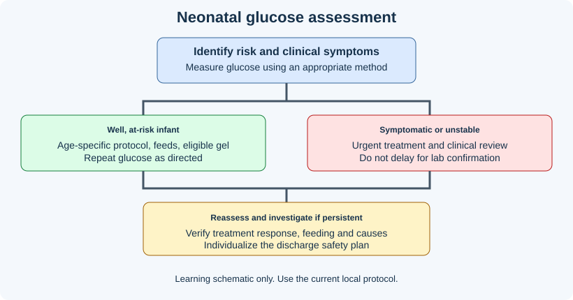

# Neonatal hypoglycemia screening and glucose therapy

**Study-ready draft.** CPS guidance ko specific context ke saath samjhenge. Local neonatal protocol aur actual prescription follow karna zaroori hai.

[Chapter](../README.md) · [20 MCQs](../MCQs/03C-Neonatal-Hypoglycemia-Screening-and-Glucose-Therapy-20-MCQs.md) · [Evidence](../Previous-Year-Questions/03C-Neonatal-Hypoglycemia-Evidence-and-Gaps.md)

## 🟠 HIGH YIELD — Birth ke baad glucose regulation

Pregnancy mein placenta maternal glucose baby tak pahunchata hai. Birth ke baad continuous supply rukti hai aur baby feeding, glycogen breakdown aur glucose production par depend karta hai. Insulin glucose uptake aur storage mein help karta hai. Preterm baby mein reserves limited ho sakte hain. Excess insulin glucose aur alternative fuel ketones dono reduce kar sakta hai. Isliye persistent hyperinsulinemic hypoglycemia neurological risk create kar sakti hai.

## 🔴 MOST IMPORTANT — Risk screening aur treatment

CPS preterm, SGA, maternal diabetes, asphyxia aur LGA infants mein risk-based screening recommend karta hai. Healthy term infants without risks mein routine universal screening nahi hoti. Asymptomatic at-risk baby ko two hours of age par screen karke feeds ke saath repeat checks plan karo. Preterm/SGA baby mein stable readings aur established feeds ke saath 24 hours par stopping review ho sakti hai.

First 72 hours mein CPS at-risk infant ka treatment target 2.6 mmol/L ya above hai. Well infant mein 1.8–2.5 mmol/L par enteral supplementation aur suitable buccal gel consider ho sakti hai. Thirty minutes baad recheck karo. Symptomatic low glucose urgent hai aur IV dextrose indicated ho sakti hai. Gel sirf suitable temporary measure ho sakti hai jab IV access establish ho raha hai. Bedside meter low range mein inaccurate ho sakta hai. Reliable confirmation arrange karo, par emergency treatment delay mat karo.

## 🔴 MOST IMPORTANT — Glucose therapy calculations

40% buccal gel aur IV dextrose solutions different preparations hain. Gel cheek ke inner surface par prescribed technique se apply hoti hai. Dose example: given order 0.5 mL/kg for 2.4 kg infant. 2.4 × 0.5 = 1.2 mL. Feed bhi important hai kyunki gel full nutrition nahi hai.

GIR glucose infusion rate hai, mg/kg/min mein express hota hai. D10 mein 100 mg/mL glucose hota hai. 2 kg baby ko 6 mL/hour order mila toh GIR = 100 × 6 ÷ 60 ÷ 2 = 5 mg/kg/min. Reverse calculation mein given GIR 7 aur weight 2.5 kg ho toh 7 × 2.5 × 60 ÷ 100 = 10.5 mL/hour. Har calculation mein actual order, concentration, total fluid allowance aur infusion device verify karo. Yeh examples blanket dosing recommendations nahi hain.

IV site swelling ya blanching ho toh affected infusion stop karke infiltration protocol follow karo. Saath mein safe alternative glucose delivery promptly coordinate karo.

## 🟠 HIGH YIELD — Persistent hypoglycemia

72 hours ke baad continuing hypoglycemia CPS mein underlying cause investigation demand karti hai. Persistent treatment target at least 3.3 mmol/L hai. Low bedside value par critical sample aur laboratory confirmation clinician-directed workup ka part ho sakte hain. Sample ke liye urgent glucose treatment delay mat karo. Persistent cases mein discharge se pehle supervised fasting safety assessment, diagnosis, treatment aur caregiver education important hain. Ghar par unsupervised fasting nahi karna hai.

## Sources

- [Canadian Paediatric Society neonatal hypoglycemia position statement](https://cps.ca/en/documents/position/newborns-at-risk-for-low-blood-glucose)
- [PubMed abstract](https://pubmed.ncbi.nlm.nih.gov/31844395/)

[20 MCQs](../MCQs/03C-Neonatal-Hypoglycemia-Screening-and-Glucose-Therapy-20-MCQs.md) · [Evidence](../Previous-Year-Questions/03C-Neonatal-Hypoglycemia-Evidence-and-Gaps.md) · [Chapter](../README.md)
