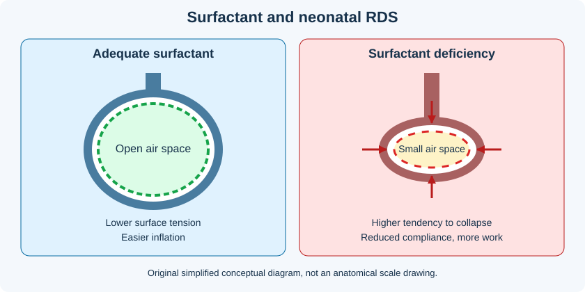

# Neonatal respiratory distress syndrome

**Study-ready draft.** Yeh newborn-specific respiratory disease ka nursing guide hai. Adult ARDS ke diagnostic criteria ko neonatal RDS par directly apply nahi karna hai.

[Chapter](../README.md) · [20 MCQs](../MCQs/03D-Neonatal-Respiratory-Distress-Syndrome-20-MCQs.md) · [Evidence](../Previous-Year-Questions/03D-Neonatal-RDS-Evidence-and-Gaps.md)

## 🔴 MOST IMPORTANT — Surfactant deficiency ka mechanism

Alveoli lungs ki chhoti hawa ki thailiyan hoti hain. Inki inner surface par fluid film hoti hai. Is film ki surface tension alveoli ko collapse karne ki taraf kheenchti hai. Surfactant is tension ko reduce karta hai aur alveoli ko open rehne mein help karta hai. Premature baby mein surfactant production inadequate ho sakti hai. Is wajah se diffuse atelectasis, yani alveoli ka collapse, aur reduced lung compliance ho sakti hai. Compliance kam hone ka matlab lungs ko expand karna difficult hai. Baby ko breathing ke liye zyada effort karna padta hai. Collapsed lung units mein blood jaane par adequate oxygen nahi milti. Severe cases mein fatigue aur CO2 retention bhi ho sakti hai.

RDS ko pehle hyaline membrane disease bhi kehte the. Maternal diabetes relatively mature baby mein bhi risk badha sakti hai. Eligible threatened preterm birth mein clinician antenatal corticosteroids prescribe kar sakta hai jo fetal lung maturation support karte hain.

## 🟠 HIGH YIELD — Clinical signs aur differential diagnosis

Retractions mein soft chest wall inspiration ke time andar khinchti hai. Nasal flaring, grunting aur tachypnea bhi breathing effort ke clues hain. RDS radiograph mein low lung expansion aur diffuse granular/ground-glass appearance with air bronchograms mil sakte hain. Yeh findings alone definitive diagnosis nahi hain.

TTN, yani transient tachypnea of newborn, fetal lung fluid ke delayed clearance se hoti hai. Ismein relatively expanded lungs aur fissural fluid mil sakta hai. Pneumonia, sepsis, pneumothorax aur cardiac conditions bhi similar distress de sakti hain. Clinical trajectory aur associated signs evaluate karo. Agar RDS ke saath nayi temperature instability aur poor perfusion ho toh coexisting infection consider karna important hai.

## 🔴 MOST IMPORTANT — Respiratory support and surfactant

FiO2 inspired gas mein oxygen ka fraction hai. Blender selected oxygen-air mixture provide karta hai. SpO2 baby ki measured oxygen saturation hai. Dono readings same concept nahi hain. Prescribed target aur clinical response ke according oxygen titration hoti hai.

Spontaneously breathing infant ko appropriate noninvasive pressure support mil sakti hai. Surfactant replacement prescribed indication par trained team respiratory tract mein deliver karti hai. Endotracheal route conventional method hai. LISA mein thin tracheal catheter use hota hai while spontaneous breathing aur appropriate noninvasive support maintain ki ja sakti hai. Specific eligibility, thresholds aur equipment neonatal team aur current guideline decide karti hai. 2025 European consensus guideline ka use exact gestation aur clinical context ke saath karna chahiye.

Surfactant se compliance rapidly improve ho sakti hai. Agar same ventilator pressure par tidal volume suddenly badhe aur oxygenation improve ho, toh team settings reassess kare. Too much volume ya oxygen bhi harm kar sakta hai.

## 🟠 HIGH YIELD — Nursing monitoring aur safety

Nasal interface fit aur septum skin inspect karo. Redness ya indentation early pressure injury ka clue hai. Correct fit aur pressure relief ke saath needed breathing support continue rakho. Interface dislodged ho toh actual gas delivery aur baby ka clinical status check karo.

CPAP ke through kuch gas stomach mein enter ho sakti hai. Prescribed orogastric venting gas remove karne mein help karti hai. Distension ko hamesha benign CPAP belly assume mat karo. Abdominal findings aur feeding tolerance evaluate karo.

Sudden desaturation, asymmetric breath sounds aur circulatory deterioration pressure support ke dauran pneumothorax ka warning pattern ho sakta hai. Urgent neonatal assessment chahiye. Blood gas pH 7.20 aur PaCO2 68 mmHg with no primary metabolic disorder respiratory acidosis suggest karta hai. Worsening ventilation urgently review karo. Prolonged respiratory support ke saath immature lung injury aur BPD risk ko follow-up mein assess kiya jata hai.

## Sources

- [MSD professional neonatal RDS](https://www.msdmanuals.com/professional/pediatrics/respiratory-problems-in-neonates/respiratory-distress-syndrome-in-neonates)
- [European RDS consensus 2025](https://doi.org/10.1159/000551062)
- [Neonatal Network CPAP nursing guidance](https://neonatalnetworkssoutheast.nhs.uk/professionals/guidelines/tvw-guidelines/nursing-care-of-cpap-biphasic-cpap/)
- [MSD transient tachypnea](https://www.msdmanuals.com/professional/pediatrics/respiratory-problems-in-neonates/transient-tachypnea-of-the-newborn)

[20 MCQs](../MCQs/03D-Neonatal-Respiratory-Distress-Syndrome-20-MCQs.md) · [Evidence](../Previous-Year-Questions/03D-Neonatal-RDS-Evidence-and-Gaps.md) · [Chapter](../README.md)
