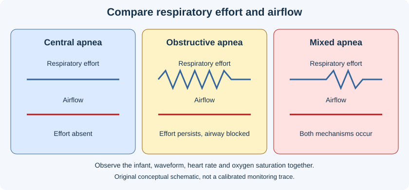

# Neonatal apnea monitoring and caffeine safety

**Study-ready draft.** Yeh guide preterm infant ke apnea events aur monitoring ko explain karti hai. Birth resuscitation ka algorithm aur later neonatal unit events alag contexts hain. Local emergency protocol follow karo.

[Chapter](../README.md) · [20 MCQs](../MCQs/03E-Neonatal-Apnea-Monitoring-and-Caffeine-Safety-20-MCQs.md) · [Evidence](../Previous-Year-Questions/03E-Neonatal-Apnea-Evidence-and-Gaps.md)

## 🔴 MOST IMPORTANT — Apnea aur periodic breathing

Preterm infant mein respiratory control immature ho sakta hai. Apnea mein breathing pause hoti hai. Clinically significant event prolonged pause ho sakti hai, ya shorter pause ke saath bradycardia, desaturation, cyanosis ya pallor ho sakti hai. Sirf seconds count karna enough nahi hai. Periodic breathing mein cycles of breaths aur brief pauses ho sakte hain without significant compromise. Infant ka color, oxygenation, heart rate aur actual effort assess karna zaroori hai.

Central apnea mein respiratory effort absent hoti hai. Obstructive apnea mein infant effort kar raha hota hai par airflow block ho sakti hai. Mixed apnea mein dono mechanisms occur kar sakte hain. Monitor waveform ke saath bedside examination important hai, kyunki electrode detachment artifact bana sakti hai aur chest movement effective airflow guarantee nahi karti.

Apnea of prematurity ka label lagane se pehle underlying infection, metabolic, neurological, airway aur other respiratory problems assess karo. First day ya unusual later onset mein alternative causes particularly important hain. Feeding-related events mein suck-swallow-breathe coordination observe karo. Poor airway position ko promptly correct karo. Compromised infant mein emergency help aur appropriate respiratory support arrange karo.

## 🟠 HIGH YIELD — Monitoring and event records

Cardiorespiratory monitoring, oxygen saturation aur clinical observations saath interpret hote hain. Alarm bajne par pehle baby assess karo. Agar electrode detached hai toh connection restore karke waveform verify karo. Real event mein duration, heart rate change, oxygen saturation, color, activity context, intervention aur recovery document karo. Isse treatment response aur discharge safety plan review karne mein help milti hai.

## 🔴 MOST IMPORTANT — Caffeine and prescribed-dose calculation

Caffeine methylxanthine respiratory stimulant hai. Immature respiratory control mein apnea reduce karne mein help kar sakti hai. Actual initiation, dose adjustment aur discontinuation neonatal clinician decide karta hai. Persistent tachycardia caffeine adverse effect ho sakti hai, par other causes bhi assess karo. Drug formulation caffeine citrate aur caffeine base ko confuse mat karo.

Example: 1.6 kg infant ko caffeine citrate 5 mg/kg ka verified order mila. Required dose 1.6 × 5 = 8 mg hai. Vial 20 mg/mL caffeine citrate ho toh 8 ÷ 20 = 0.4 mL. Yeh given prescription ka arithmetic example hai, universal dose order nahi. Route, formulation, dose, concentration aur independent medication check verify karo.

## 🟠 HIGH YIELD — Postmenstrual age and discharge review

PMA mein gestational age at birth aur elapsed chronological age add karte hain. Agar baby 28 weeks 4 days par born hua aur 25 days old hai, toh 25 days = 3 weeks 4 days. Total 32 weeks 1 day hai. PMA corrected age for milestones se different calculation hai.

Discharge observation periods units ke according vary karte hain. UCSF local consensus example mein birth gestation 30 weeks ya above ke liye five-day event-free observation hai, jo final caffeine dose ke 120 hours baad start hoti hai. Monday 08:00 final dose se Saturday 08:00 observation start, aur following Thursday 08:00 earliest end hota hai, if no further events and all other discharge criteria met. Is example ko universal discharge policy mat samjho.

New significant event aaye toh clinical assessment, record aur observation plan review karo. Home monitoring SIDS prevent karne ka proven substitute nahi hai. Family ko safe-sleep guidance aur neonatal follow-up plan samjhao. Home monitor sirf specific clinical indication par consider hota hai.

## Sources

- [MSD professional apnea of prematurity](https://www.msdmanuals.com/professional/pediatrics/respiratory-problems-in-neonates/apnea-of-prematurity)
- [UCSF neonatal consortium apnea consensus](https://medconnection.ucsfbenioffchildrens.org/apnea-guidelines)

[20 MCQs](../MCQs/03E-Neonatal-Apnea-Monitoring-and-Caffeine-Safety-20-MCQs.md) · [Evidence](../Previous-Year-Questions/03E-Neonatal-Apnea-Evidence-and-Gaps.md) · [Chapter](../README.md)
