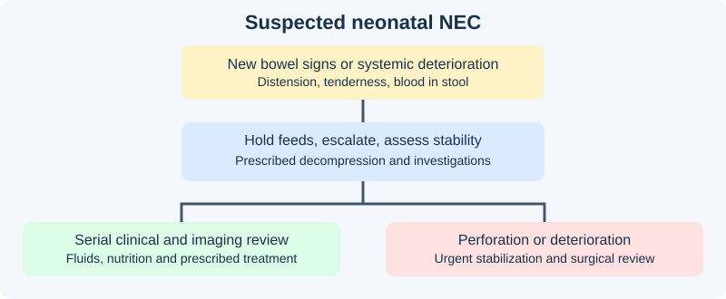

# Necrotizing enterocolitis — neonatal nursing care

**Study-ready draft.** [20 MCQs](../MCQs/04A-Necrotizing-Enterocolitis-Nursing-Care-20-MCQs.md) · [Evidence](../Previous-Year-Questions/04A-NEC-Evidence-and-Gaps.md)

## 🔴 MOST IMPORTANT — Mechanism and early recognition
NEC mein immature intestine ki inflammatory injury aur tissue necrosis ho sakti hai. Premature baby high risk mein hota hai, lekin term baby mein bhi disease possible hai. New abdominal distension, tenderness, bloody stool aur systemic instability ko seriously assess karo. Single gastric residual ya single normal X-ray se diagnosis confirm ya exclude nahi hoti. Serial clinical findings important hain.

## 🟠 HIGH YIELD — Imaging and staging
Pneumatosis intestinalis ka matlab bowel wall mein gas hai. Portal venous gas bhi important clue hai. Pneumoperitoneum free abdominal air hai aur perforation suggest karti hai. Modified Bell stage I suspected disease, stage II definite disease aur stage III advanced disease ko describe karta hai. Substage decide karne ke liye clinical, laboratory aur radiological findings combine karo. Perforation par urgent surgical assessment chahiye.

## 🔴 MOST IMPORTANT — Nursing management
Suspected NEC mein feeds hold karke neonatal team ko urgently inform karo. Prescribed gastric decompression, IV support, antibiotics, serial imaging aur nutrition plan follow karo. Abdominal girth same site aur position par measure karo; skin color, tenderness, bowel findings, drainage aur perfusion document karo. Platelet fall, acidosis aur poor perfusion worsening disease suggest kar sakte hain. Drainage losses accurately measure karo. Example: 18 mL in 6 h for 1.5 kg = 2 mL/kg/h. Actual replacement prescription verify karo. Prolonged bowel rest mein prescribed parenteral nutrition aur associated monitoring chahiye.

## Recovery
Feeds sirf neonatal team ke plan par restart karo. Mother's own milk preferred hai when available. Recurrent distension aur bilious vomiting after recovery mein intestinal stricture possible hai. Extensive resection ke baad short bowel syndrome aur reduced absorption ke liye long-term specialist support chahiye.

[MSD neonatal NEC](https://www.msdmanuals.com/professional/pediatrics/gastrointestinal-disorders-in-neonates-and-infants/necrotizing-enterocolitis) · [Safer Care Victoria NEC guidance](https://www.safercare.vic.gov.au/best-practice-improvement/clinical-guidance/neonatal/necrotising-enterocolitis-nec-in-neonates)
