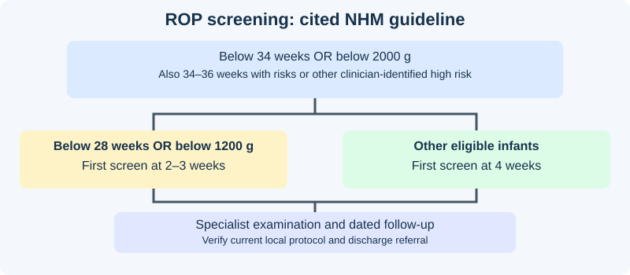

# Retinopathy of prematurity — screening and neonatal nursing

**Study-ready draft.** [20 MCQs](../MCQs/04B-Retinopathy-of-Prematurity-Screening-and-Nursing-20-MCQs.md) · [Evidence](../Previous-Year-Questions/04B-ROP-Evidence-and-Gaps.md)

## 🔴 MOST IMPORTANT — Indian screening criteria
ROP immature retinal blood vessels ki abnormal development hai. Very preterm aur low birth weight babies high risk mein hain. Cited NHM guideline weight below 2000 g OR gestation below 34 weeks, 34–36 weeks with specified clinical risks, aur clinician-identified unstable high-risk infants ko include karti hai. Usual first examination four weeks after birth hai. Gestation below 28 weeks OR birth weight below 1200 g mein 2–3 weeks par early screen recommend kiya gaya hai. Local updated ophthalmology pathway verify karo; foreign thresholds se mix mat karo.

## 🟠 HIGH YIELD — Classification
Zone retinal location hai; zone I most posterior area hai. Stage 1 flat line, stage 2 ridge, stage 3 abnormal neovascular proliferation, stage 4 partial detachment aur stage 5 total detachment hai. Plus disease posterior retinal vessel dilation aur tortuosity ko describe karti hai. Type 1 pattern jaise zone II stage 3 plus disease prompt treatment planning demand karta hai. Type 2 pattern jaise zone I stage 2 without plus disease close observation demand kar sakta hai. Actual classification aur decision ophthalmologist karta hai.

## 🟠 HIGH YIELD — Nursing care
Oxygen prescribed range mein titrate karo; unnecessary hyperoxia aur hypoxia dono avoid karo. Examination ke dauran baby ko warm rakho, respiratory aur circulatory status observe karo, prescribed drops verify karo aur instability par team ko alert karo. Anti-VEGF ke baad reactivation possible hai, isliye specialist follow-up complete karo. Discharge se pehle next date aur service document karo, family ko explain karo ki apparently normal vision screening substitute nahi hai. Audit coverage mein all eligible babies denominator mein include karo. Example: 44 screened of 50 = 88%.

[NHM guideline](https://nhm.gov.in/images/pdf/programmes/RBSK/Resource_Documents/Revised_ROP_Guidelines-Web_Optimized.pdf) · [ICROP3](https://pmc.ncbi.nlm.nih.gov/articles/PMC10979521/) · [ROP clinical review](https://www.ncbi.nlm.nih.gov/sites/books/NBK562319/)
