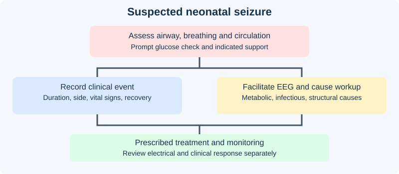

# Neonatal seizures and EEG nursing

**Study-ready draft.** [20 MCQs](../MCQs/04C-Neonatal-Seizures-and-EEG-Nursing-20-MCQs.md) · [Evidence](../Previous-Year-Questions/04C-Neonatal-Seizures-Evidence-and-Gaps.md)

## 🔴 MOST IMPORTANT — Recognition and cause
Neonatal seizure abnormal electrical brain activity hai. Focal movements, eye deviation ya subtle events possible hain; kuch seizures sirf EEG par detect hoti hain. Jitteriness stimulus-induced aur gentle limb support se suppressible ho sakti hai. Clinical signs alone sufficient nahi hain. EEG confirmation aur cause assessment important hain. Hypoglycemia, calcium disturbance, CNS infection, stroke aur hypoxic injury evaluate karo. Stabilization aur reversible cause treatment delay mat karo.

## 🟠 HIGH YIELD — Monitoring
Event onset, duration, affected side, eye movement, saturation/heart rate, intervention aur recovery record karo. Electrode artifact ko seizure assume mat karo. Trained staff se signal restore karvao. Visible movement stop hone ke baad electrical seizure continue ho sakti hai; electroclinical dissociation ke liye EEG reassessment chahiye.

## 🔴 MOST IMPORTANT — ILAE 2023 treatment principles
Most neonatal seizures mein phenobarbital first-line hai, except likely channelopathy jahan phenytoin ya carbamazepine specialist consider kar sakta hai. Respiratory depression aur hypotension ke liye monitored administration chahiye. Example given order 20 mg/kg × 3 kg = 60 mg, at 10 mg/mL = 6 mL. Actual formulation, infusion method aur order verify karo. Refractory cases mein vitamin B6-dependent epilepsy suspected ho toh monitored specialist pyridoxine trial possible hai. Acute provoked seizures resolve ho jaayein aur neonatal-onset epilepsy absent ho toh ILAE discharge se pehle ASM discontinuation recommend karta hai under treating team. Seizure burden calculate karte waqt actual recorded durations add karo: 45+90+105 seconds = 4 minutes.

[MSD neonatal seizures](https://www.msdmanuals.com/professional/pediatrics/neurologic-disorders-in-children/neonatal-seizure-disorders) · [ILAE 2023 guideline](https://pubmed.ncbi.nlm.nih.gov/37655702/)
