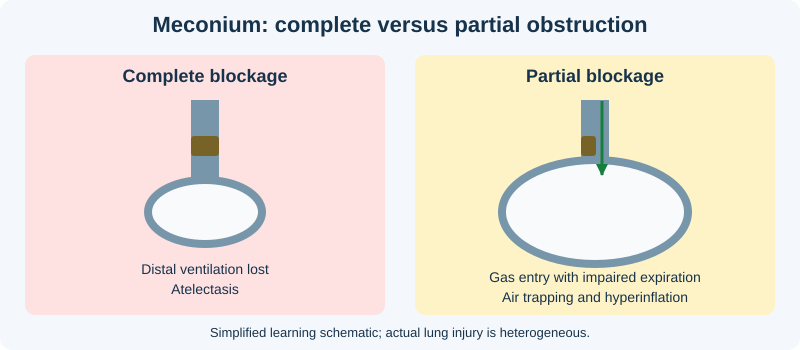

# Meconium aspiration syndrome and PPHN

**Study-ready draft.** [20 MCQs](../MCQs/04D-Meconium-Aspiration-and-PPHN-20-MCQs.md) · [Evidence](../Previous-Year-Questions/04D-MAS-PPHN-Evidence-and-Gaps.md)

## 🔴 MOST IMPORTANT — MAS ka mechanism

Meconium first fetal intestinal contents hai. Term/postterm birth mein passage possible hai; staining alone symptomatic MAS prove nahi karti. Aspiration ke baad respiratory tract mein mechanical obstruction, inflammation aur secondary surfactant dysfunction ho sakti hai. Complete airway obstruction distal collapse cause kar sakti hai; partial ball-valve obstruction expiration mein air trapping aur hyperinflation cause kar sakti hai. Patchy radiographic opacities with mixed expansion aur collapse clinical context mein MAS support karte hain. Pneumonia aur other causes bhi evaluate karo.

## 🟠 HIGH YIELD — PPHN aur differential saturation

Normal birth transition mein pulmonary vascular resistance fall hoti hai. PPHN mein high resistance persist ya recur karti hai; pulmonary perfusion kam ho sakti hai aur ductal/atrial right-to-left shunting hypoxemia cause kar sakti hai. Right hand preductal aur foot postductal readings compare karo when indicated. Right-to-left ductal flow descending aorta mein less oxygenated blood mix kar sakta hai. Equal low readings PPHN exclude nahi karti. Echocardiography hemodynamics aur structural cardiac alternatives assess karta hai.

## 🔴 MOST IMPORTANT — Monitoring and advanced support

Prescribed oxygen, respiratory support aur systemic perfusion monitor karo. Nonessential stimulation avoid karo while coordinating essential care. Severe MAS mein surfactant replacement clinician discretion par consider ho sakti hai. Selected severe PPHN mein inhaled nitric oxide pulmonary vasodilation support karta hai. Gradual protocol-based weaning important hai; abrupt withdrawal rebound hypoxemia cause kar sakta hai. OI = FiO2 fraction × mean airway pressure × 100 / PaO2. Given 0.80, 15 and 60, OI 20 hai; actual management overall trend aur specialist criteria se decide hoti hai. Refractory cases mein ECMO-capable center referral evaluate karo. Do not confuse MAS with routine birth airway suction indications; existing immediate-care and resuscitation banks cover those separately.

[MSD MAS](https://www.msdmanuals.com/professional/pediatrics/respiratory-problems-in-neonates/meconium-aspiration-syndrome) · [MSD PPHN](https://www.msdmanuals.com/professional/pediatrics/respiratory-problems-in-neonates/persistent-pulmonary-hypertension-of-the-newborn-pphn) · [CPS surfactant](https://cps.ca/en/documents/position/guidelines-for-surfactant-replacement-therapy-in-neonates/)
