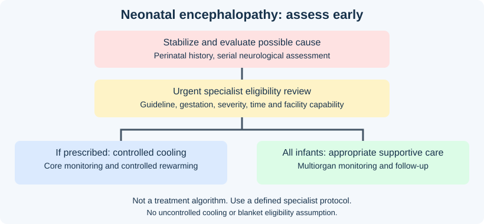

# Neonatal hypoxic-ischemic encephalopathy and cooling nursing

**Study-ready draft.** [20 MCQs](../MCQs/04E-Hypoxic-Ischemic-Encephalopathy-and-Cooling-Nursing-20-MCQs.md) · [Evidence](../Previous-Year-Questions/04E-HIE-Evidence-and-Gaps.md)

## 🔴 MOST IMPORTANT — Recognition and serial assessment

HIE mein oxygen aur blood flow inadequate hone ke baad brain dysfunction develop ho sakta hai. Har encephalopathy hypoxia-ischemia se nahi hoti. Perinatal history, neurological examination, metabolic/infectious investigations aur appropriate imaging/EEG specialist team evaluate karti hai. Modified Sarnat examination consciousness, activity, tone, primitive reflexes aur autonomic features assess karta hai. Moderate pattern mein lethargy, hypotonia aur weak suck possible hain. Severe pattern mein stupor/coma, flaccidity aur absent primitive reflexes ho sakte hain. Serial examination se evolving changes identify karne mein help milti hai.

## 🔴 MOST IMPORTANT — Guideline-specific cooling decisions

AAP 2026 established standard regimen eligible infants at least 36 weeks gestation with moderate-to-severe HIE mein core temperature 33.5–34.5°C, initiation within six hours and maintenance for 72 hours describe karta hai. Actual eligibility multiple clinical criteria par depend karti hai. Yeh universal order nahi hai. South Asian HELIX trial mein expected benefit nahi mila aur mortality concern tha. ILCOR 2024 recommendation retained in 2025 LMIC settings mein eligible term infants at least 37 weeks with evolving moderate-to-severe HIE aur suitable supportive care ke liye weak, low-certainty recommendation hai. Defined protocol aur multidisciplinary resources essential hain. India mein current local specialist policy reconcile karo; uncontrolled cooling ya indiscriminate transfer cooling avoid karo.

## 🟠 HIGH YIELD — Nursing monitoring

Prescribed cooling mein continuous core temperature, cardiorespiratory status, perfusion, urine output, electrolytes, glucose, renal function, coagulation aur neurological findings monitor karo. Lower heart rate cooling ke saath occur kar sakti hai but perfusion aur rhythm assess karo. New bleeding, oliguria ya instability promptly report karo. Renal injury aur cooling drug clearance change kar sakte hain; actual medication levels/dosing team review kare. Pain and comfort care individualized hai. Rewarming prescribed controlled rate par monitor karo; physiological changes aur seizures possible hain. Cooling ke baad normal temperature maintain karna important hai.

## Follow-up

Family ko prognosis uncertainty explain karo. Normal-looking discharge exam future motor/cognitive outcome guarantee nahi karta. Structured developmental assessment, hearing/vision follow-up when indicated aur early intervention coordinate karo. EEG/seizure-specific treatment previous 04C bank mein covered hai.

[AAP 2026](https://publications.aap.org/pediatrics/article/157/2/e2025073627/206158/Therapeutic-Hypothermia-for-Neonatal-Hypoxic) · [RCH nursing guidance](https://www.rch.org.au/rchcpg/hospital_clinical_guideline_index/Therapeutic_hypothermia_in_the_neonate/) · [European standards](https://newborn-health-standards.org/standards/standards-english/medical-care-clinical-practice/postnatal-management-of-newborn-infants-with-hypoxic-ischaemic-encephalopathy-hie/) · [ILCOR resource-setting CoSTR](https://costr.ilcor.org/document/nls-5701-therapeutic-hypothermia-in-limited-resource-settings-nls-5701-tf-sr) · [HELIX trial](https://pubmed.ncbi.nlm.nih.gov/34358491/)
