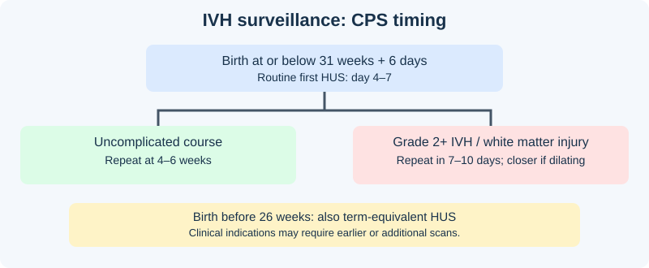

# Preterm IVH and neuroimaging

**Study-ready draft.** [20 MCQs](../MCQs/05A-Preterm-IVH-and-Neuroimaging-20-MCQs.md) · [Evidence](../Previous-Year-Questions/05A-IVH-Evidence-and-Gaps.md)

## Mechanism and classification
Germinal matrix immature vascular area hai near lateral ventricles. Bleeding ventricle mein enter kar sakti hai. Conventional grade 1 confined GMH, grade 2 IVH without acute distension aur grade 3 with distension hai. Historical grade 4 ko modern PVHI terminology se distinguish karo: yeh venous infarction mechanism represent karta hai. Blood products CSF circulation disturb karke PHVD cause kar sakte hain.

## CPS-specific surveillance
Birth at or below 31+6 weeks: routine HUS day 4–7 aur repeat 4–6 weeks; birth before 26 weeks mein term-equivalent scan bhi. Grade 2+ IVH ya white matter injury par 7–10 days repeat, dilation par closer surveillance. Clinical indication routine interval se pehle imaging justify kar sakti hai. Anterior fontanelle acoustic window hai; bedside ultrasound radiation-free hai. Head circumference consistent occipitofrontal technique se measure karo. Stable circumference early PHVD exclude nahi karti. Serial imaging, physiology aur neurological observations combine karo. Avoid avoidable abrupt BP/CO2 changes through prescribed clinical support; urgent deterioration report karo. Follow-up individualized hai.

[CPS imaging](https://cps.ca/en/documents/position/routine-imaging-of-preterm-neonatal-brain) · [Canadian classification consensus](https://www.frontiersin.org/journals/pediatrics/articles/10.3389/fped.2021.618236/full) · [CPS neuroprotection](https://cps.ca/en/documents/position/neuroprotection)
