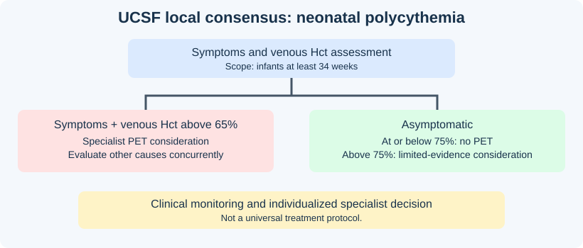

# Neonatal polycythemia and hyperviscosity

**Study-ready draft.** [20 MCQs](../MCQs/05B-Neonatal-Polycythemia-and-Hyperviscosity-20-MCQs.md) · [Evidence](../Previous-Year-Questions/05B-Polycythemia-Evidence-and-Gaps.md)

## Mechanism
Hct red cell volume fraction hai. High Hct blood viscosity badha sakta hai, lekin hyperviscosity aur Hct identical measures nahi hain. Placental transfusion, growth restriction aur maternal diabetes jaise contexts relevant hain. Plethora, perfusion problems, respiratory symptoms, hypoglycemia aur platelet changes assess karo. Capillary Hct higher ho sakta hai; invasive treatment se pehle venous result review karo.

## UCSF 2023 local consensus (at least 34 weeks)
Asymptomatic risk alone routine Hct screening indication nahi hai. Symptomatic infants evaluate karo. Confirmed venous Hct above 65% with relevant symptoms mein specialist PET consider kar sakta hai. Asymptomatic Hct at or below 75% par PET nahi; above 75% par consideration with limited evidence, not automatic intervention. Local Indian protocol separately verify karo.

PET selected infants mein excessive cell concentration reduce karta hai. Prescribed isotonic saline and specialist monitoring required. Given calculation: [(initial Hct - target)/initial Hct] × weight × estimated blood volume/kg. Example 75%, target 50%, 3 kg and 90 mL/kg yields 90 mL. Out-of-range volume recheck karo; unauthorized adjustment nahi. Withdrawn/replaced volumes and perfusion document karo. Clinically well infants mein routine exchange benefit established nahi hai; possible NEC risk discuss karo.

[UCSF consensus](https://medconnection.ucsfbenioffchildrens.org/polycythemia-guidelines)
