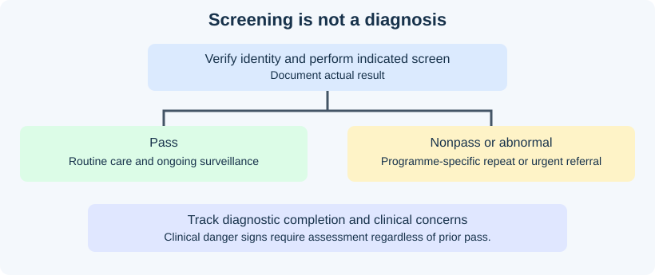

# Newborn screening and referral

**Study-ready draft.** [20 MCQs](../MCQs/05C-Newborn-Screening-and-Referral-20-MCQs.md) · [Evidence](../Previous-Year-Questions/05C-Newborn-Screening-Evidence-and-Gaps.md)

Screening apparent well baby mein hidden risk detect karne ka step hai; positive screen confirmatory diagnosis nahi hai. Indian newborn care recommendations hearing, CCHD pulse oximetry and feasible treatable metabolic disorder screening support karti hain. Local programme panel, specimen timing aur referral process verify karo. Congenital hypothyroidism screen abnormal ho toh prompt thyroid confirmation arrange karo; symptoms ka wait mat karo. Approved blood-spot card use karo, exact infant identity aur collection quality verify karo.

## 2025 CDC/AAP CCHD algorithm
Stable eligible newborn mein right hand aur foot saturation measure hoti hai. Both at least 95% with absolute difference no more than 3 points passes. Any site below 90% fails immediately. Other nonpass results one-hour repeat demand karte hain; repeat nonpass fails. Failed screen hypoxemia evaluation demand karta hai, not automatic anatomical diagnosis. Clinical red flags after pass still need urgent assessment. Indian local algorithm reconcile karo.

## Hearing
OAE cochlear outer hair cell response assess karta hai; A-ABR auditory neural pathway. NICU infants mein JCIH A-ABR recommend karta hai. Standard EHDI benchmarks: screen by one month, diagnosis by three, intervention by six. Nonpass result follow-up demand karta hai. Pass mild or delayed-onset loss exclude nahi karta. Track appointment, result and diagnostic completion; 68 completed of 80 referred = 85%.

[CDC 2025](https://www.cdc.gov/heart-defects/hcp/screening/) · [ASHA/JCIH](https://www.asha.org/Practice-Portal/Professional-Issues/Newborn-Hearing-Screening/) · [Indian newborn care](https://www.ijppediatricsindia.in/care-of-the-normal-newborn/) · [ISPAE thyroid screening](https://pubmed.ncbi.nlm.nih.gov/29380252/)
