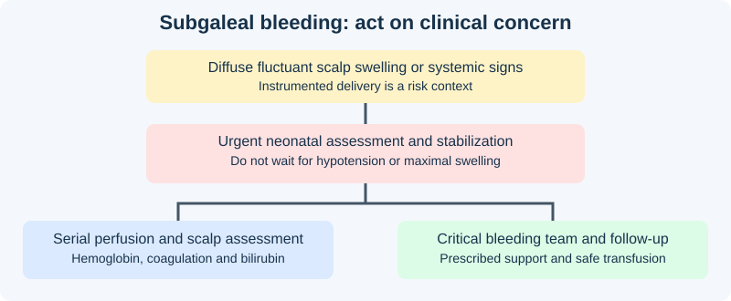

# Neonatal birth trauma and functional care

**Study-ready draft.** [20 MCQs](../MCQs/05D-Neonatal-Birth-Trauma-and-Functional-Care-20-MCQs.md) · [Evidence](../Previous-Year-Questions/05D-Birth-Trauma-Evidence-and-Gaps.md)

Subgaleal hemorrhage galea aur periosteum ke beech large potential space mein bleeding hai. Instrumented birth risk context hai. Diffuse swelling, increasing head size, pallor, tachycardia, poor perfusion aur lethargy concerning hain. Blood pressure initially reassuring ho sakta hai. Full swelling ka wait mat karo. Urgent neonatal critical bleeding support, serial hemoglobin, coagulation, perfusion and jaundice monitoring coordinate karo. Blood product identity and actual administration verify karo.

## Nerve injury and functional care
Facial nerve CN VII facial movement control karta hai. Incomplete eyelid closure mein prescribed corneal protection, weak lip seal mein feeding assessment chahiye. Phrenic nerve diaphragm control karta hai; associated injury mein asymmetric chest movement or respiratory difficulty urgently evaluate karo. Pain-limited fracture movement true nerve weakness mimic kar sakti hai. Neuropraxia temporary conduction impairment hai; severe avulsion ka risk total flaccid limb plus Horner features se suggest ho sakta hai. CPS incomplete recovery by one month par multidisciplinary referral recommend karta hai. Joint-specific active movement, side, history and recovery trend document karo. Therapy individualized, no forceful manipulation. Suspected spinal cord injury mein breathing support and safe handling priority hain.

[MSD birth injuries](https://www.msdmanuals.com/professional/pediatrics/perinatal-problems/birth-injuries) · [WA SGH guideline](https://cahs.health.wa.gov.au/-/media/HSPs/CAHS/Documents/Health-Professionals/Neonatology-guidelines/Subgaleal-Haemorrhage-Detection-and-Management-in-the-Newborn.pdf) · [CPS brachial plexus statement](https://cps.ca/en/documents/position/neonatal-brachial-plexus-palsy)
